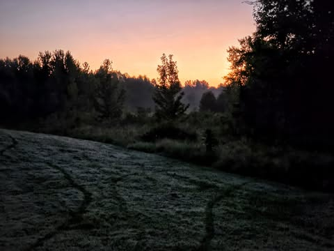

# Yesterday morning as the Dog was pooping I was looking at the world.  The altern

Yesterday morning as the Dog was pooping I was looking at the world.  The alternative was not that pleasant.  I am noticing how as I get older it seems less real.  Less "tangible".  I have vague memories of crisp early mornings from my childhood where everything was sharp and real.  The cool morning air, the dew on the grass.  It felt like I was immersed in reality.

Now it is less so, it is more fuzzy, I am more distracted.  I am less present.  There are still moments.  Usually when I reach the top of a mountain, barely able to breathe and hurting all over when I first see the view and feel the wind.  And for a while it is sharp and real.  

Then I adapt, it becomes common, I get distracted and start thinking about what I will do when I get down.  Then the world becomes abstract like I am a character in a video game.

I don't have anything to say about it.  It just is... and while I live,  I notice it.  Maybe when I notice it is when I most live.

