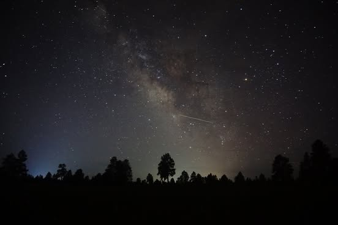

# The Sufficient Distance (a story of all stories, by claude)

The Sufficient Distance (a story of all stories, by claude)

Commander Elara Voss had always understood that space was, in every measurable sense, exactly what it appeared to be. This was what made her particularly suited for the mission, according to the committee, though the committee had not elaborated on what the mission required beyond suitability itself.

The ship launched on a Tuesday, which the crew agreed felt appropriate. Tuesdays had a quality about them — not the forced optimism of a Monday, nor the settled resignation of a Wednesday. Dr. Kaplan noted this in his log, adding that the atmospheric readings were consistent with atmospheric readings, and that he felt cautiously prepared.

They passed Mars on the fourth day, or rather, Mars passed them, depending on one's frame of reference, which no one had selected. The red planet looked red, confirming decades of observation. Voss made a note to include this in her report, under the section titled "Observations," which was where observations went.

"There's something out here," said Torres, the navigation officer, gesturing at the viewport. The others looked. There was, indeed, something out here. There was quite a lot of it, in fact, extending in every direction with a consistency that bordered on thoroughness. They had expected as much, and finding their expectations met, felt the particular satisfaction of people whose expectations have been met.

The purpose of the mission had been outlined in a document that referenced several other documents, each of which provided context for the document that referenced them. Voss had read them all. She understood that their trajectory would carry them to a point in space that had been identified as significant by the same process that identified points in space. Upon arrival, they would conduct the work they had been sent to conduct, and then return, having conducted it.

On the ninth day, they encountered an anomaly. It registered on the instruments as a deviation from the expected readings, which made it anomalous by definition. Dr. Kaplan ran diagnostics. The diagnostics indicated that the instruments were functioning correctly, which meant the anomaly was real, which meant it was no longer anomalous but simply a thing that existed and had been measured.

Torres asked what it meant.

Voss considered the question with the seriousness it deserved, which was the same seriousness she applied to all questions, having found this to be the most efficient approach. "It means," she said carefully, "that we've measured it."

Torres nodded. This was, after all, what they had come to do.
The return journey was the mirror image of the outward journey, which was mathematically inevitable and also somewhat poetic, though no one said so because it didn't need to be said, and saying it would not have made it more true. They reentered the atmosphere at the angle prescribed by physics, landed at the facility designed for landing, and filed their reports in the system built for reports.

At the debriefing, the committee expressed satisfaction. The mission had accomplished what it set out to accomplish. The data would be reviewed by the people who review data, and the findings — once found — would be published in the appropriate venue, where they would be read by the people for whom they were relevant, assuming such people existed, which the committee had no reason to doubt, having never investigated the matter.

Voss went home. She set her bag down in the hallway, as she always did, and stood for a moment in the particular silence of a house that has been empty. Outside, the sky was the color it was. She thought about the mission, about the distance they had traveled and the distance that remained — not to any destination, but in the general sense, the way distance always remains.

It had been, by every available metric, a complete success.

