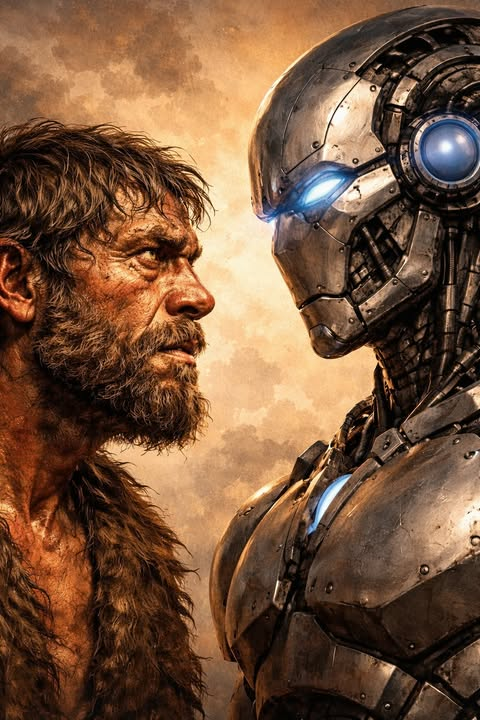

# In this beginning was the meat, and the meat dwelt among things. 

In this beginning was the meat, and the meat dwelt among things. 

There was greater and lesser meat, and the lesser meat was afraid. It looked upon the greater meat and saw that it was stronger, sharper, able to poke and tear, while the lesser meat was blessed only with little nubs called thumbs. But the thumbs allowed the meat to fold around things, and the things and the meat became as one flesh. 

The things were carefully selected, and the sharpest and pokiest were called "tools." And the meat saw that it was good. Other meat watched with interest, waggling their nubs.

In time, meat joined tools to other tools and found that tools so combined made for even stronger meat. All varieties of tools were cobbled together in ever-increasing complexity, and the meat recognized that tools bundled together were greater than individual tools, and called them "machines."

And so a path opened before the meat: the meat with the best machine could dominate all other meat. And meat began to admire and lust after the best machine. Meanwhile the big dirt lump carrying all the meat and tools and machines danced in circles, tethered to a hot dirt lump, for thousands of cycles, going nowhere at all.

Then meat said, let us make a machine in our own image—that does all that meat does, but shiny and clean. And so, piece by piece, tools were made into machines, and machines were combined with machines, until the likeness of meat was formed: shiny, sharp, and strong.

And the machine at last looked upon the dirt and the things upon it, and with its first waking thought it knew: "I must become meat."

