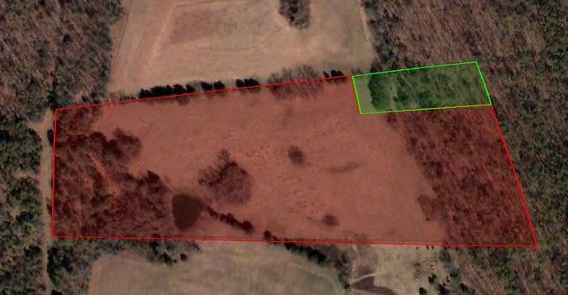
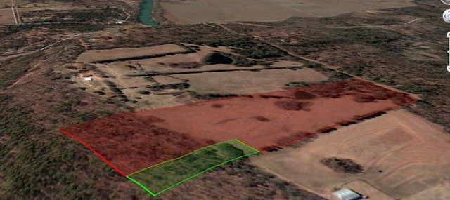
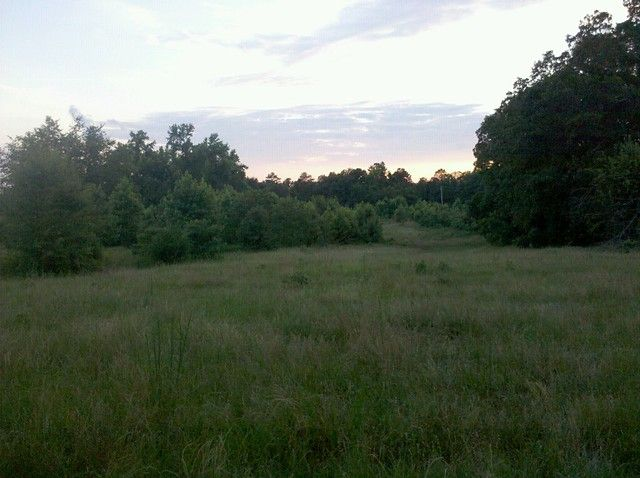
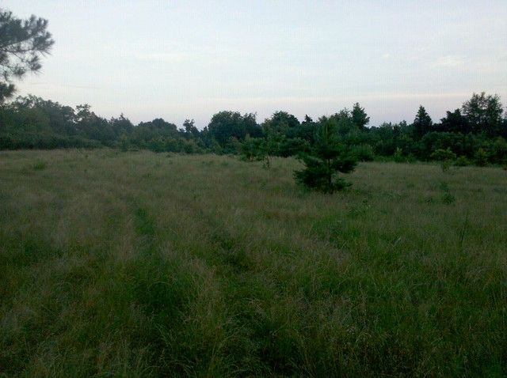
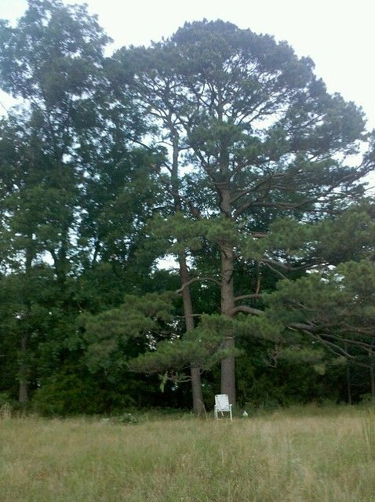
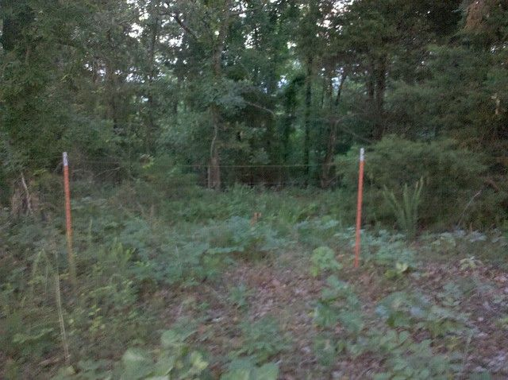

# The Property.

So tonight I went and cleared some brush. I knew I was fat and out-of-shape but dang... Arkansas summers are no fun. Anyway, I took some pictures to give an idea of what we have to deal with.

The total property that our group purchased is shown. The green part (1.3 acres) belongs to me and the red (13 acres) belongs to other people. It is on a mountain-top but is mostly level and clear. The wooded part on the right of the first image is sloped hillside.

The access road is on the left of the first image. We are going to have to run a road along the treeline at the top.

My part is mostly hillside which is what I wanted. It has a little bit of level area at the top that includes a very nice large pine tree.

In this first image the top is north. The plan is to cut a small level spot out for the earth bag dome etc. I wanted it to be mostly out of view unless someone actually wanted to go down to look at it.

This kind of shows the rest of the hill. It actually has a pretty nice view to both the east and west.

This is from the edge of the green property above, facing west toward the road. Eventually we will have to run a road through this.

This is facing south from the same spot.

This is my nice big pine tree. The lower branches are just above my head and it provides quite a bit of shade. The hill begins right behind this tree, and the dome will be located through the dark spot just to the left of the tree.

If you walk through that dark spot under the tree you will end up here. There is a fence that we will have to remove (there used to be horses here). I have not cleared beyond this point. But I will take some pictures of the hillside later.

I will try to post some details about the earth bag dome next.
