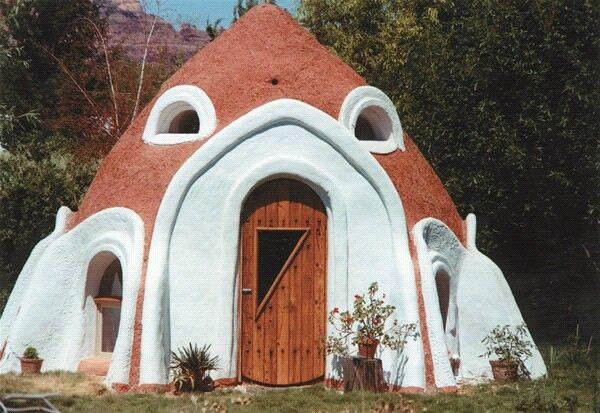
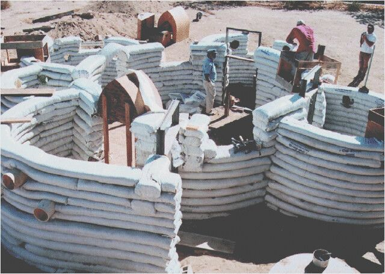
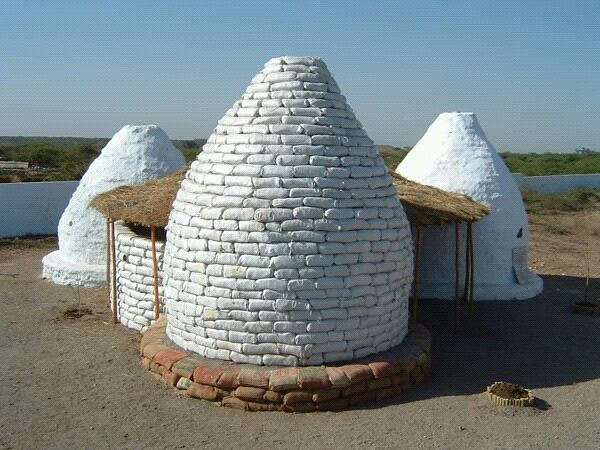

# Earth Bag Domes Introduction.

The motivation behind these things is simple. No mortgage payments, and very little maintenance. The entire thing can be built for less than $1000 in materials and a bunch of labor. The reason the cost is so low is that all you really have to buy is a bunch bags and some barbed wire. Of course if you are able to spend a little more then it would make the job easier and faster but even then it will still be less than a few thousand dollars.

There is an excellent book with a great deal of information about all aspects of earth-bag construction that is available on Amazon and elsewhere (click on the picture to the left). If you are actually thinking of doing this then I would recommend buying a copy.

The idea is that you take a woven polypropylene bag like they use for storing feed for farm animals and you fill it with dirt. If the composition of your particular dirt is too loose then you can buy cheap dirt or stabilize the dirt you have with a little cement or lime. You then tightly stack the bags in rows and between each row you add a couple of strands of barbed wire to keep it from sliding. As you go up you move the bags slightly inward until you end up with a dome. On top of this you put some kind of plaster such as cob, or cement, or lime, or even a living roof of some kind of grass.

They can be built in a variety of sizes but generally should probably be under 20ft. in diameter. If a larger area is needed several can be joined together. Windows and doors are created by stacking the bags into a variety of arch shapes. Other more traditional structures can be built using the same principle, I am going to probably use earth bags to build a fish-pond for the aquaponics project and for an outdoor hot-tub.

The finished structure weighs about 40 tons or more and is basically impervious to floods, tornadoes, earthquakes, rotting, insects and fire. The pressure on the bags produces something similar to rammed earth, which has been used all over the world and has held up for hundreds of years. Most of the great wall of China is rammed earth. The mass of the structure also helps stabilize the inside temperature. It takes a long time for heat to pass through and as a result it tends to remain cool through the day and be warmer at night. If lime is used then it can have a similar effect of the humidity. They can be built with a sleeping loft in the top and can be partially subterranean for extra thermal stabilization from the earth.

The disadvantage is that it is unusual looking, generally smaller than a normal house, and not allowed by most building codes inside city limits. The lobbyists for the steel and lumber industries pretty much had it written into law that a home had to be "stick built" or metal and generally has to be over a specified square footage. This is the main reason I had to buy property outside of city limits. They also require a lot of labor, but I am considering that a free fitness program.

I have a friend that is about half way through building one of these. He agreed to let me do an article on his dome. I will try to take some pictures of it for another article in the near future.

Useful Links:

Wikipedia

http://www.earthbagbuilding.com/

Videos of another couple in Arkansas currently building a dome.
