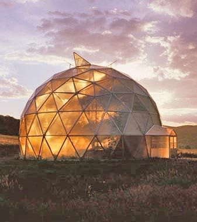
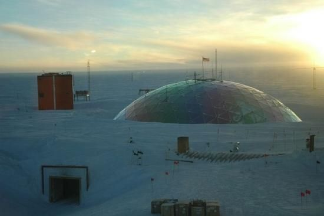
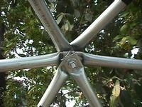
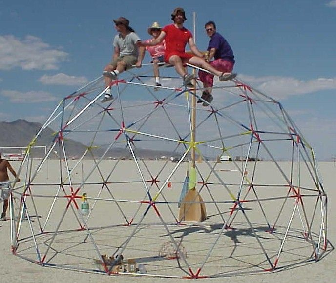
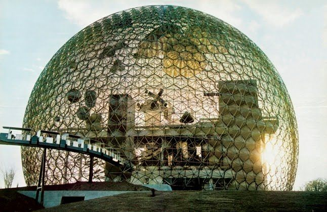

# Geodesic Dome Introduction

While my primary goal over the next year will be the construction of an earth bag dome, there is another better known design that has been around since about 1926. This would be the geodesic dome that was popularized by Buckminster Fuller.

As a home I think the earth-bag dome will work best, but the geodesic dome does have a few advantages. Some of these are as follows:

1. Also inexpensive, can probably be built for under $1000

2. Can be very large.

3. Can be semi-transparent (greenhouse)

4. Are relatively lightweight so can be moved.

5. Can be built quickly.

The structure of interlocking triangles make the geodesic dome the strongest possible structure for the material used. As a result they are good for large open areas that contain no internal supports. Apparently Buckminster wanted to put an entire city under one in order to maintain warm temperatures during the winter. A sphere also provides the most volume with the least surface area, which in theory provides the most efficient use of resources. This is why they use geodesic domes in places like Antarctica.

In practical terms they do have a few issues. Using standard building materials (such as wood) they are almost impossible to build. Every angle is different, there are lots of joins which all have the potential to leak and nothing that you buy at the local home improvement store will fit as there are no flat walls or 90-degree corners. They also amplify sound so everything inside becomes very noisy. These issues can be mostly avoided if you buy one as a kit, but then it is very expensive.

However, if you think of it more in terms of a yurt or permanent tent than a traditional house. Things become much simpler. Basically you use inexpensive metal galvanized conduit pipe, flatten the ends, drill a hole and join them with a bolt. Then you cover it with some kind of tarp. This has been mainly used for making temporary shelters for events such as burning man.

For my purposes I want to build a smallish (25ft diameter) version as a test and to use as a temporary shelter while I build the dome. Later we may make a guest-house, storage building, or chicken coop out of it. In any case it will be semi-permanent and will need to be waterproof. The covering then becomes the most complicated part. Usually people use a parachute, or make their own cover out of some kind of plastic. Because of the shape this can be kind of complicated. There are patterns which can be sown to fit, but this is a lot of work.

My plan (and I don't know if this has been tried) is to cut a cotton or Tyvek drop cloth into circular bands that are cut to fit the contour with a slight overlap on the bottom of each. Then "paint" over this with polyurethane floor sealer (the clear plastic stuff on gym floors) or fibreglass resin. Then while it is still sticky throw on some white sand. The idea is to make the fabric stiff and waterproof and a little heavy so that it does not flap in the wind.

Hopefully if this works out then we can build a much larger version for the aquaponic greenhouse. In my opinion this would be the most cost effective and practical option but since this part is going to be a community effort I will have to convince everyone else that is involved. I would estimate that a 70ft diameter dome could be built for less than $2000, which if true would be far less than using a traditional design.

I expect my small 25ft version will be less than $1000 and will be two stories which the top story being a trampoline base. The reason for this is that I am used to sleeping in hammocks and they are a lot cooler in the summer. A mattress acts as a huge blanket on one side so air conditioning has to be used to compensate. A thin fabric does not insulate well so will be much cooler.

Useful Links:

http://www.desertdomes.com/domecalc.html

http://en.wikipedia.org/wiki/Geodesic_dome

http://www.weasel.com/dome.html

http://graphics.stanford.edu/~munzner/dome/struts/

http://www.byexample.com/projects/current/dome_construction

https://www.artsy.net/artist/r-buckminster-fuller

1 comment

Owen Geiger · July 7, 2010

I recommend using the method at the Dometown Project: http://earthbagbuilding.wordpress.com/2010/04/18/the-dometown-project/

It uses earthbags and a metal frame to create a geodesic shape.
