# Aquaponics.

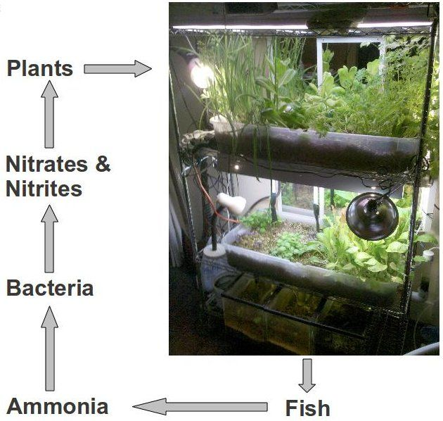

Essentially this is hydroponics (growing plants without soil), except instead of mixing chemicals with the water you stick some fish in it.

The short version is that the fish eat whatever you give them and produce waste in the form of ammonia which is then turned into nitrites and nitrates by bacteria in the water. These are then consumed by the plants. This cleans and aerates the water for the fish and provides the plants with everything they need to grow.

The advantage of aquaponics for plants is that you can grow them in a more controlled environment (without bugs). They put more energy into the fruit instead of the roots, since the water brings the nutrients to them. And it eliminates soil borne disease and pests (since there is no soil). There also seems to be much less maintenance when they are set up properly, this is the main appeal to me. Mainly you have to add water as it evaporates and pick whatever it produces.

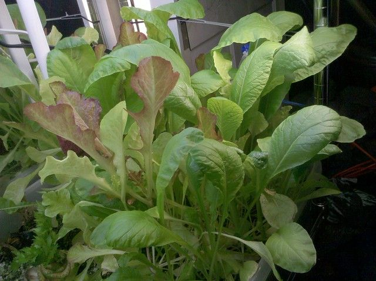

When it is balanced properly it solves most of the problems associated with having fish, you never have to clean the tank or change the water and it does not smell bad. It also produces a bunch of food in a small area, like an apartment. I have not changed the water in two years, and I don't use any filters (other than the growbeds themselves). I do have to add about five gallons of water a week to keep up with evaporation.

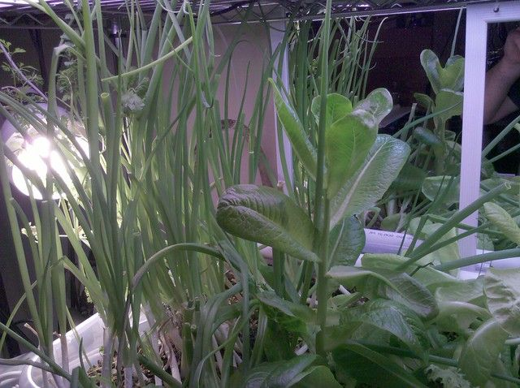

On a large scale you can use something like tilapia, or another edible fish in a large pool to provide enough nutrients for several greenhouses. For example a pool 6ft deep with a 5ft radius would have a volume of 471 cubic feet. You can have one tilapia per cubic foot, they mature in 6 months which would produce about 1000lbs of fish a year along with a greenhouse full of food.

So far I am on version three of this system after two years of messing with it. The room I am currently in has no windows which makes it impractical from a cost standpoint since I had to use artificial lights. Apart from that though it has been fairly successful.

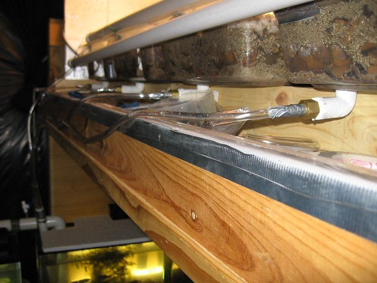

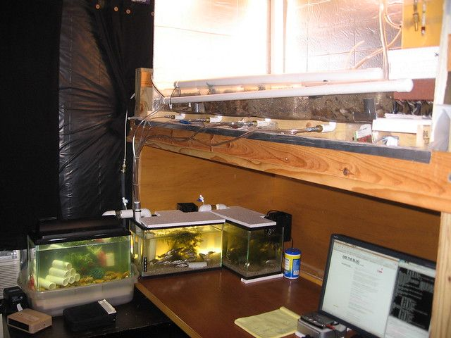

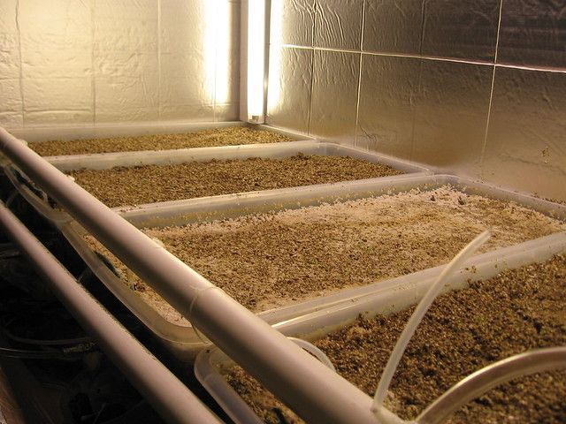

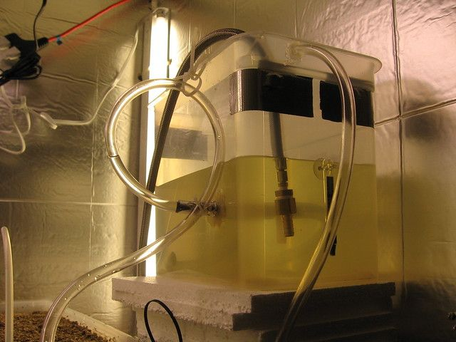

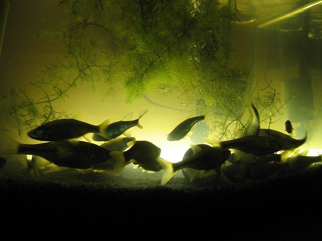

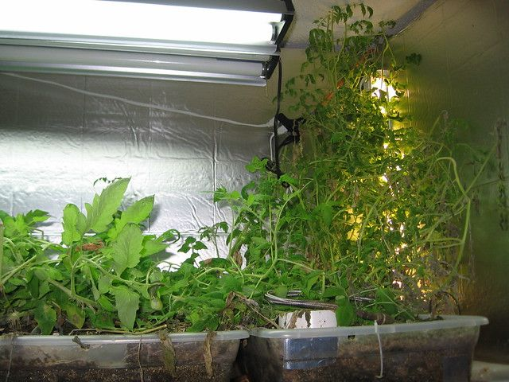

Version One was built on the top bunk of a bunk bed. It had 4 medium sized plastic bins as grow beds and used a fairly complicated system of bell and loop siphons to produce an "ebb and flow" cycle. The idea was to have each of the beds completely fill then completely drain over and over in order to provide nutrients without leaving the roots constantly in water which can result in rot. I have three 10 gallon fish tanks containing bait-store minnows (about 10 in each tank). There is a water pump from a cpu cooler that is still going strong after two years of continuous use that pumps water from the tanks to a reservoir that slowly fills then totally drains with a loop siphon into a PVC pipe will holes drilled into it to trickle into the four beds. Each bed has a bell siphon that allows it to fill to a point and then they each drain independently back into the fish tanks.

It worked fairly well for about six months. I grew basil, cilantro, lettuce, oregano, and tomatoes. They all came up well, then the tomatoes grew over and killed everything else and produced no actual tomatoes. Turns out that without insects or airflow you have to manually vibrate the flowers to pollinate the tomatoes. I also did not provide adequate drainage and every once in a while one of the siphons would fail and dump water all over the bottom bunk which was my computer desk. This was not ideal.

This system is really designed for a much higher water flow than I had. The siphons need to get to a tipping point in order to engage and if the water flow is insufficient they seem to just dribble a little instead of producing a sudden gush of water. You can compensate for this by using smaller tubes and siphons. But I think it would be much more practical in a larger system. There are several you-tube videos demonstrating hydroponics with bell siphons.

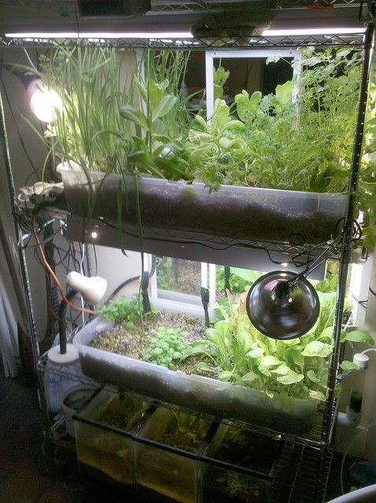

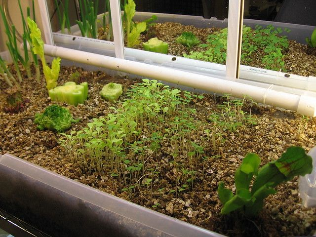

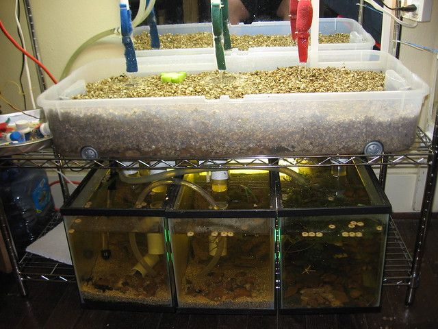

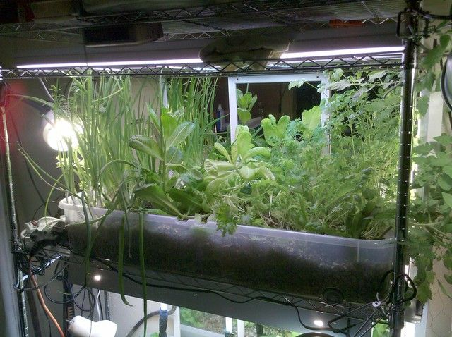

Version Two was much better. I built it on a heavy duty steel wire shelf system and did away with the siphons entirely. The grow medium I am using is pebbles on the bottom and a few inches of vermiculite on top of that. Vermiculite is essentially puffed rock, it wicks moisture really well. The intention was to have the water pumped out of the tank into bed one on top. It would then trickle down to the pebble layer at the bottom and would wick up into the vermiculite above. After filtering through this it would drain from holes in the bottom into bed two below and do the same before finally dripping back into the fishtanks. One complication was keeping the water levels even in the three 10-gallon tanks at the bottom. I used a system of vacuum tubes, one big tank would have been much better.

I grew the tomatoes off to the side this time and kept them trimmed back. I also used cherry tomatoes which seemed to fruit without the need to vibrate the flowers. The top bed contains a couple of types of lettuce, cilantro, tomatoes, and chives. The bottom one has more lettuce, and a couple types of basil and mint. I put some pitcher plants, venus fly traps, and sundew plants in both to get rid of the gnats that I think came from the pebbles that I picked up outside. The lettuce, mint, chives, pitcher plants and tomatoes did really well. The basil, sundew and venus fly traps did not do so well... I think the light was insufficient. With good sunlight I expect a system this size would produce enough for 5 small salads or a couple of big ones each week.

I planted the bulbs of a pack of grocery store chives after cutting off the green part to eat and was a little amazed to see it immediately start growing about two inches a day. The stump of a head of lettuce from the grocery store also grew really well.

I stopped maintaining it about 4 months ago, and now let it grow wild to see what will happen and to keep the fish happy. Again I need to improve the drainage... something like a small french drain made out of PVC pipes would probably work better. The vermiculite compacts over time, and roots plug things up.

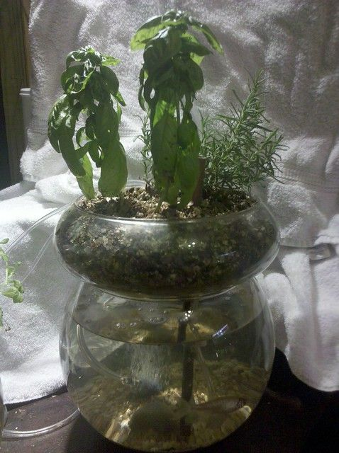

Version Three is my attempt at making the whole thing as small as possible in order to make a kit that I can sell or give away to friends of mine with a south facing window. It is still a work in progress. The current version works pretty well, I just need more time to see if issues occur.

With the first two I was not concerned at all about appearance, but this one is supposed to be slightly decorative. It is basically a big glass bowl on top of a glass globe. The glass bowl is the growbed and has a couple of holes drilled in the bottom of it. The globe is the fishtank. It has a copper pipe going through the center that uses an airlift pump to dribble a stream of water over the vermiculite. It then drains back into the globe through the other holes in the bottom. There is also a larger copper pipe that goes through the center hole that I can use to feed the fish.

The growbed has the same gravel in the bottom, and this is again covered in vermiculite. The vermiculite wicks water from the point it is dribbling out and stays constantly damp all over. The plants can be added anywhere in the top bowl.

The hardest part is drilling the holes in the glass. There need to be about three of them, and they need to be about 3/4 inch in diameter. To do this you need a drill press and a diamond drillbit. Which can cost a couple hundred dollars. The trick is to do all the drilling underwater (fill the bowl with water while you drill the holes) otherwise the glass gets hot and the bowl cracks. The biggest surprise so far is that for some reason you seem to need a bubbler to aerate the water sufficiently. In the other systems I was able to have about five times the suggested fish density without any aeration. The water flowing through the growbeds was sufficient. In the small verison this does not seem to be the case.

The airlift pump seems to work particularly well for this. Basically you bubble air partway up a submerged water filled tube. The bubbles force some water up the tube as they rise. It seems that with some one-way valves you can lift water quite high with this, even though I only need a few inches. I found out about it here: http://our.windowfarms.org/ it allows the motors to be external to the system so they are not visible and it provides the small amount of water flow needed to maintain something this size. I also expect that since there are no moving parts it will need little maintenance.

I expect that not counting the tools, the raw materials are about $60 with a couple of hours labor. Not bad for a low maintenance year round herb-garden and fish-based entertainment center.

The plan for the property is to build a large version. I hope to make a 70ft diameter geodesic greenhouse with a 10ft diameter fishpool in the middle. But that is still open for debate.
