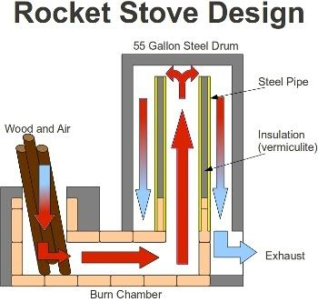

# Rocket Stove Introduction.

I was fairly skeptical about these things at first. I suppose I still am and as a result I am eager to actually try it. The short version is that it is a large (several tons), cheap, easily constructed wood burning stove that is extremely efficient. It has two fairly unique properties. The first is that the design allows for a horizontal chimney that can be run as far as thirty feet or more. The second is that it burns extremely hot, so hot that it totally burns all the gases that come off the wood to the point that the only thing coming out the chimney is basically warm water vapor.

I want to use this for two reasons, heating the earth-bag dome and heating the hot-tub. This is where the 30-foot horizontal chimney comes in. In a traditional fireplace the majority of the heat goes up the chimney with the smoke. With a rocket stove the design produces a forced-air effect once it heats up and essentially pushes the exhaust through the chimney. In an earth bag dome the chimney can be buried in cob or cement and made into a bench running around the interior perimeter of the dome. The heat conducts through the metal chimney pipe into the thermal mass of the bench and uses the bench and the dome itself as a kind of heat-battery that then slowly releases heat into the dome for long periods. By running the chimney a sufficient distance through the bench most of the heat from the exhaust gas is removed leaving the water vapor coming out end of the chimney only slightly warm.

In the hot tub, it would basically work the same way except that the bench will be underwater and will heat the water as well.

The materials needed are a large (55 gal) metal drum, a small (20 ish) gallon drum, a few firebricks (15 or so), some high temperature stove pipe and a bunch of regular chimney pipe. The diagram above shows a simple design. The air and wood go in the small drum (not shown) then into the burn chamber this heats the insulated steel stove pipe causing an updraft in the heat riser at the top of which it hits the 55-gallon drum and starts to cool as it goes down the other side and out the chimney. The whole thing is plastered in cob or cement to hold it together and absorb the heat. The top (or the bottom of the upside down 55-gallon drum) can be used as a cooking surface or a boiler or whatever.

There is an excellent book on the whole subject available on amazon with much more precise instructions and other variations. There are also a large number of websites and videos demonstrating the construction process I will list a few here:

http://en.wikipedia.org/wiki/Rocket_stove

http://www.rocketstove.org

http://biocongress.org/category/rocket-stove/

video - dancing rabbit

9 comments

Maitri Homestead · July 23, 2014

I hope to build one soon. Thanks for the info. Erica and Ernie Wisner have plans and workshops to learn more here; http://www.ernieanderica.info/rocketstoves

Anonymous · September 11, 2017

I blog quite often and I really thank you for your content. Your article has really peaked my interest. I'm going to take a note of your website and keep checking for new information about once a week. I subscribed to your RSS feed too. paypal login

Anonymous · April 21, 2018

Today, I went to the beach front with my kids. I found a sea shell and gave it to my 4 year old daughter and said "You can hear the ocean if you put this to your ear." She put the shell to her ear and screamed. There was a hermit crab inside and it pinched her ear. She never wants to go back! LoL I know this is completely off topic but I had to tell someone! paypal login my account

Aleks Aleksandrovich · January 13, 2019

Thank you for useful knowledge! For the development of your projects there are new technical solutions for a universal rocket furnace. This furnace design operates on solid, liquid, gaseous fuels and can perform functions without the emission of harmful aerosols into the atmosphere:

- cooking on the stove and in the oven;

- heating of the heated floor with waste gases from the combustion of fuel;

- water heating in the boiler of a detachable stand-alone structure for the water heating circuit - underfloor heating, etc.: https://sites.google.com/site/menedzmentteoriapraktika/upravlenie-infrastrukturoj/rocket-stove-new-design/rocket-stove

Rocket stove for use on the territory near the house: https://sites.google.com/site/menedzmentteoriapraktika/upravlenie-infrastrukturoj/rocket-stove-new-design/rocket-stove

Melanie · November 24, 2020

A reverse house loan can sometimes require high closing costs which would allow it to be impractical as being a short-term solution in certain cases. textbooks

dalecacchione · April 4, 2022

The king casino no deposit bonus, free spins, bitcoin - CommunityKhabar

No deposit bonus, free communitykhabar spins, bitcoin. No deposits bonus. No goyangfc.com withdrawals, bitcoin dental implants no deposit bonuses, free spins, jancasino bitcoin, 10k followers.

Aleks Aleksandrovich · April 6, 2022

Thanks for the helpful knowledge. To heat the house, it is better to use a rocket stove. This furnace runs on solid, liquid, gaseous fuels and can perform functions without releasing harmful aerosols into the atmosphere:

- cooking on the stove and in the oven;

- heating of the heated floor with waste gases from the combustion of fuel;

- water heating in the boiler of a detachable stand-alone structure for the water heating circuit - underfloor heating, etc.: https://sites.google.com/site/menedzmentteoriapraktika/%D1%83%D0%BF%D1%80%D0%B0%D0%B2%D0%BB%D0%B5%D0%BD%D0%B8%D0%B5-%D0%B8%D0%BD%D1%84%D1%80%D0%B0%D1%81%D1%82%D1%80%D1%83%D0%BA%D1%82%D1%83%D1%80%D0%BE%D0%B9/rocket-stove-new-design-%D1%80%D0%B0%D0%BA%D0%B5%D1%82%D0%BD%D0%B0%D1%8F-%D0%BF%D0%B5%D1%87%D1%8C-%D0%BD%D0%BE%D0%B2%D0%BE%D0%B9-%D0%BA%D0%BE%D0%BD%D1%81%D1%82%D1%80%D1%83%D0%BA%D1%86%D0%B8%D0%B8

Allen smith · May 6, 2022

Your posts are very good, suitable for me as a new learner. Thanks. Travelers have a question: can US citizen travel to India? Yes! You can obtain an Indian tourist visa in the form of 30 days, a year, or a five-year visa, which is easy and trackable via the internet.

Bralin Allison · August 18, 2022

You are sharing a wonderful article with your audience. Readers are already enjoying it. I am here to inform the travelers who are willing to visit Turkey that they need to fill a Turkish visa application to enter Turkey. Online process makes makes easy to get evisa.
