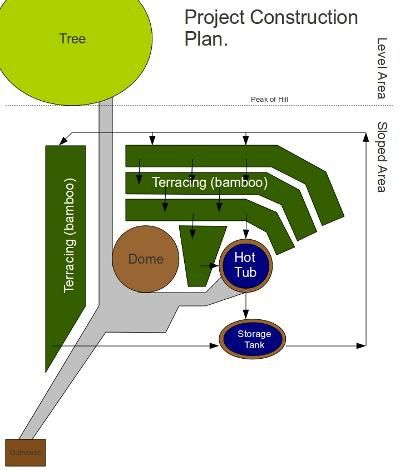

# Outline of my personal projects.

I think I mentioned some time back that this was a group project. There are parts we plan on collaborating on as a group and other parts that are just mine.

The aquaponics and most of the general farm/garden related stuff will be a group effort. This part is pretty much my own pet project. The 1.3 acres or so that I bought are on a hill so imagine the dotted line being the peak of the hill, where the tree is (the gigantic pine from earlier pictures) is on the level top of the hill, the rest is on the slope.

The idea is to make as inexpensive and permanent a setup as possible to provide a comfortable and independent lifestyle at a minimum of expense and maintenance. When this is all done the whole thing including the land should cost less than $7,000 and should last the rest of my life. I also don't want to have to spend much time maintaining it and want to be able to leave it for long periods without worrying about anything.

Long term I would like to make several of these in different locations. This one is in Arkansas, which is as close as I get to a "hometown". While spring and fall in Arkansas are incredible... summer (now) and winter leave quite a bit to be desired. It would be nice to have a similar setup in places like Colorado, Montana, Maine, Florida, Oregon, British Columbia. I envision hauling a bunch of solar panels and whatever I have that is valuable around with the seasons. Hopefully I can build a few of these... maybe I can convince a few other people (hint, hint) that it is a good idea and we can perhaps form a group where we can loan out the spares to each other.

I would like to think that the structure would not present much of a target for vandalism or abuse. There is nothing really valuable that could be taken, it cannot be set on fire, it is too solid to be damaged much. All factors that make leaving it for months at a time in the middle of nowhere a little more practical. Then again my optimism in humanity has not been very justified lately, so who knows.

The basic idea here is to eliminate the need for utilities as much as possible. In the short term I expect I will just get standard water / electric utilities, but I would like to do away with these eventually by substituting solar for electric and catching rainwater.

Solar means that there can be enough power for lights, fans, a computer, and small appliances, but not enough for standard refrigerators / freezers and air conditioners. There are some smaller fairly expensive refrigerators for the RV industry that can be used with sufficient solar power, but standard air conditioning is out. Some years ago I spent a couple of years living out of a truck and learned some ways to make this work, but I think I will save that for another post.

Water can also be conserved greatly by a few simple changes that in my mind fall into the minor inconvenience category... most peoples opinion on this probably differs. I grew up using a outhouse in Africa, it never seemed to be much of a problem to walk a little ways to go to the bathroom. In America I used them while hiking the Appalachian Trail. Most people I talk to dismiss them immediately because of bad experiences with poorly maintained outhouses or "porta-potties". In reality "composting toilets" can be very clean, comfortable and not smell bad with some minimal maintenance. This eliminates one major use of water.

The other major water consumer would be showers. While it is possible to stay clean by taking a sponge-bath using about a half-gallon or less of water, it is not ideal. What I am going to try as a solution will be a large outdoor hot-tub. I will go into more detail on this later, but the idea is to combine some of the aquaponics with earth-bag construction with a rocket-stove water heater in order to make a controlled creek with a swimming hole. In the diagram you can kind of see how this works if you follow the arrows. There is one electric pump which constantly pumps water from the holding tank at the bottom through the terraces and back into the hot-tub in an continuous loop. The terraces will act as a giant "sand trap" filter, and this along with the plants should clean the water enough that it can be continuously re-used. Water will have to be added periodically to account for evaporation, but hopefully the rain will be sufficient for that.

I also plan to do away with "running water" by having a water-barrel that I can periodically take somewhere and fill for drinking water and dishes. This with a nice metal bowl seems to suffice for most of the world. I don't foresee the slight inconvenience as sufficient to justify chaining myself to the public utilities.

Well... hopefully that gives a "birds-eye-view" of where I am going with this part of it. I will go into more detail on the hot-tub design and some of the things I figured out while living in my truck in later posts.

1 comment

ซีรีย์เกาหลี · August 5, 2010

You outline is good. I like your project.

cheer,

ball

hot tub filters
