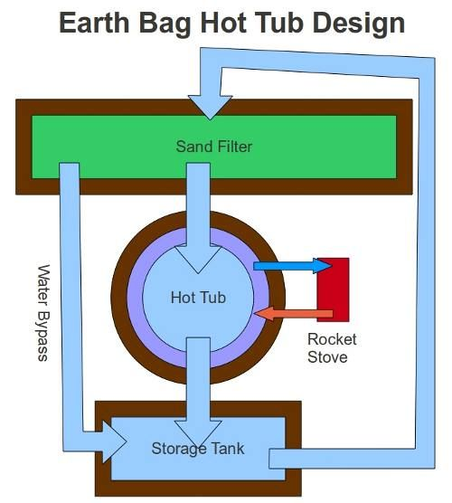

# Earth Bag Hot Tub

So far everything I have listed has been done by somebody and documented somewhere on the internet. This is an exception not because it is particularly complicated, and I imagine it has been done... but so far I have not seen any accounts on how it worked out. Therefore, if anyone knows of anything similar please leave a link in the comments.

The end goal is to have a workable hot-tub that requires almost no maintenance or chemicals. As a friend pointed out: hot tubs are not usually thought of as minimalistic, however I believe that this will use less water overall than a standard shower... and will be more fun besides. I want to use earth bags to build most of the structure, all the stuff in brown in the diagram is to be made from earth bags. This will then be covered with a water barrier, cement, and a waterproof paint.

The idea is to make a kind of simulated creek. The sand filter at the top will consist of several levels of terraces each containing vermiculite, sand, charcoal, and gravel. I will probably plant something like bamboo or river-cane or sorghum in the terraces for both privacy and to remove nitrogen from the water. The vermiculite will maintain some moisture for the plants, the sand will filter sediment, the charcoal will remove chemicals and bacteria and the gravel will help drainage. The water will flow into the hot-tub from here, will be heated by the rocket stove, and will then overflow into the storage tank where it will be pumped back to the terracing at the top of the hill.

During the summer it will not need to be heated, but when it is there will be a valve between the sand filter and the hot tub that can be shut off. This will cause the water level to rise until it flows through the bypass leaving the hot-tub and the stove isolated so that I am not trying to heat the entire system. It is not shown in the diagram, but the chimney from the rocket stove can be run through the bench of the hot tub so that it heats the water more efficiently.

Another possibility would be to use compost to heat the water. Apparently a compost heap can reach internal temperatures of over 160 degrees F. This would basically be a pile of green wood-chips soaked in water for a few days and then shoveled into a cube made out of hay-bales until it makes a pile about 6ft tall. You run pipes through the compost and then pump water through the pipes to collect heat. From what I understand, this will continue to produce heat for several months at a time and you are left with a bunch of useful compost.

When not in use the water would be continuously cycling through the system providing constant filtration.

3 comments

Virginia · June 6, 2013

Did you ever finish this hot tub? If so, how did it work? What would you do differently?

If not, what happened? I am really interested to hear about this journey of yours.

bhoult · June 7, 2013

VIrginia: I have been working on it for about 4 hours a day for the past three weeks. So making good progress. There is still probably a month or so before it is done at this rate.

It just kind of sat there for over a year while I did other stuff, but for some reason last month I decided I really wanted to get it done. I will try to post an update with pictures this weekend.

If you are thinking of making one, I suggest you make it about 1/3 the size of the one I am working on. Mine is 38ft long 10ft wide and 5ft deep (roughly). The hot tub part is the last 8ft of the 38, so the other 30ft is just filter. Probably 5-10ft would have been sufficient.

It will probably end up costing $600-sand, $400-cement, $500-gravel. $300-plumbing. (? Labor) So it is not really cheaper than just buying one, but it is a lot bigger and will make a great planter.

Thanks for checking in.

Anonymous · December 5, 2014

You build up your own hot tub! sounds good ...Hot tubs are best for relaxation, we never tried of building it up but have a hot tub and cover too for keeping it clean. Now am on a search of finding a spa cover lifter because its very hard to lift up the cover alone. Thanks.
