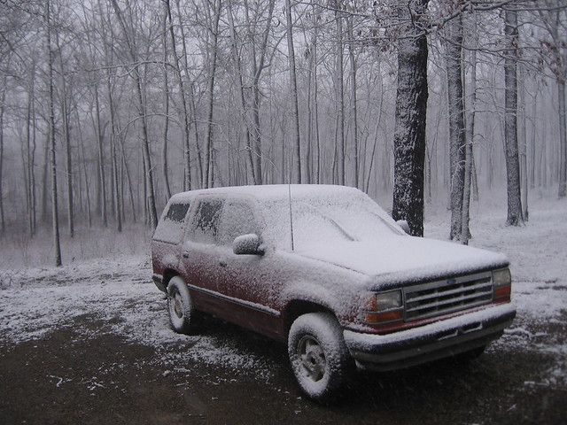

# Living in a Truck for Two Years. Part 1

The motivation for a lot of these projects comes from having spent six years doing nothing but paying off debt. I had a good job as a programmer in Little Rock, was living in an apartment and was making slow but steady progress towards paying it off. The problem was that at the rate I was going it would take about 10 years and I did not want to spend that long. I always liked the outdoors and camping, when I was living in Kenya I was in a canvas tent for a year and then a mud and stone building for the next five years or so. In my mind a "house" was a place to sleep and store stuff.

Immediately prior to paying off this debt I had decided to hike the Appalachian Trail. This is basically a footpath 2100 miles long from Georgia to Maine. It took about 6 months to hike the entire distance back in 2004. I loved it... all I had in terms of "stuff" was what would fit in a backpack, and yet I did not feel that I was lacking anything essential.

I came to the conclusion that life could be much simpler than it currently seems to be. All we really require is food, shelter, and water to sustain ourselves. These can be easily obtained with almost no effort in America. Having accomplished these basic requirement we should be able to spend the rest of our lives doing whatever we want -- reading, travel, art, working on project we enjoy. We complicate it by turning and artificial "standard of living" into a requirement. This then drives us to turn something as simple as shelter into an elaborate shrine to consumerism that we spend the rest of our lives working to maintain. Some people, when they reach the end of their lives and are looking back on the enormous volume of possessions that they once consumed and passed on to their heirs will be satisfied ... I am not one of these people. When I see the stress, and fear and hopelessness that pervades much of our society I wonder if slavery ever really ended.

So sometime around 2006 I found myself with a 98 ford explorer, a pile of stuff, an apartment, a bunch of debt and an ideology at odds with my lifestyle. I started looking at my truck. I discovered I could fold the seats down to make an area in the back of the explorer that was three inches longer than I was. This left a fairly large area in which to store stuff... certainly more than I had in my backpack on the AT. I did not spend much time in the apartment anyway. Usually spent the evenings reading in a coffee shop or visiting friends. Once I got over the idealogical hump and started considering living out of my truck as a possibility the advantages (paying off my debt twice as fast) seemed to clearly outweigh the disadvantages (the comfort of having an apartment full of stuff).

I started looking for other people who had come to the same conclusion and found this: http://www.violentacres.com/archives/30/you-can-learn-a-lot-from-a-rich-girl/

http://www.violentacres.com/archives/32/drastic-measures/

Then did some research and ordered this book. I found out it was not a very popular choice, but it had been done. My friends pretty much thought it was a terrible idea but eventually stopped trying to talk me out of it.

I had a few months left on my lease, so I started to get rid of stuff and make plans. In the end I learned quite a bit, had a few surprises and saved at least $12,000 over two years.

To be continued: here
