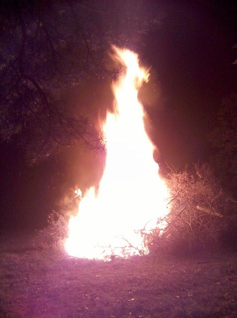
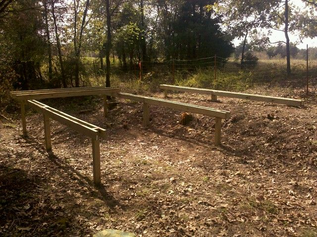
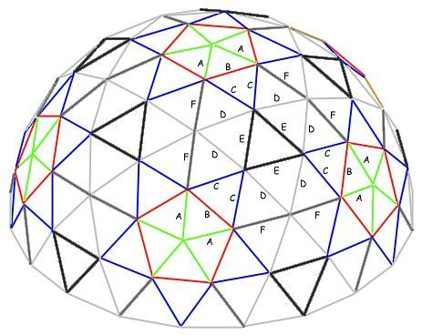
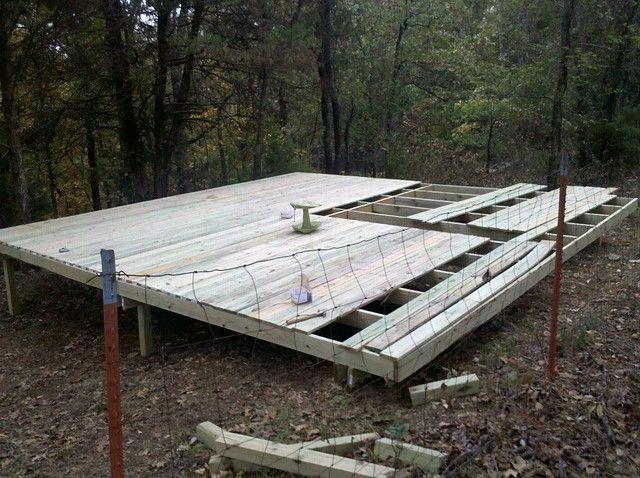
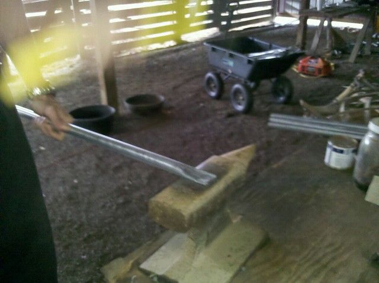
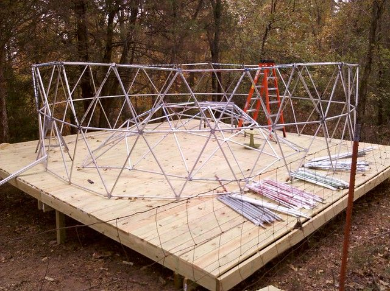
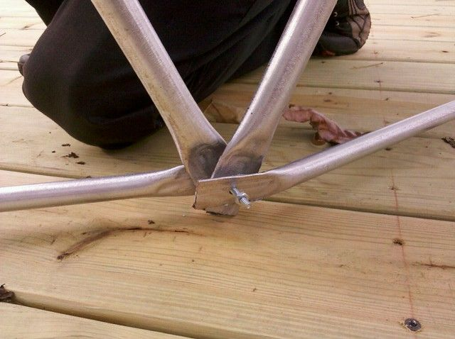
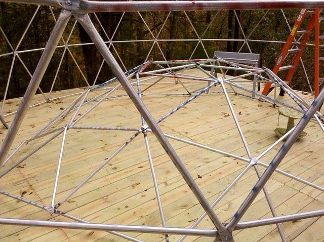

# Progress Report Nov 3, 2010

It has been a while since my last post, so I thought I should give an update for the 15-20 people who seem to be reading this. I went part time at my job at the beginning of October so that I could spend the mornings working on these projects. Progress has been good since that point. I spent a few weeks clearing land, pulling out thorn vines and digging up trees. I made a big pile of the thorns and brush and after it had dried for about a month we had a bonfire... it is worth noting that dry thorn vines burn really well. The flames reached about 35 feet. We had a helicopter do a flyby about 30 minutes later.

It is starting to get colder here in Arkansas and since I need to be out of my current home in the next couple of months I decided to build a "geodesic yurt". This will function as a temporary house so that I will have more time to work on the earth-bag dome/terrace/hot-tub without having to rush. The basics of the dome are here: geodesic dome introduction, I will write a more detailed report when it is done, but I thought I would post some information and pictures now.

I am calling it a "geodesic yurt" because it is intended to be a semi-permanent structure. Most conduit domes made this way are intended to be temporary for events like burning man. This one is more yurt like in that it is intended to be a primary dwelling for several years.

The reasoning behind this is that it is fairly cheap (less than $2000), can be built in a few weeks, and will be useful later as a storage shed / guest house / chicken coop or whatever. It will be 19 feet in diameter which is about the same size as the earth bag dome so it will provide a preview of what living in the dome will be like. Also, it will be practice for the greenhouse I hope to build later which will be about 70ft in diameter. Since the ground is sloped where I am building it, I made a wooden deck to put it on. The boards for the deck come in 10ft lengths so I built it 20ft by 20ft so that I would not have to cut anything besides the posts. If I end up taking this down when the earth bag dome is complete then I will be able to use the deck material to build a porch for the dome.

The construction of the deck was fairly standard, with a few concessions made so that I would not have to cut any boards. The cost of the material was about $800. One person would be able to build it in about a week I think.

I am using the more heavy duty 3/4 inch galvanized steel electrical conduit for the dome. This comes in 10ft lengths and costs about $4 per piece. The dome used about 50 pieces so about $200 in pipes. The smaller 1/2 inch conduit is more like $2 a piece so it could have been done for $100. This will be a two story dome with a trampoline base that I will use as a bed for the second story, so I wanted it to be strong enough to support the second level. It may have been strong enough with 1/2 inch, but I decided to overbuild just in case.

It took about a week to cut, flatten and drill all the pieces. For the most part there were two of us working on it for 3 hours a day. We used a metal cutting disk on a cheap miter saw for cutting the conduit, then flattened it with a four-pound hammer on an anvil, then drilled it with a drill press. Most of this could have been done a lot faster with a full day to work, but there is a limit to how much a person that is not used to it can swing a four pound hammer. My forearms are still sore.

We color coded the pieces with spray paint, they were six different sizes. One mistake we made here was not using the same colors in the diagram. I would suggest that you check the diagram at desertdomes and use the same colors to avoid confusion.

The dome is mostly assembled at this point. I added an extra ring at the bottom to give it another three feet of height so it is not exactly according to the plans at desertdomes. I have a couple of volunteers helping me put this together which is a great help. I would suggest anyone doing this have at least two people to assemble the dome, preferably three. One person could do it, but it would take a lot longer. We did the bottom couple of levels first which brought it to about 6ft high, then we started assembling from the center out. The idea is that when we have done the center we will lift it up and join it to the bottom. I am not too sure about the wisdom of this plan since it will weigh about 150lbs but I imagine we will get it done somehow.

I have been through a number of ideas for the covering of the dome. The original idea was to use cotton drop cloths painted over with polyurethane floor sealer (like on gym floors) or fiberglass resin. One complication of this plan was that the cloth would need to be cut to fit the shape of the dome which is not a simple task, and it would be fairly flammable when done. Then I found out you can get heat shrink fire-retardant plastic fairly cheap. They use this stuff to wrap buildings at construction sites, or boats for transport. I got 100ft x 20ft 9mil white for $270 here. It should come in this friday. Basically it is like thick plastic sheeting that shrinks when it gets hot to about half of it's original size. So I should be able to just drape it over the dome, fasten it down at the ends and have it shrink to fit.

I had planned originally to make two domes, one inside the other leaving about a six inch gap for insulation. But now with the heat shrink wrapping I am going to try just making a single dome, wrap it, add a layer of fibreglass insulation and wrap it again. It will probably not be quite as well insulated, but will be a lot easier, and less expensive. I will still probably put a layer of polyurethane and sand on the outside to seal it completely... then will maybe paint it.

So far the biggest expense has been tools. I will probably have spent about $2000 on tools when this is done but I expect I will get plenty of use out of them in the future. I will provide a complete list of tools, parts, and expenses when it is done.

Hopefully this will be complete by the end of next week and I can start moving in after that.
