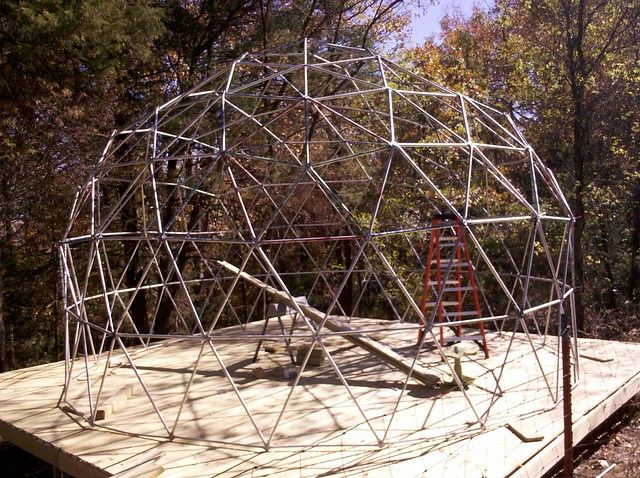

# Update: The dome structure is complete.

Just wanted to add a quick update to show the completed dome structure. Basically we finished to first two outside layers and then worked from the middle outward (as seen in the previous post) then lifted it up and attached it to the base. This worked fairly well, except that we left all the bolts loose so that we could adjust it at the end. Turns out that this makes the dome twist in strange ways when things start to get heavy, which makes everything not fit right in the end. We used the board in the middle of the picture to lift the entire dome so that the tension in the frame could redistribute which helped a lot. The dome structure actually weighs about 400lbs at this point. We also ended up having to use bigger bolts (1/4 inch) since the smaller ones were getting all bent up.

A lot of the smaller bolts did not want to tighten at the end, there was too much tension and mostly just stripped out when we tried to drill them tight. We started replacing them one at a time with the larger bolts and then just decided to drill another larger hole beside the first and leave the small bolt in as well as adding the larger one. I expect to have it all tightened down by Monday.

The next step will be adding a door frame and then putting on the first layer of heat-shrink wrap. The wrap came in today so hopefully I will be able to mess with it some this weekend to see how it works.
