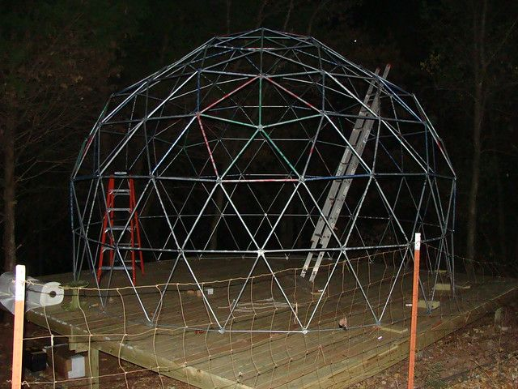
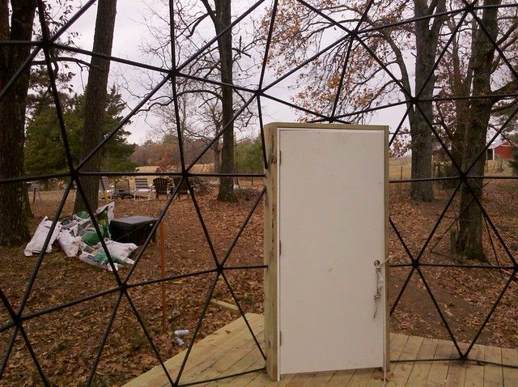
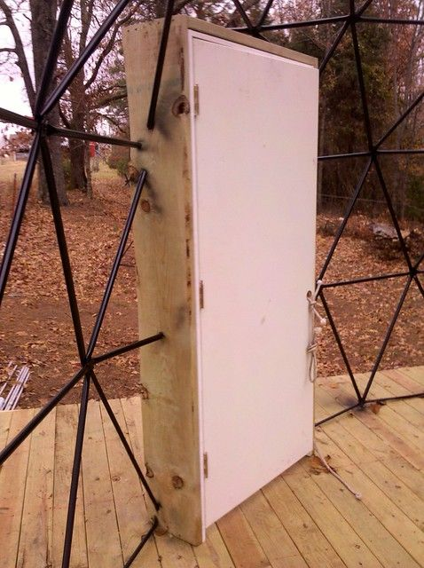
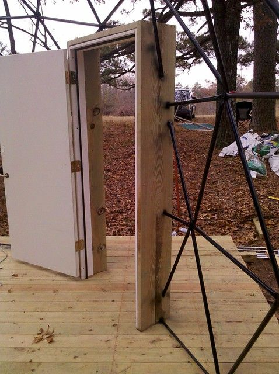
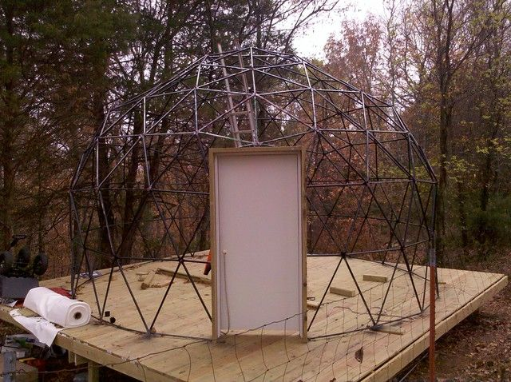
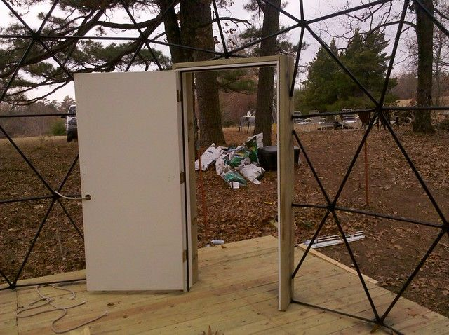

# Progress Report Nov 22, 2010

Things always take longer than I think they should. I ended up replacing all the bolts, doing that and tightening it all down took almost a week. This would not have been the case had we done it correctly in the first place.

Lessons Learned:

1. Use big bolts... 1/2 inch would have been nice. Make sure the bolts have a square head that you can put a socket around... not a screwdriver head.

2. Start at the center and build out, tighten down every time all the pieces are together, when a layer is done lift it up on sawhorses and continue.

3. Go from the outside in with the bolts, so the nut is on the inside.

4. Don't color code with paint unless you plan to repaint the entire thing when it is done, use colored tape instead.

Unfortunately I screwed up on every one of the above with the result being that it took a lot longer than it should have.

I left it all loose with the idea that it would leave some give for minor adjustments in the end... instead the weight pulled it all out of alignment once it started getting fairly large.

I used tiny bolts. They seemed big enough in the box, I did not realize that these things were going to do more than just hold the pieces together. In actuality they will bend and twist the flattened pipe ends into perfect alignment. Unless they are too small and break while being tightened. I used bolts with a Philips head ... which of course got stripped out whenever I tried to tighten them too much.

I painted all the pieces different colors to aid assembly. This would be fine if you are going for the exploding rainbow look, since the pipes are all visible when inside the dome. I ended up spending another several days and 25 cans of black spray paint to paint over everything.

I put the bolts so that when they were done there were sharp ends poking out into where the plastic shrink wrap would go. I don't know why.

But in spite of all this, the door is now on and it is almost ready for the cover. It seemed like the door would be kind of a pain, but it was actually really easy. We built a frame out of 2x12 treated wood and pre-installed the door in the frame. Then stood the whole thing up where it was supposed to go and roughly cut the pipes a little longer than the outside of the frame. The frame then slid into place (moving the ends of the pipes out of the way) and I drilled holes in each pipe that was touching and used a deck screw to fasten it to the frame.

Next is the trampoline ring which I will fasten with cables to the frame. Then the cover. I borrowed a forced-air propane heater from my brother which I will hopefully be able to use to shrink the cover. This is to avoid buying the $400 heat gun that I am supposed to use to shrink this stuff.

One thing I am still debating is how to insulate it. I could either use fibreglass rolls of insulation around the outside and shrink another layer on top of that. Or I could get sheets of extruded polystyrene (the blue styrofoam stuff that costs about $12 a sheet), and cut it into triangles to fasten up inside. It seems the cost will be about the same... at the moment I am leaning toward the latter.
