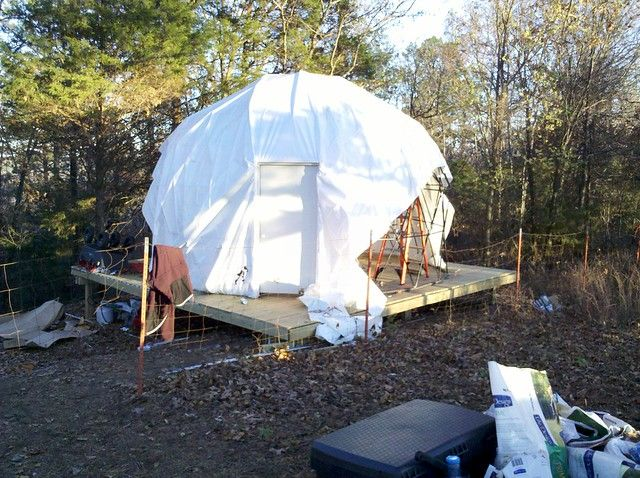
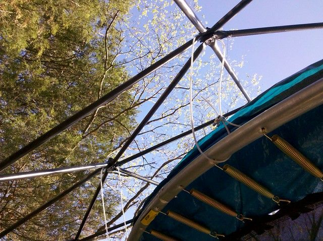
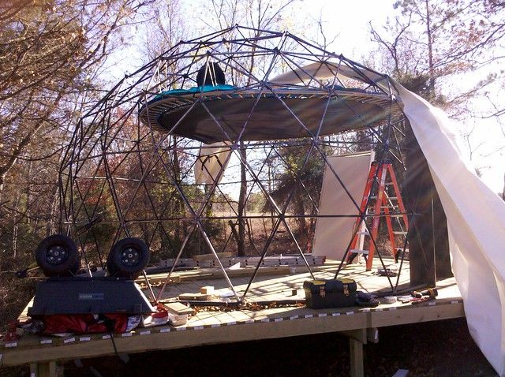

# Dome Progress Dec 1, 2010

Well... the trampoline is in, that went very nicely. The shrink wrap has been problematic however. 100ft by 20ft of 9mil fire resistant shrinkwrap was $270 including shipping. This did not seem too bad. The special propane heat shrink torch was $350 to $1000 however... which is bad. My theory was that surely I could use something else to basically blow a lot of hot air. My theory was wrong.

I tried everything. Starting with a forced air propane heater. This kind of worked, but very slowly, it also had to be inches from the plastic and tended to touch it occasionally with the heater rim which melted holes. I spent a couple of hours doing a 10x8 ft section and it looked pretty bad. The leaf burner and the blowtorch caused it to shrink very quickly but only in a one inch wide strip... also melted more holes. I made a custom tip for the blowtorch out of copper pipes with a bunch of holes drilled in it to try to spread the flame into thin even strip, but the regulator could not be adjusted and it would not burn well. I even tried boiling various water / salt / sugar solutions to see if I could just throw hot water on it.

In the end I had to break down and buy the stupid heat shrink gun. It should come in tomorrow and better be a huge improvement... I don't know what I am going to do with it after I have finished shrinking everything, but for $350 I am definitely going to use it for something. Maybe a water heater or home-made rotissary. This is the cheapest heat shrink gun I could find: http://bigshrink.com/shopexd.asp?id=1025

