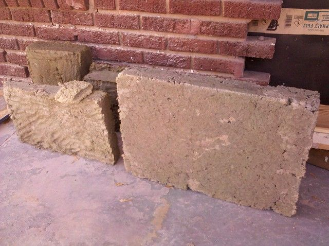

# Papercrete

So I heard about this stuff a while back, and did not think much about it until recently. I was looking into ways to insulate the dome and was considering putting fiberglass insulation on the outside and another layer of shrink-wrap around that, or cutting foam panels into triangles and attaching them inside. Both options would be about $300. Being fundamentally cheap and since I am quickly running out of cash I decided to look into other options which brings us back to papercrete.

Basically this is like a large cement spitwad. You mix newspaper with water and blend it up into an oatmeal like slurry then you add portland cement powder. There are variations on the recipe, but the most basic seems to be equal parts by weight of dry newspaper to dry cement powder. You can pour this into blocks or molds or forms, or spray or plaster onto screens, or walls. One bag of cement will produce about 40 large blocks which will weigh about 3 lbs each. It apparently has an r-value (insulation) of about 2.5, by comparison the foam panels are about r-value:3. It is also basically fireproof and can be made waterproof by painting it with masonry sealer.

Any type of paper can be used, but newspaper is usually available for free in bulk from the local newspaper printing company or recycling center. The blocks are strong enough to drive over and will not shatter but will compress like a really stiff sponge. They can be made stiffer and more fireproof by the addition of more cement and sand with the trade off being greater weight and less insulation. Some people suggest adding borax to prevent mold and to further increase fire resistance.

The finished product can be cut with woodworking tools and will not fall apart even if it becomes wet. People have made ponds with this stuff. The real draw for me is that along with being practical and easy to work with, it is really cheap. The only thing you have to buy is cement and $10 worth of that will get you over 40 large blocks.

I plan to pour it into one inch sheets then cut into triangles to put on the inside of the dome. I have a batch drying at the moment and I made a small scale mixer out of a 55-gallon drum and a huge drill. I hope to make a tow-mixer this summer for making blocks, but this should get me through the winter at least. I will post more pictures of the test-blocks and the mixer later. I am currently testing different mixes portland / masonry cement / sawdust / polyurethane / leaves etc. The blocks in the picture are still very wet but quite hard, they have been drying for about 5 days now. Winter is probably not the best time to be doing this.

More info:

http://www.mortarsprayer.com/

http://www.youtube.com/watch?v=JoLBeV6tzJ4&feature=player_embedded

http://makepapercrete.com/index.html

2 comments

keregg228 · August 15, 2012

The entire idea of using papercrete is that it by itself can support the structure and has an incredible r value. I linked in here from a survival blog. People there use this material bc unlike wood and drywall papercrete stops bullets. Unlike cement blocks that shatter with larger cal rifle rounds, papercrete just takes the rounds in and stops them (if it is thick enough). A dome structure was probaly not the best choice for you. Research slip forms for making papercrete walls. They allow u to use the same forms and work your way down and up straight walls using a minimal about of forms. Also since there are no blocks you dont have to move them or worry about using more papercrete to fit them together. your r value is only as good as the seal btw the blocks. IDK where you are getting your paper but often u can buy a ton of crushed paper from recycling companies and use that. my father called and it was like 200$ or less for a ton of paper. after u have made the walls to the height u want. u pour large "blocks" to use as the roof and lay them over wood framing you have put up to support it. i think for a really good r value u need almost a foot thick wall and ceiling. you can paint papercrete. though i have read if you use thick enough walls and roof everything runs off before it can absorb all the way through. Idk what u are planning to use to heat your dome but u may want to look at kits that allow u to turn a metal barrel into a wood stove. i am finishing up my medical training(one year to go). I plan I renting for a year or two and then building a papercrete home. hopefully entirely off grid. other than aquaponics have u lookde into raising chickens or rabbits for food? try searching for raising rabbit on whenshtf.com probably a lot easier than aquaponics and the rabbit poo can be used to fertilize your garden. aquaponics take a lot of time energy and equipment to be cost effective. rabitts have a very cheap start up especially if u have more time than money. best of luck. ill keep reading as time allows

bhoult · August 15, 2012

Thanks for the info keregg. It has been a while since I updated the blog. Mostly because it seemed that there was not that much interest, and also because the dome had been essentially done for a couple of years now and I need other interesting stuff to blog about.

I get my paper from a local newspaper that has a recycle bin that they let you get stuff out of for free... but I would be willing to pay to get it in bulk. I will have to call some recycling companies when I start the next papercrete project.

I agree that spraying was not the way to go. I think blocks would have been a lot easier. I plan to make a workshop and another dome later so I will do it that way next time. I will hopefully be doing slip forms to cover earth bags with cement on a 30ft long "hot tub" in the next few months. I think they are a great idea... I just like blocks because they are easier to work with / prepare in advance.

I like the idea of domes partly because of their strength, also because of their low surface area to space ratio (better efficiency) but mostly because they are different. I seem to have a perverse tendency to want to do everything differently than the mainstream says it should be done. Big squares just seem kind of uninteresting.

I did not know papercrete was bullet proof though. I have some old blocks sitting around, will have to shoot them and see what happens. I just kind of assumed that the bullet would go right through. Will be trying that in the morning.

We have plans to do chickens... partly for the eggs and meat but also to intercept the grasshoppers that seem to destroy our garden annually. The idea is to build a double fence around the garden and let the chickens run in that. Will probably not solve the problem, but will make me at least feel like I am taking revenge on the stupid grasshoppers.

The subject of rabbits (and goats for that matter) keeps coming up as well. There are a few of us that have tried them in the past and it seems that at least when not in survival mode, nobody really likes to eat them. Maybe we could work on acquiring the taste. Might do it at some point just for the fertilizer though. Like you mentioned... it is great stuff. The fish we do want to eat though, so that is why we are focusing on those.

It sounds like you have been researching for your own upcoming projects. Best of luck with that, and if you decide to blog about it let me know and I will put a link to it. I don't get much traffic, but it can't hurt.
