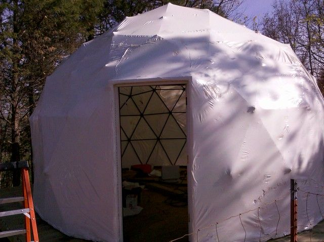
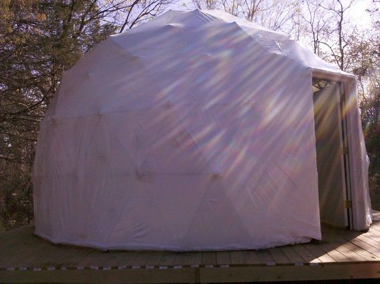
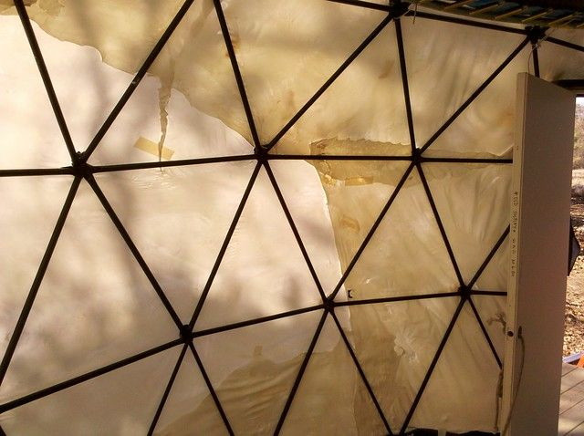
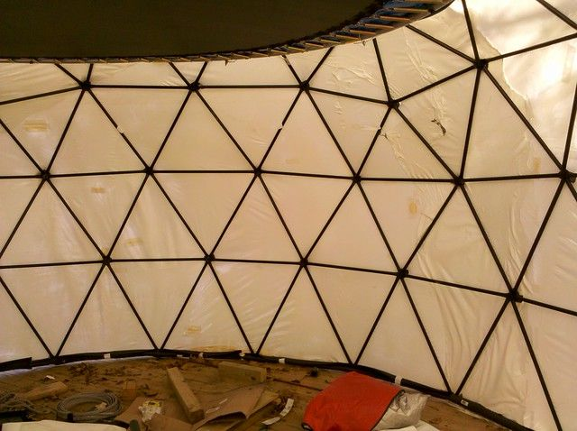

# Dome Progress Dec 8, 2010

Well... there it is. It is waterproof, strong, tight and looks like crap.

I was kind of hoping this shrink wrap stuff would look a lot nicer when done but that does not seem to be the case. Again, if I had done this right from the start things may have been different. The issue is that with the bolts sticking out the wrap gets hung up on them even when they are padded which prevents even shrinking and causes it to get thin and tear. If I were doing this again I would have made sure the bolts were facing inward and the pipe ends were all rounded off so that the plastic would slide over the joins. I would also have wrapped the entire thing before I tried to shrink any of it. I would fold, cut and tape all the excess material and then tape all the seams before I started to shrink anything. Maybe if I had done all this it may have turned out cleaner.

The gun did work a lot better, but I still managed to melt a lot of holes with the result being that there is now a bunch of duct tape patching all over the place. So it looks like I am going to be using a lot of papercrete in the near future. First I will probably go around the base to seal the dome to the deck on the outside and inside, then I will make panels to put between the structural triangles on the inside, then I will probably spray papercrete on the outside and paint over it.

A lot of this depends on how well the papercrete can be sealed against water. I have some test samples drying at the moment, but it will probably take a week or so for those to dry in the current climate. Were I doing this again I think I would probably skip the shrink wrap and try using pallet wrap... basically big rolls of saran-wrap that are about three feet wide. Since I am going to have to papercrete over it anyway, this would have saved me a couple hundred dollars on the shrink film and $360 on the heat shrink gun. Ah well...

1 comment

Nolan Scheid · December 8, 2010

Your home looks wonderful!

Last year I received pictures from one of our customers that is using the stucco sprayer to spray over shrink wrap structures in the Bahamas. You are on the right track.

I know I have the pictures on my old hard drive. when I get it running I will save them for you. Say hello when you want to talk about the next step. http://www.mortarsprayer.com/contact/ We did some experiments with very thin shells and progressive thickening that I think will help you.

Best regards,

Nolan Scheid
