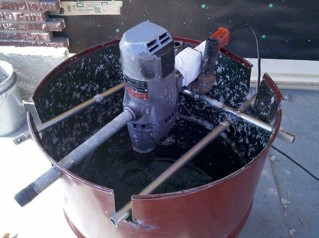
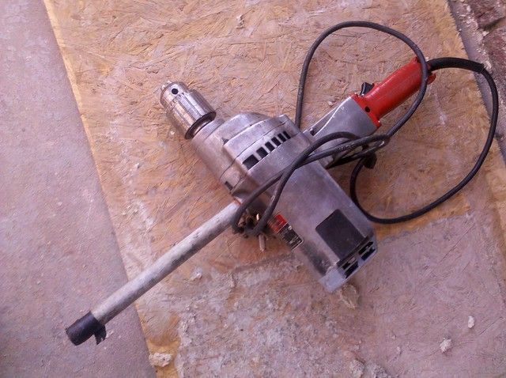
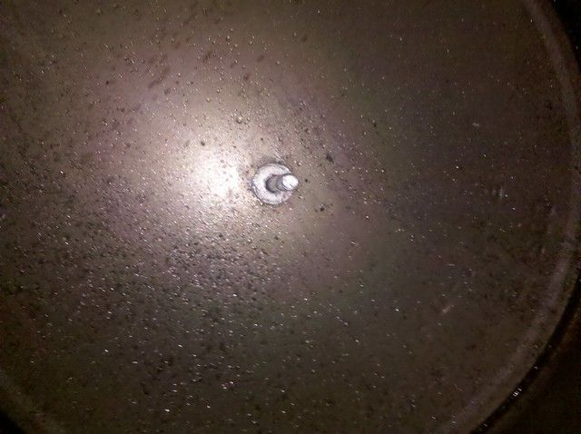
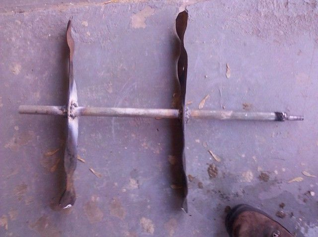
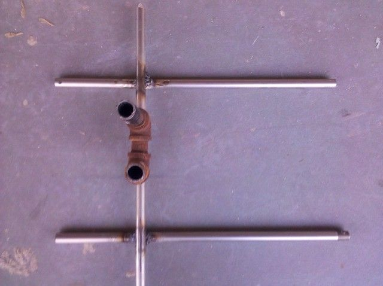
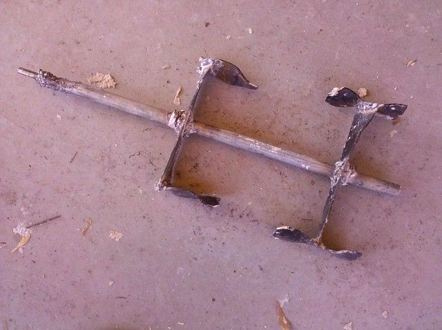
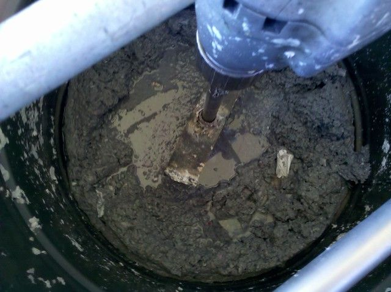

# Small Papercrete Mixer Version 1.

Behold my first papercrete mixer! Well... actually the first was technically a five gallon plastic bucket and a paint mixer attached to a little cordless drill, but this one is a lot more impressive.

It started when my father showed up with this gigantic drill. This thing is so huge that you would have to be somewhat insane to try to use it on just about anything. The drill by itself weighs about 40lbs. The new version seems to have a lighter casing. This one is all cast-iron. I am hoping some day someone asks me if I have a drill they can borrow to put in a few screws. I can't wait to pull this out for them.

Anyway, I was getting ready to make a tow-mixer and was kind of wishing I had something for medium size batches that I would not have to drive around when drillzilla showed up. $10 on a metal 55-gallon drum and some welding and I now have this thing. Basically I put a bolt in the bottom of the drum facing inward, put a couple of washers on the bolt then welded a couple of lawn mower blades to a pipe to put over the bolt. Then a bolt in the other end of the pipe for the drill to hold on to. The rest is just a frame to hold the drill in place.

The first test lasted about 10 seconds... my welding around the bolt that the drill attached to broke and I had to reinforce that. On the second test it seemed to be going pretty well until the entire barrel started spinning and lurching all over the porch. I guess the torque from the drill was too much for the weight I had in it (about 15 gallons at the time). Like an idiot I grabbed the barrel while it was flopping around and forgot that the edge was sharp. I now have three impressive cuts on the ends of my fingers.

I decided the blades were probably too long so I cut the ends off, then I decided it was not mixing fast enough so I welded them back on at an angle. I am fairly pleased with the final result, it does not throw the barrel around when you turn it on, but it still mixes pretty quickly. It will probably help if I wet and tear the papers into strips before I throw them in instead of just throwing the dry papers in. They tend to get wrapped around the shaft if you do that.

Now as soon as we get power and water at the property I will have a lot of mixing to do. Since I doubt anyone would want to buy a $700 drill for this, the same thing could probably be accomplished with an auger powerhead for $200.

8 comments

Nolan Scheid · December 24, 2010

Good morning Brandon.

I found another small dome project that I think you will be interested in:

http://tinyhouseblog.com/tiny-house-concept/the-coffee-pod-construction/

They did a thin shell of surface bonding cement and tar for waterproofing.

Merry Christmas.

Nolan

Ernest · May 29, 2011

I have a few questions: Do you own this property and if so, any building permit hassles for this dome? Reason why I'm asking is because I planning on building something similar here in Indiana.

bhoult · June 8, 2011

Oops... sorry it took so long to answer. I marked it to get back to on my cell phone and then lost track of it.

To answer your question, yes I do own the property, I made sure it was outside city limits in order to avoid zoning hassles. I am not sure if that is going to be sufficient so I am basically just hoping that it does not become a problem at some point. If it does then I guess I will have to deal with it when the time comes.

Good luck with your project in Indiana. I wish it were easier to know what the rules are.

Madam Yussif · June 24, 2011

nice work :)

Carson · May 13, 2012

Hi Brandon,

I formulated the idea of papercreting a pipe geodesic dome about a year ago. I had no idea that someone had already done it! I'm thinking of doing it on a large scale though. I'm just wondering how your dome has been performing (energy efficiency) and if you would consider doing it with a larger building?

I'm looking at somewhere between a 36 ft to 48 ft dome. I watched Mikey Sklar use a trash pump to move a lot of papercrete real fast so I'm thinking about putting the chicken wire/ plastic wrap combo you mentioned around the outside of the frame and then invest in building formwork for the inside with the idea that if this works then I might be building a couple more domes. I could build my own dome kit but I'm hoping that if I buy a conduit frame kit from a dome manufacturer that I might be able to talk the local authorities into a permit. Maybe I'm a bit naive....

My project is probably a year or two out. It's nice to see a like minded individual that gets out there and actually makes stuff...

Thanks,

Carson Capaul

Spokane , WA

Carson · May 13, 2012

Hi Brandon,

I formulated the idea of papercreting a pipe geodesic dome about a year ago. I had no idea that someone had already done it! I'm thinking of doing it on a large scale though. I'm just wondering how your dome has been performing (energy efficiency) and if you would consider doing it with a larger building?

I'm looking at somewhere between a 36 ft to 48 ft dome. I watched Mikey Sklar use a trash pump to move a lot of papercrete real fast so I'm thinking about putting the chicken wire/ plastic wrap combo you mentioned around the outside of the frame and then invest in building formwork for the inside with the idea that if this works then I might be building a couple more domes. I could build my own dome kit but I'm hoping that if I buy a conduit frame kit from a dome manufacturer that I might be able to talk the local authorities into a permit. Maybe I'm a bit naive....

My project is probably a year or two out. It's nice to see a like minded individual that gets out there and actually makes stuff...

Thanks,

Carson Capaul

Spokane , WA

Carson · May 13, 2012

Hi Brandon,

I formulated the idea of papercreting a pipe geodesic dome about a year ago. I had no idea that someone had already done it! I'm thinking of doing it on a large scale though. I'm just wondering how your dome has been performing (energy efficiency) and if you would consider doing it with a larger building?

I'm looking at somewhere between a 36 ft to 48 ft dome. I watched Mikey Sklar use a trash pump to move a lot of papercrete real fast so I'm thinking about putting the chicken wire/ plastic wrap combo you mentioned around the outside of the frame and then invest in building formwork for the inside with the idea that if this works then I might be building a couple more domes. I could build my own dome kit but I'm hoping that if I buy a conduit frame kit from a dome manufacturer that I might be able to talk the local authorities into a permit. Maybe I'm a bit naive....

My project is probably a year or two out. It's nice to see a like minded individual that gets out there and actually makes stuff...

Thanks,

Carson Capaul

Spokane , WA

bhoult · May 16, 2012

Hello Carson. Good to hear other people are thinking about this.

It has been performing well for what it is. I have a wood burning stove that provides plenty of heat, and a small air conditioner (8000 btu window unit) that can keep it cool in the summer. Keep in mind my walls are only about 4 inches thick and I used 3x the recommended cement so the insulation properties are not that great on mine at least.

I am actually planning to do a greenhouse dome (no papercrete just conduit frame and shrink wrap). That will be about 35ft diameter. And another three story papercrete dome (first story will be earth bag). I see no reason why you could not make one as large as you want though. I believe the structure actually gets stronger the larger you make it (assuming the individual pipe lengths stay the same).

The main thing I would have done differently would be to make a tow-mixer and pre-pour papercrete blocks to stack around the frame. If you are using a pump then you might consider doing two frames with each covered in shrink-wrap or palette wrap then pouring the papercrete or cement between them. If you do this with papercrete though make sure it can drain as you pour each layer (a lot of water will run out of the mix).

Keep me updated on your project, I am curious what you will end up deciding.
