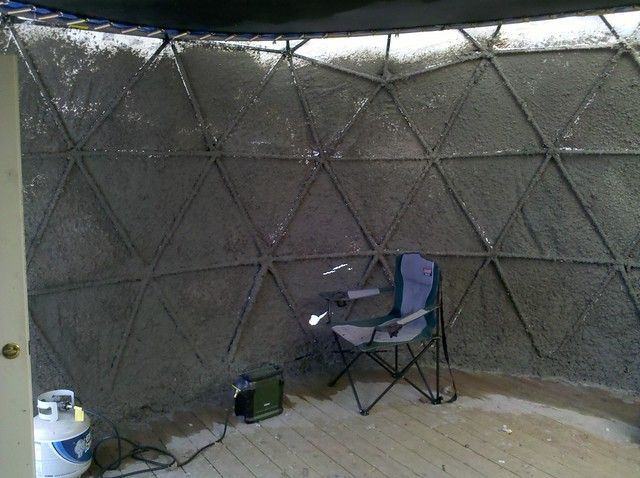
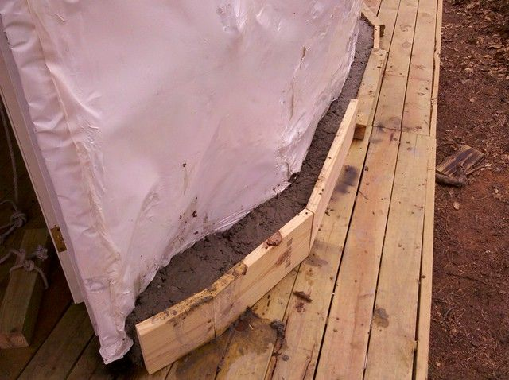
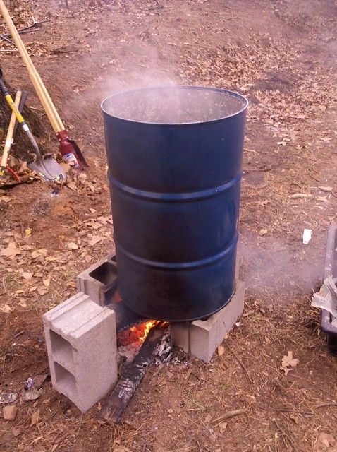
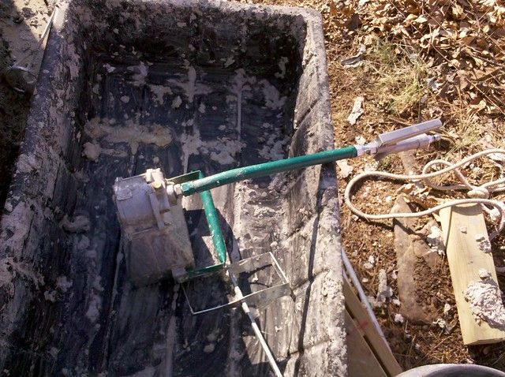
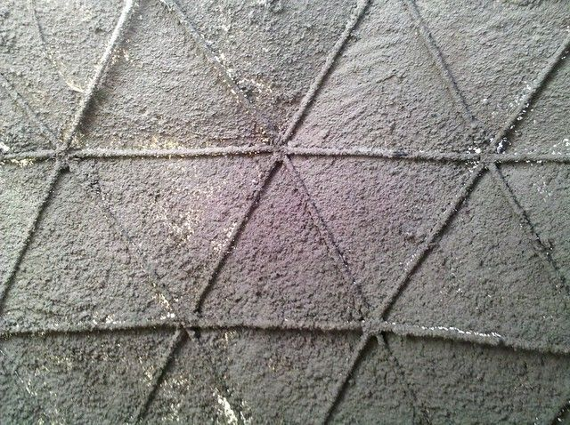
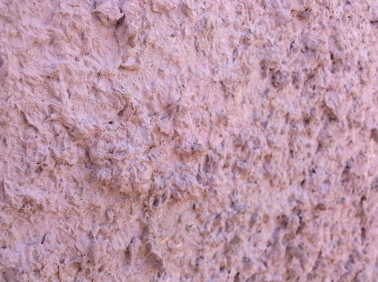

# Dome Progress Jan 6, 2011

A couple of weeks ago I had to move out of my current residence so I have now been living in the not-yet-completed dome for a little over a week. This is not exactly ideal since I am still spraying the inside and outside with papercrete and as a result I can't really move anything inside since I will have to move it out every time I spray. Also I still do not have power or water. The power should be installed tomorrow and I am hauling water in using two 15-gallon containers.

The weather has been fairly cold the last few weeks. Nights have been in the teens, so I have been thinking a lot about insulation. Even though the dome is sealed there are cracks in the decking that make up the floor. My theory was that since heat rises this would not be a big problem... again my theory proved inadequate. There is enough air movement that even with a small propane heater running all night it only gets about ten degrees warmer than the outside temperature. Also while the shrink wrap keeps the rain out, it does not do much in terms of insulation. So, now I have thin frozen sheets of ice that form on the ceiling each night from condensation and come crashing down on me every morning when the sun comes up. I guess it makes a pretty effective alarm clock.

I relocated my computer to a friends house so I could use that as an office for work and signed up for a membership at the local fitness center so that I could take showers. I rediscovered how much I like the steam room. Probably as a result of sleeping in a damp wet dome I have had some kind of mild cold for the past week and were it not for the steam room I am sure I would be a lot more miserable about this. I am seriously thinking that I will have to add a steam dome to the list of projects.

Papercrete

A few weeks ago Nolan Scheid from http://www.mortarsprayer.com emailed me with some tips about how to attach papercrete to the shrink-wrap. I am fairly impressed that he found this blog at all since it is somewhat buried in more high-profile sites at the moment. Since then he has put me in contact with several other people doing similar projects that have been a great help. Nolan just started producing a smaller papercrete sprayer that works better with my somewhat undersized compressor. So I ordered one here: http://www.mortarsprayer.com/plaster-sprayer/

We first sealed the base to the deck inside and out by pouring papercrete in forms and then just packing it on by hand. I had to rent a compressor last week because the one I have is electric and we are still lacking in that department. But I did manage to put an initial coat on last Saturday and Sunday. The first attempt I did not blend my papercrete well enough and I had too little water in it. It worked but it went really slowly, the larger chunks kept plugging up the holes on the sprayer. The next day I tried again with a better blended mix and more water and the difference was dramatic. I could spray just about as fast as my friend could mix the cement in with the pulp.

Currently the best process we have found goes something like this:

1. Soak paper in water for a while (overnight) we use a 55-gallon metal drum for this.

2. Tear wet paper into strips (this helps keep the sheets of paper from wrapping around the mixer blades)

3. Put the strips into another 55-gallon drum filled a little over half full with water until the mix comes about a foot from the top of the barrel.

4. Build a fire under the paper/water mixture to heat the water up. This is probably not necessary but it is a lot more fun working with hot papercrete in the winter, also I expect that it makes the end result more pulpy. I just put the entire barrel on cement blocks and shove wood/trash under it and light it on fire.

6. Blend the heating mix with Drillzilla (a powerful but low speed drill I talked about earlier)

5. Mix cement powder with warm paper/water pulp in three 5-gallon buckets using a high speed drill mixer. I am adding about three quarts of cement powder per 5-gallon bucket. I am sure you could use more or less than this, but I like the results of this mix. If you have the right drill attachement and the right consistency of pulp it mixes like a big milkshake in just a few seconds.

6. Dump the three mixed 5-gallon buckets into a large plastic bin that I can scoop it out of with the sparyer. This just makes it easier than trying to scoop it out of the little 5-gallon buckets into the sprayer hopper.

7. Blast it all over the walls in multiple coats. I found that if you put it on too thick then it falls off, so it has to be done in multiple layers and allowed to dry between each coat. The first layer almost but not completely covers the plastic. The sprayer leaves a rough texture on the outside that will hold much thicker subsequent layers. I suspect for a 1-2 inch thickness it will take four layers.

So far I have two coats on the bottom eight foot of the inside of the 19ft diameter dome. This took about 80 gallons of wet papercrete. With it freezing every night it takes all week to dry. I suspect with a big heater and/or fan this could be sped up. The resulting surface will absorb water like a sponge, but will not soften while doing so. This is fine inside as I expect it will help regulate the humidity. On the outside I will probably only do two coats and then paint to seal it. I am going to try to trowel the second coat smooth.

Hopefully in another couple of weeks I can start moving stuff in permanently.

10 comments

Anonymous · January 6, 2011

Here is something for future reference; heat flows to cold, it doesn't care about up/down/ sideways/whatever. Now hot air does rise above cooler air because less dense fluids rise above more dense fluids. Ever seen pics of Nolan Scheids house? It's way cool.

Bruce Dickey · March 2, 2011

Looking good Brandon. Don't forget your EP CD of Robb's music, it's paid for, come to think of it, I haven't gotten mine either and we had BBQ last week.... grin!

Nice weather now, hope you make good progress and can relax a bit... Bruce

ken winston caine · July 31, 2011

So glad you made time to document all of this, Brandon--the lifestyle stuff and decisions as well as the dome building, etc.

Have a question here:

You wrote, "A few weeks ago Nolan Scheid from http://www.mortarsprayer.com emailed me with some tips about how to attach papercrete to the shrink-wrap."

Could you share those tips?

I'm wanting to use his plaster sprayer to spary a fidobe mix onto poly covered forms and it tends to slip off if put on thick at first coat and, as you noted, slip off weeks later if put on thin and not built up quickly.

Any tips to stop the slippage on the initial coat? Would like to go 1/2 inch thick with first coat so that the surface has some structural integrity once it hardens. But how in the world do you get it to stick to poly sheeting?

And -- if I must cover the poly with some kind of netting -- am wondering what is the least expensive source of web fabric (new or recycled or salvaged) that I can get in large amounts. Don't mind cutting and stitching together used grain bags -- if they're available for free or at very low-cost somewhere.

Thanks for all you do.

Best,

ken winston caine

bhoult · August 2, 2011

Here is an excerpt from Nolan:

"This may give you some good ideas. http://planetaryrenewal.org/ipr/ultralc.html IF you can protect the straw insulation from getting wet, then clay is a very good resource. I think there is a next step waiting for someone to try by combining chopped straw and paper fiber.

When we did the balloon form demonstration, the hardest part was getting the first egg shell thickness on the structure. Since the tyvek was so slick, very little would stick to it.

We used a combination of cement and the inexpensive moose milk in the tile section from Home depot. The first layer was speckled on. This needed to be an extremely lightweight because air was the only thing holding out formwork. We used a texture sprayer at this stage.

http://elfevents.com/index.php?pg=2

You may be able to hit it a little harder.

After we had the first thin layer on, we started adding fiber to the mix to bond one piece to the next. A little lightweight aggregate dust would be helpful for thickness as well. (Styrofoam doesn’t work well.)

Once you get the shell past a quarter of an inch, it will start to be strong. You can continue with your progressive stiffening from there. I would do this all on the outside to work towards a solid shell. With your nice conduit, the inside insulation mix will be easy to attach.

The papercrete being on the inside will go along ways towards your comfort in a small place. The absorbent nature of PC on the inside can let you sleep through the night without all the moisture building up like when sleeping in the truck. This can be a BIG step towards making it feel cozy inside and less like camping."

The best route I could find was just to spray a thin layer and build it up more shortly after it is mostly dry (as you noted). Basically it will eventually pull away from the plastic since they expand and contract differently with temperature, so by then it needs to be self supporting. My walls ended up being about 5 inches thick which is now strong enough that I could cut a hole and install a window unit AC without it breaking.

The least expensive netting I could find is "deer netting" or "wildlife netting". A roll 100ft x 8ft is about $10. If I were doing my project again I would have put this between the frame and the shrink wrap.

Hope that helps.

ken winston caine · October 3, 2011

Great tip about the deer netting. Thanks.

ken winston caine · October 10, 2011

Actually, have been unable to find deer netting -- or anyone who knows what it is here in the Southwest. Have looked in Santa Fe, Albuquerque, Truth or Consequences and El Paso, Texas.

Have found some camouflage netting for hiding hunting blinds in the Sporting Goods department at one Wal Mart but it was about $16 for an 8x10 foot piece which appears to be made of burlap.

Am still researching, trying to find out just what deer netting is to see if I can find an 8'x100' roll (or package) for about $10.

ken winston caine · October 10, 2011

OK. Found it. Thanks, Google. Lowes carries it.

About $14 for a 7 x 100' roll. Is a gardening item, designed to keep hungry animals from eating your veggies.

http://www.lowes.com/webapp/wcs/stores/servlet/ProductDisplay?langId=-1&storeId=10151&catalogId=10051&cId=SEARCH&productId=3102763&cm_mmc=SCE_gps-_-gps-_-gps-_-DuPont%207'%20x%20100'%20Wildlife%20Netting&CAWELAID=1023845890

caverdude · October 18, 2011

I have not read this yet, but do you have info on R Values for papercrete? For example R value for given number of inches of thickness?

ken winston caine · October 18, 2011

It does depend upon the density of your mix. 'Creters' use 3 to 4 per inch as a general R-value. And some has tested at both less than that and at more than that. But I think that's a fair rough number to use.

The more sand, soil, clay, or cement you use, the lower the R value.

Sophie Grace · November 9, 2020

Thanks a lot for keeping great stuff. I am very much thankful for this site. Let become a spellcaster in game sims 4 cheats
