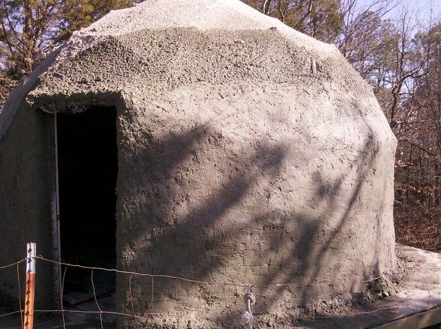
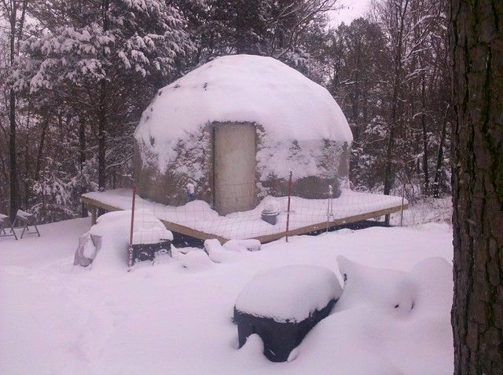
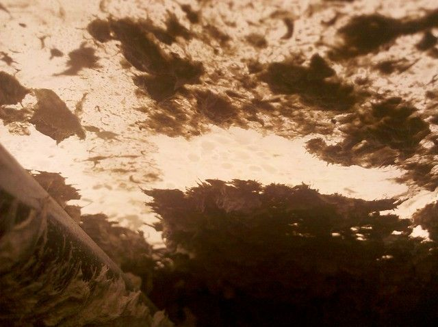
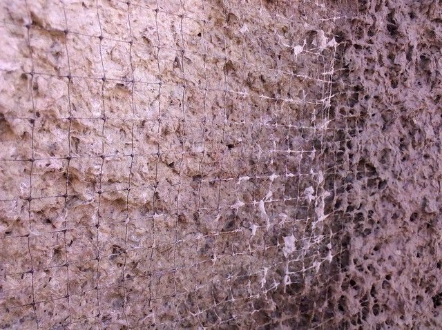
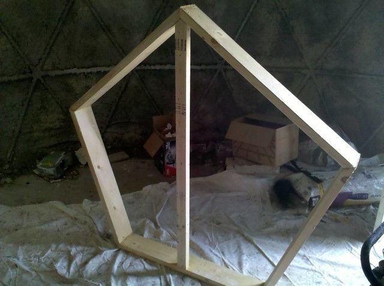
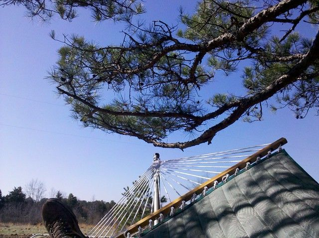

# Dome Progress Mar 4, 2011

If you have been reading along so far you might think that this is a journal of how I expect things to happen, followed by how they inevitably don't happen as expected. It has been cold and snowy for the past couple of months until last week, now it is in the 60's and quite nice. Papercrete is not really something that works well when it is raining or below freezing so I kind of gave up on it until the last couple of weeks.

The outside is done to the height that I can reach. It took about 150 gallons of papercrete to get it to this point. A month ago I put a thin layer on the outside and inside with the intention to add more when it dried. Because of the weather I never got to the "adding more" part and learned that while papercrete sticks well initially, after weeks of getting wet and drying out along with the thermal expansion of the dome as the temperature fluctuates, it starts to become unstuck where it is still thin. On the outside this meant chunks falling off in sheets, and on the inside it means that there are small pieces falling on me all the time. In case you were wondering, bits of papercrete in bed are quite itchy. This is only a problem when the thickness was basically just a thin film less than a couple millimeters in depth. There have been no issues where I managed to get a few coats on.

Before this all started I thought about putting a layer of chicken wire over the whole thing. If it had been cheap enough I might have but I thought it would be alright without it since papercrete is not really brittle. I expect that this is true, but a friend of mine pointed out that I could get a 7x100 foot roll of "Deer Netting" for about $15. This is basically the same as chicken wire except made out of light plastic. At that price I thought it could not hurt so I wrapped the whole thing in it on the outside of the first layer of papercrete. After that I sprayed until it covered it up then troweled it smooth. I am quite pleased with the result. It feels quite hard and solid now that it is dry. They make the same stuff as a 20x20ft net, so hopefully I will be able to do the top part with that this weekend (weather permitting). Then I will just have to let it dry and paint to seal it.

One issue is figuring out how to reach the top part. I am not quite sure how this is going to happen but I plan to try leaning a long extension ladder against it at a steep angle and hopefully I will be able to reach everything. I also made a skylight out of 2x6 lumber made into a pentagon with plexiglass stuck to it with silicon caulking. The plexiglass cost about $100 so I hope I don't have to re-do any of this. It is almost 6 feet in diameter, the idea is that I will cut away the shrink wrap in the center and put this over the hole like a cap. Then I can open and close it to allow for ventilation and access to the outside center and hopefully resolve the condensation issue. Also it will provide quite a bit of light and a good view of the stars at night.

Besides the dome we managed to get quite a bit done on the rest of the property so now we have a good road, electric, and water.

I think if I were doing this again (and I did not have to live in it as I was working on it), I would skip the shrink wrap and just cover the geodesic frame with one layer of chicken wire, and a few of layers of deer netting until I could just spray papercrete directly onto that. It would leak in the rain until it was painted at the end but it would have been a lot less trouble and would have saved several hundred dollars. If I was using shrink wrap (or pallette wrap) to seal it then I would have put a layer of deer netting under the shrink wrap as well as on the outside so that the first few layers would have had something to stick to.

Also... if you plan on making much progress when the weather is good you should probably avoid having a hammock nearby.

4 comments

Anonymous · March 10, 2011

Like your blog, want touild a dome myself. Darren

bhoult · March 10, 2011

Thanks Darren... hopefully my mistakes will save you some work. Good luck on your dome.

Anonymous · March 20, 2011

very cool idea

Sharin Barber · April 7, 2011

Great work and it looks wonderful!
