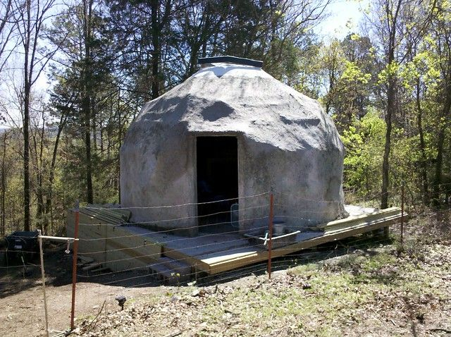
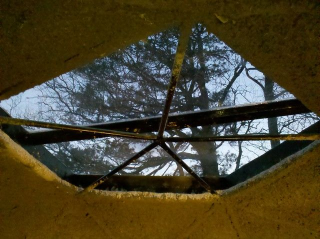
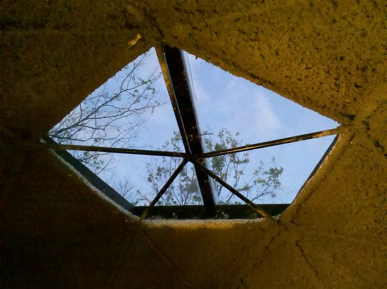
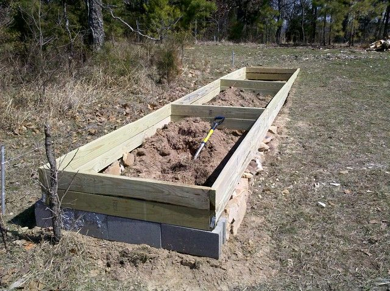

# Dome Progress April 6, 2011

So progress has picked up a bit now that the weather is better. For Arkansas right now and in the fall is about as good as it gets. The sun is shining and it is about 60 to 70 degrees F. I work my normal job as a programmer during the day from 1pm - 5pm so I have mornings until noon and evenings to work on this stuff.

The outside is now completely done except that I will probably do another outside coat to make it look smoother. It turned out that I could reach everything either by reaching though my skylight hole or by duct-taping a trowel onto a metal pole. The outside now has about four layers total and is about 5 inches thick.

The biggest improvement is the skylight. This is basically a wooden pentagon about 6 feet in diameter that is covered in plexiglass. I cut a hole around the top pentagon of the geodesic frame and the skylight sits on top of that like a cap. Before I put it on I made sure there was plenty of solid papercrete built up around the hole. While the papercrete was still slightly soft I set the skylight on top. The skylight weighs over 50 lbs so it sunk into the papercrete a little and made a good seal. I added more papercrete around the inside rim so that there is a lip to keep water out and to hold the skylight in place. When it dried I painted about a half gallon of UGL Drylok Latex Masonry Waterproofer onto the top of the papercrete to keep the water from soaking in.

It has been about three weeks now and we have had several good storms with better than 30mph winds. It has not had any trouble with leaking but it does make some odd buzzing / howling sounds when the wind is really strong. The first night the skylight was quite distracting, I could not sleep until about 1am because I wanted to keep looking at the stars.

Last weekend I sprayed three layers on the top inside above the trampoline. This is where I put a thin layer a couple of months ago only to have it slowly fall off in chunks while I was trying to sleep. Once you build up a little thickness it becomes a single solid piece that does not move or crack or flake off. The first layer is the hardest since without any netting it has to be really thin so that it does not fall off. Once it hardens a bit you can add a second layer which should make it fairly strong. I did the first in the morning and the second in the evening last Saturday, then I did a third on Sunday afternoon. It is now almost thick enough to cover the geodesic structure. I think two more coats and I can trowel it smooth and the top inside will be done except for painting.

I have a small street legal dirt bike that gets about 70 mpg (klr-250). With the price of fuel going up I am going to try to drive that as much as possible instead of my van which only gets about 18 mpg. So I decided to add a motorcycle-port to the dome. It is going to be a wooden frame attached to the back which I am going to try covering with just netting and papercrete to see how well it does as a semi-free standing structure. I will add some pictures of that when it is a little further along.

I should also add that we started a small garden. It does not look like we will be able to start the aquaponics before this fall so this will have to suffice until then. It is a "square foot garden" which is a really effective way to grow a lot of food in a small space. This one is 24ft x 4ft.

6 comments

Sharin Barber · April 7, 2011

I'm sure it will be a great view under the stars :)

Virginia Pykonen · April 10, 2011

Great blog! I'm very interested to see the progress on all of your projects.

I can't see where to subscribe to your blog, though. I really want to keep getting your updates. Help!

Virginia Pykonen · April 10, 2011

Oh-kay. Nevermind. I found the "follow" button. :D

Voydlander · April 10, 2011

Great stuff. The window really makes the dome seem more like a home.

bhoult · April 11, 2011

(virginia) ... thanks, I had meant to make those more prominent and had forgotten to actually do it.

Ernest · May 29, 2011

Keep us updated on waterproofing.
