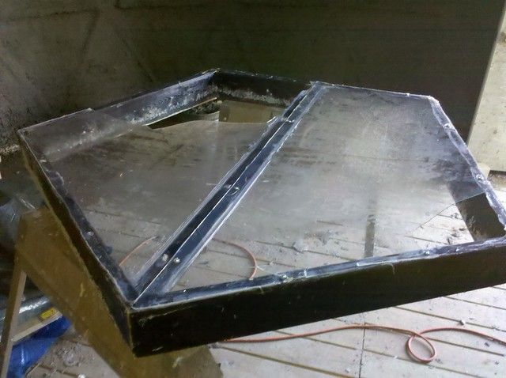
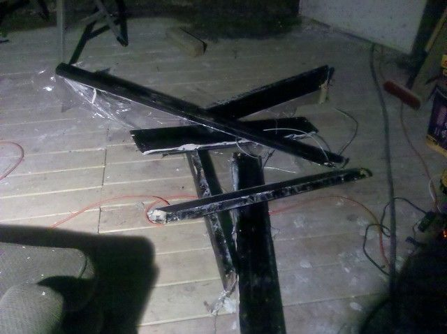
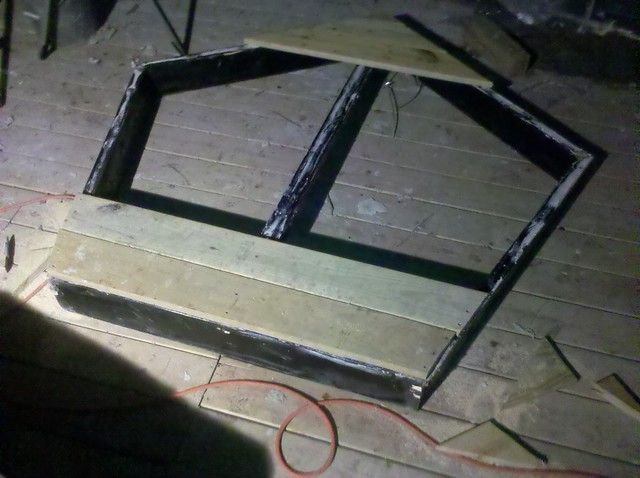
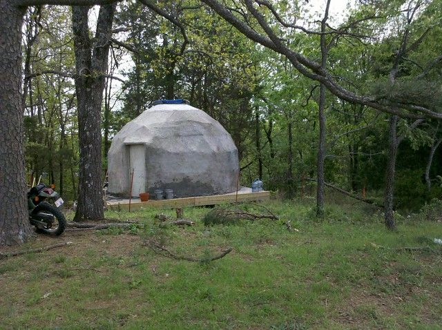

# Tragedy in Domeland.

Ah well... it could be worse.

I got quite a bit done last week, the inside bottom part is pretty much done except for paint, and I made progress on the motorcycle port. Last Friday I had finished spraying the inside so I left the skylight cracked a few inches so it could dry and went to work. Instead of the nice sunny day that was predicted it became cloudy and very windy. I went home after work to find that the skylight (all 70 pounds of it) had blown off and all the plexiglass had shattered.

Argh ... Depressing.

I stapled up a tarp to keep the rain out. Saturday and Sunday were marathon sessions that started early in the morning and went until midnight both days. I mixed and sprayed 250 gallons of papercrete, and after buying another $100 worth of plexiglass I rebuilt the skylight. I found out that if you pat the wet papercrete a few hours after you spray, it tends to flatten out and become more even. After several hours of patting, my hands were swollen and cracked from the cement. The next day I was sore all over, and was getting some kind of cold, so I decided to take a rest.

So last night I was sitting in my dome, admiring my fancy new skylight and reading a book when the wind starts to pick up. This time I was not worried since the skylight was closed and I had it tied to the frame with a thick metal cable. Branches started falling out of the trees and the gusts were causing the deck to bounce around, I went out to look around but dirt was blowing in my eyes and I was getting hit with small sticks so I went back inside. Then there was a ridiculous gust that looked and sounded like a tornado had hit. I have been in 70mph winds and this was much worse. It only lasted for about 10 seconds, but somehow it yanked my new skylight off, swung in around on the cable and smashed it into the dome hard enough to break all the glass (again) and splinter the 2x6 wooden frame into 5 pieces. This thing was held together at each joint with three 4-inch deck screws. Only one joint did not shatter, the rest were in pieces 40 feet down the hill. Where it hit the dome it bent one of the 3/4" conduit pipes, I am not sure how hard that was, but I weigh 300lbs and could swing from these pipes without them even flexing.

So much for relaxing. The wind was still howling and I now had a six foot hole in my roof. I stapled a tarp up as best I could through the hole, collected all the pieces of my skylight frame and started re-assembling them. The silicon sealer was still wet so I scraped that off as best I could, removed all the screws (most at the corners were bent, 5 had snapped). About three hours later I had a replacement skylight roughly done with a tarp stapled to it instead of plexiglass.

I am going with a different skylight design now since I can't afford the plexiglass. This time I attached 3/4" decking to the top leaving a window in the middle big enough for one piece of plexiglass (I had two before). I re-attached the cable and added a bungee cord in the middle. I am going to add two more bungee cords to the far side as well. It will not look as nice but at the moment it is all I can afford, and who knows how much more wind we have to look forward to. I guess this is the disadvantage of building on top of a hill.

On the bright side I did learn a few interesting things.

1. The dome does really well in high winds. Other than the deck shaking, it did not have any trouble at all.

2. The dome does quite well when hit with stuff... there were a couple of dents in the papercrete where the skylight hit. They were a couple of inches long and may have gone down to the shrink wrap layer. The branches did not cause any damage that I could see.

3. Papercrete is really easy to repair. I mixed three buckets this morning and just dumped it over and smoothed it out.

This morning when mixing papercrete to fix the dent, my home-made mixing blade broke. The bolt where I attach the drill sheared off. There were huge branches and trees all over the place and all the stuff that I left outside was blown somewhere down the hill. Like I said... an all round depressing week. And it looks like storms for the next seven days.

6 comments

Anonymous · April 22, 2011

Sorry about your skylight. Like the idea of two domes with insulation in the middle. Darren

bhoult · April 22, 2011

Thanks... I added four bungie cords on the new one, hopefully it will stay on now. They say another wind storm is coming next week so maybe we will find out.

I was thinking more of the two domes plan. In some ways I kind of wish I had done that. The reason I initially abandoned the idea was that the vermiculite I was going to put between them was going to cost too much. Now I am thinking that if I had put canvas on the outside of both dome frames and poured concrete or papercrete between them it may have been simpler. I had no idea that spraying papercrete to a sufficient thickness was going to take this long.

Anonymous · April 22, 2011

I was thinking about plastering the inside of the first dome, covering with papercrete for insulation, and then ferrocementing the outside of the second dome. But I worry about leaks in the ferrocement. Thanks for the blog, gets me to thinking. Darren

bhoult · April 22, 2011

That would probably work as well... I am guessing from the inside out then you would have plaster, papercrete/geodisic lattice, another geodesic lattice with ferrocement.

I am not sure how you would actually put this together though. I was thinking that if you attach canvas to the outside of both domes then it would give you a form to pour cement or papercrete into that would be breathable enough to allow the cement to dry. Then you could plaster or papercrete directly onto that. I think the geodesic pipes and some chicken wire would be sufficient to reinforce the cement if you used that.

Papercrete on cement as an insulator is a good idea though, especially on the inside to prevent condensation. I think if you wanted a cement dome then papercrete then plaster on the inside as you describe is a good idea.

I think painting the papercrete will be good enough for my purposes though. Plaster would be smoother, but I am not that picky.

Anonymous · June 7, 2011

What's happening at Domeland? Darren

bhoult · June 7, 2011

Darren: A lot is happening. I keep wanting to get it all done before I write another post but it seems like there is always more to do.

I have the painting done, and the floor in and am currently building the desk and shelves. I will try to post some pictures in the next few days.
