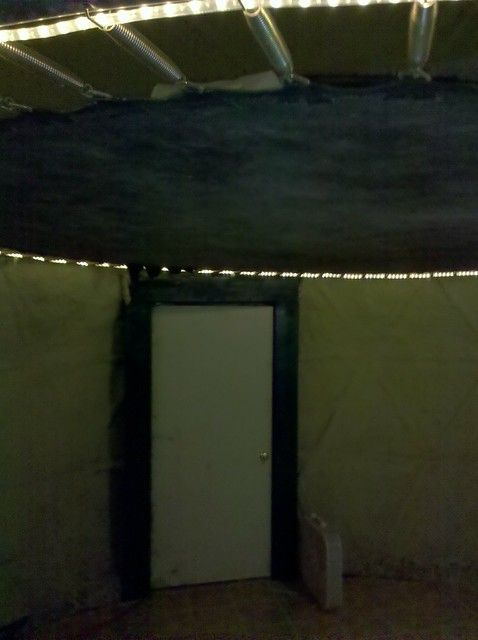
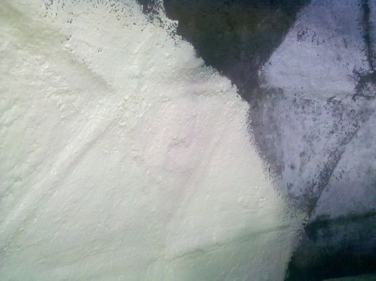
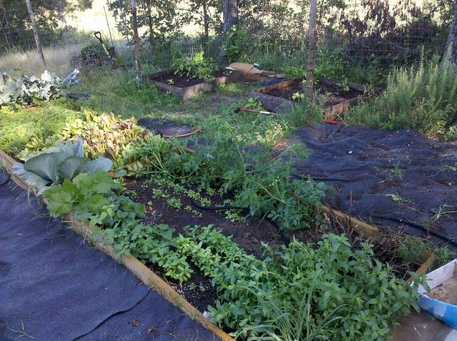

# Hello Again.

It has been a while since my last post... sorry about that. Life has been busy and much progress has been made however. The problem has been that I am so close to being in a "more presentable" state, so I keep wanting to get everything done before I write about it. However the closer I get to being done, the more comfortable it becomes and suddenly various other projects seem to be more of a priority.

Briefly, the interior is mostly done. I painted it all with Drylok stained a very light green and it helped considerably with the somewhat cave-like atmosphere. I will probably add windows someday, but until then it is nice and bright inside with the door open or just a few lights on.

I put a floor in, just having a deck seemed like it would be sufficient when I started, but there were a couple of issues... drafts and bugs... mainly spiders. I ended up putting down linoleum since I was given some for free. Now the dome is air-tight except for the skylight and the door.

I added shelves and desks and cleaned and painted everything. Installed a small portable air conditioner a tiny refrigerator and a decent sized freezer. Got a bunch of random cooking stuff. So now finally after seven months or so I am living fairly comfortably. Don't let this scare you off... I made a lot of mistakes that wasted a bunch of time and I only had half days to work on it. I was doing it by myself and I did not really know what I was doing. My biggest mistake was that I was living in it while I was working on it. You may be able to pull this off with a normal sized house, but with a 19 foot diameter dome there is just not enough room. I should have got a cheap travel trailer or something... it would have been worth a couple thousand by the time I was done. If you are thinking of doing this and like the idea of a dome, I still think it is the most practical, and least expensive option.

The final total on cost seems to be about $3200 or so. This is broken down roughly as follows:

$800 Deck

$300 Frame

$200 Cement for papercrete

$300 Paint and Drylok

$200 Wood for motorcycle-port.

$200 Skylight

$300 Desks and Shelves

$250 Trampoline

$650 Misc. stuff like tape, saw-blades, screws, nails, brushes, drill-bits etc.

The cost of tools was about $5000, which is somewhat embarrassing really since if I had had more patience I could have borrowed and found most of them used... but I was in a hurry and was thinking of it as an "investment". Hopefully that will pay off, but I have found that "investing" is often just an excuse to buy something that you want when you know you don't really need it.

It is also worth considering that the cost of just the structure is only about $500. If I used an earth or stone floor and skipped the trampoline it would have been much less expensive... but I really like the trampoline :).

It is summer now, we have had a couple 100+ degree days, and the usual Arkansas humidity. I found that the dome is mostly comfortable just using a fan. The main source of heat was actually the skylight, the sun shines in and turns it into an oven, so I had to block the skylight with some metallic looking bubble wrap and Velcro I think if I break the plexiglass again I will try some tinting like the stuff they use on car windows. At night if it is hot and humid I use the air conditioner. It is a standalone 10,000 btu unit that is kind of worn out, so it probably only manages about 6,000 btu at the moment. The nice thing about having so little space is that it takes very little to get it comfortable, which means that I only have to run the AC when needed and it only takes about 10 minutes to get comfortable.

The exterior I will probably paint with whitewash perhaps stained with coffee. I experimented a little with putting a drip hose on the outside of the dome so that it would provide evaporative cooling. The idea being that if I did not seal the papercrete completely it would absorb some moisture that could then evaporate and cool the interior. There was about a 5-10 degree difference depending on humidity and I am undecided weather that is enough to justify messing with it. The whitewash should allow a little permeability and it is much less expensive than paint in any case... probably more durable as well.

Apart from the dome the garden has been going well... so much so that I am tripling the size of it this week. It is being shared by about five people so that is the priority for a little while.

Next project will probably be an outhouse shaped like a pyramid. Then begin terracing for the hot-tub and building the aquaponics dome.

Not sure what other details people might be interested in, so feel free to leave questions in the comments. I am planning to borrow a better camera when things are all presentable and take a bunch of pictures so hopefully I will get that in the next few weeks.

9 comments

Anonymous · July 19, 2011

Sorry it took me so long to post a comment, but I've been super busy. I finally got a job and am putting together my grubstake. Looking for offgrid land in NW Arkansas. The dome is looking great and I can't wait for more pics. Do you use a composting toilet, and is your motorcycle your only transportation? I have so many ? Darren

Anonymous · September 9, 2011

The dome looks great. However, as you built your papercrete form on top of a membrane rather than on your frame itself, would it be possible to remove the frame itself? Now that the papercrete is solidly set, I would think you could re-use the frame to build innumerable domes.

bhoult · September 9, 2011

Well, I papercreted both the inside and outside of the frame and membrane. So at this point I could not remove the frame. Besides that I have probably 500+lbs suspended from it 8 feet up (trampoline + me + storage). The papercrete would probably be self supporting, but would not hold that much weight.

I thought about doing two frames and pouring cement/papercrete between them... in that case I would build it so that at least the outside frame could be removed and reused.

Anonymous · January 28, 2012

Did you have any problem with the papercrete sticking to the lath (wire) on the ceiling of the dome when you were putting it up?

bhoult · January 30, 2012

Anonymous: Well... it depends on what you mean by trouble. It was not easy, but it did work. Part of the problem in my case was that there was no wire for the papercrete to stick to. I just sprayed it directly onto the plastic shrink wrap. It stuck but only in very thin layers. Then the key was to quickly build it up over the next few weeks before temperature changes caused it to separate from the shrink wrap and fall off. That way it was supported by the geodesic frame instead of adhesion to the shrink wrap.

I would use deer netting on the inside of the shrink wrap to help with this if I were doing it again.

Anonymous · April 9, 2015

Hi Brandon,

I really liked your posts on the dome you built. I've been wanting to do something similar and have been searching the internet for weeks trying to find others who have done something similar. It looks like you are it. Can you make another post on how things have been going over the last few years living in the dome? How has it held up... What other improvements have you made... If you were to make another one now, what would you do different. I know you already addressed this one, but I'd like to know if your opinion has changed over the years. I've read from others that one of the issues with papercrete is mold in the paper. Have you experienced any issues with mold on your end?

I would like to build a 32' 3/4" EMT dome and cover it with concrete or earthbags, but I'm concerned about the weight and cave-ins. I suppose I could cover the dome shell with rebar and then put concrete over it but I can't find anyone who has done that as well.

Thank you so much for these posts and I look forward to an update!

Myers

bhoult · April 9, 2015

Myers: Thanks for the comment. I did the same when I was thinking of building this. I looked all over the place and could just find bits and pieces of what I was wanting to do. That was really my main motivation it making the blog in the first place. So thanks for letting me know all this typing was not a waste.

A couple people have asked for an update and some interior pictures. I plan to do that soon, and will probably answer your questions more generally there but I thought I would go ahead and answer them specifically here before I forget.

How has it held up: Quite well I think. There have not been any major issues. The dome was directly hit by lightning a few months ago. Damaged a bunch of electronics inside, and reduced my phone box (on the outside wall) to blackened bits scattered in a 50ft radius. It blew a 1 ft chunk of papercrete out of the wall, but I just mixed a small batch with a blender and slapped it on. It also caught my Air Conditioner on fire, which went out after a few seconds. I had to replace that which involved pulling it out, throwing it down the hill, cutting some papercrete out to accomodate the new AC and then mixing another blender full to seal the new AC in.

I have noticed some small flaked falling off on the outside. I never sealed the dome on the outside against water. I painted some pure cement powder and water on to reduce absorption, but I wanted to try making a swamp cooler originally, so just used whitewash to color. I think that when it is wet and then freezes it causes some of the papercrete to flake off or split. It is not enough to cause concern, but a few small flakes have broken off on the outside. I intend to paint it this summer whenever we get a good span of dry days.

On the inside there are some cracks in the papercrete, but they are small and don't cause a problem. I think they are from the difference in thermal expansion between the metal frame and the papercrete. It is also possible that it is from slight movements of the trampoline when I climb in and out every night since it is just cabled to the underlying frame. I think thermal expansion is more likely though.

I have not made many other improvements, it has been quite comfortable as is. What work I have done is on the giant hot tub, which it turns out is a never ending project. That and the water heater.

If I did another one it would not have the wooden deck. This is starting to look a little weathered (after four years) and will probably rot and collapse eventually. It was the most expensive and weakest part. The storage underneath is nice, but I think a stone or cement or even dirt floor would have been better.

There are also a couple of giant pine trees right next to the dome. They are pretty and provide shade, but every time there is a storm I wonder if they are going to squish me like a little egg. I would not build under such huge trees on the top of a hill in tornado country in the future. It handles high winds quite well, but if you live in a windy place I would suggest you build a little down the hillside or behind a wind break of some sort.

There has not been any problem with mold at all. No water has ever leaked inside and the outside does not seem to want to mold either. I actually tried to grow some moss on the outside at one point. Did not work out... either too much sun or the whitewash was too much for it. I live in Arkansas which is a pretty humid place, I am pretty sure if it has not had trouble here then it unlikely to be a problem.

bhoult · April 9, 2015

(continued)

I plan to build a more permanent dome at some point. It will probably be a little wider (like 25ft instead of 19) and will probably be two stories + the trampoline loft as I have now. The first story would be earth bag since it is much stronger and will support the next story which will be papercrete blocks (not sprayed like the current one). I would much rather work with papercrete over earth bags, but each has it's own strength. Papercrete insulates really well and is easy to work with. Earth bag has thermal mass and is stronger. I may even do cordwood on the exterior or as a workshop at some point. Also I would use palette wrap instead of shrink wrap (but I think I mentioned that elsewhere).

If doing cement I would probably make two metal frames with one being a foot or two wider than the other. Place the smaller inside the larger, wrap them both in palette wrap and pour cement between them. The EMT will serve the same purpose as rebar I think. As long as the shape is correct all the tension is inside the cement and it will not collapse. This is the principle of arches that has been use since roman times. Basically think of chain hanging between two points. Each link is in perfect tension. If all the links were welded together and then it was flipped upside down then you have the perfect arch that if spun around the Y axis gives you a dome. As long as the chain would be inside the inner and outer wall of the dome you build then all the forces are balanced to push on the walls so it will not fall unless is can be crushed. Cement is hard to crush. Therefore the dome shape is about the strongest structure that it is even theoretically possible to build.

Hope this helps. Will write an article later. Need to clean up a bit and take some pictures... and I am really lazy. Keep me posted on whatever you make.

Anonymous · November 20, 2016

I have a papercrete dome on terligua ranch.id like to ee a big pic of yours from the outside
