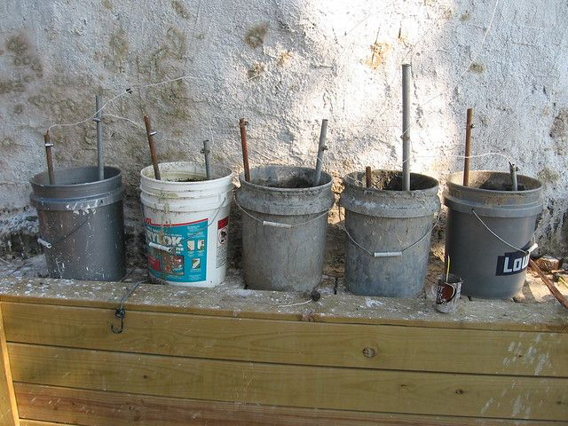
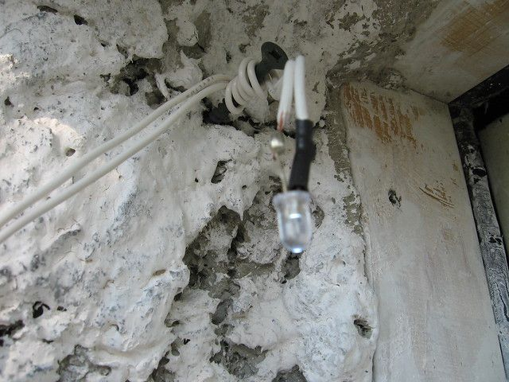
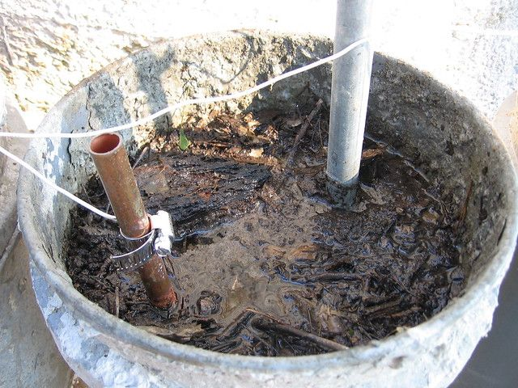
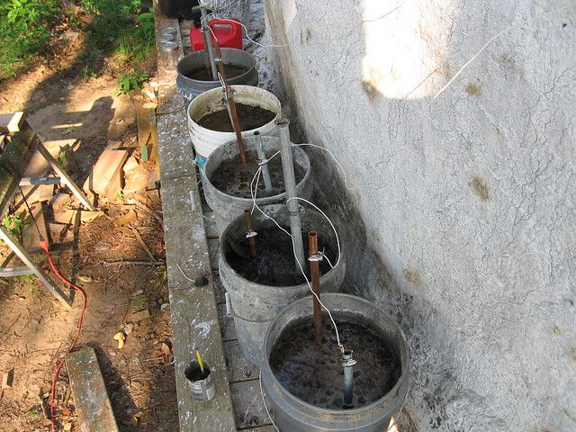
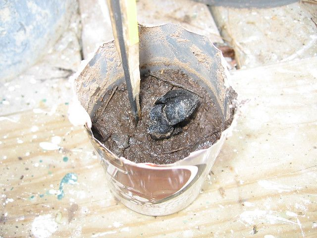
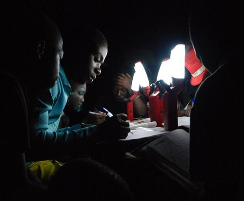

# The Humble Earth Battery

When I was a kid, I made a potato battery. Basically I stuck a galvanized nail and a copper wire into a potato and hooked it to a light. This was interesting, but the amount of electricity was so small and the slowly rotting potato was so unpleasant that I wrote it off as being fun but totally impractical.

So now being a little older I come across the concept of the Earth Battery. This is pretty much the same as the potato battery except that you just stick some copper and galvanized steel in the ground somewhere and get about 0.5 volts of power with very low amperage. I also now know that you can increase the voltage by putting several in series or increase the amperage by wiring them in parallel... or increase both by doing a combination of the two.

There is also a little gadget called a joule thief http://en.wikipedia.org/wiki/Joule_thief that will boost the voltage at the cost of amperage. You can apparently run over 100 led's or even a fluorescent tube with a single earth battery cell using one of these.

So I wanted a light for my doorway, and I had a couple of old LED flashlights. The LED I had required three volts to function, so I thought I would just keep hooking more cells up in series until it ran the light. I had some copper and galvanized pipe that I cut into pieces a few feet in length, and I had some plastic 5-gallon buckets.

Basically, all I did was fill the bucket with dirt, add water to make mud, push a copper pipe in one side and a galvanized (zinc) pipe in the other. This generated about 0.2 volts. I added some salt and vinegar (about a cup of each) and the voltage went up to about 0.6 each. I hooked 5 of these up in series and ended up with about 3.2 volts at 30 milliamperes = 0.096 watts.

Now 0.096 watts is not much power, a AA batter is about 1.5 volts at 4 amps or about 6 watts, so it would take about 60 of my buckets of dirt to generate the same current as a AA battery. However, there are a lot of low power appliances that can make use of this, such as small lights, radios, telegraphs and fans to name a few. These are not that important here, but are vital in most third world countries, and may become important in a SHTF scenario here someday.

For comparison, I have a 50 watt solar panel worth about $250. So it would take about 2600 buckets (or cans) of dirt to accomplish the same thing, except that they work 24 hours a day instead of about 6 for solar so really it would only take 650 cans of dirt to accomplish the same thing as a $250 solar panel.

The real question is how long will it last. I have had it running now for about 48 hours and it looks about the same. If it lasts for a week it may have potential, if it lasts a month it will definitely be useful. In any case there are several factors that will influence this that I will have to play with. I believe that if I stuck the pipes directly in the ground with several feet of damp dirt between them (instead of in my buckets) then it should last indefinitely. I also made a smaller lower cost version by cutting the top off of an aluminium soda can, filling with mud and sticking a pencil lead in it. This version actually worked a little better on voltage (about 1 volt per can), but not so good on amperage (about 0.5 milliamperes). I tried substituting an old lump of wood charcoal that I pulled out of a camp fire and it produced about the same voltage but about 6.3 milliamperes... much better, I suspect this is due to the increased surface area of the lump of charcoal.

I will post more after I try a few more combinations and see how they work over time. I also found some similar methods of generating electricity from static, radio, and cosmic rays... basically from the air, that I intend to try out. For more information start here: http://en.wikipedia.org/wiki/Earth_battery and then do a youtube search on "earth battery".

My parents were missionaries in Kenya, E. Africa when I was a kid. Perhaps that is why it seems so strange to me that such a basic technology that we have known about since 1841 has not been utilized where it could make a huge difference. For the average person living in a third-world country the day is only as long as there is daylight, and most of that is spent working to try to stay alive. If they want to go to school they often have to do it in the evening, usually using a campfire or a kerosene lantern for light. Both of these are really hard to read by, are expensive, produce lots of toxic fumes and sometimes burn their house down. Fires cause all kinds of lung and eye problems, and babies often roll into the fire when someone is not paying attention and spend the rest of their lives covered in burn scars. Often the solutions to this such as solar panels are too expensive to buy and then require rechargeable batteries to maintain. However the problem can apparently be solved with six empty aluminum cans some lumps of charcoal, dirt, water and about 2 feet of small wire. If you know people helping in third world countries please let them know.

part 2 here

15 comments

Anonymous · September 1, 2011

Nice to hear from you again. How is the dome? Darren

bhoult · September 1, 2011

Nice to hear from you too. The dome is good. I have not done much on it lately, I am a little obsessed with decreasing my electric bill at the moment... it is not high, but still. I whitewashed it a few weeks ago for about $15, which made it substantially cooler kind of surprisingly so. I need to do a post on that soon I guess.

Hope all is going well for you and your projects.

Anonymous · September 1, 2011

I really wonder here if the dirt is doing much in this battery process. Maybe its just the pipes, salty or acidic moisture. The dirt merely holds up the pipes and holds the moisture.

bhoult · September 1, 2011

Yea... I suspect the same could be accomplished without the dirt. According the the wikipedia article on earth batteries and galvanic series of metals the dirt is just a medium to hold the water which conducts the current from the metals. There is another current http://en.wikipedia.org/wiki/Telluric_current which can be picked up if the earth battery is big enough, but mine (so far) is not.

Anonymous · January 18, 2012

Hi -- have you seen this?

http://www.youtube.com/watch?v=_zMAWztZ6TI

bhoult · January 22, 2012

(Anonymous) Thanks for the link to the video. I had seen that a while ago but it is worth pointing out. Such a simple idea that works so well.

oshwin · January 18, 2021

Thanks for such a pleasant post. This post loaded with lots of useful information. Keep it up. If you are looking for the best information and suggestions related to copper nickel valves manufacturers in india then visit Oshwin Overseas.

greatmetal · January 19, 2021

Thanks for shared that blog with us. If anyone here searching Duplex Pipe manufacturers then visit Great steel & metals.

Manifold Pipe Solution Inc. · January 20, 2021

Hi there to everyone, the contents present at this web page are actually amazing for people knowledge, well, you can also visit inconel 625 bolts for more fastenersonline related information and knowledge. Keep up the good work.

nickelalloysonline · February 22, 2021

Your blog is awfully appealing. I am contented with your post. I regularly read your blog and its very helpful. If you are looking for the best Stainless Steel Allen Bolts, then visit nickelalloysonline. Thanks! I enjoyed this blog post.

duplexpipessteel · March 10, 2021

Wonderful blog, Which help us to understand information easily and fast. Keep sharing more info on this duplex pipe manufacturer Visit Perfect Impex to more relevant services.

siddhagirimetal · March 17, 2021

Thanks for discussing, great news. This type of news is really appreciative. I have great news. Your article is very informative, Visit stainless steel threaded rod. Thanks for sharing.

Jessie · November 3, 2021

I am amazed with your work. Can't imagine how you do it on your own. Thank you for sharing your project to us, inspired me to do my own thing as well not but of more landscapes.

- Jessie, https://landscapingcarlislepa.com/

Regal Sales Corporation · December 14, 2021

Really helpful down to the ground, happy to read such a useful post. I got a lot of information through it and I will surely keep it in my mind. Keep sharing. If you are looking for some useful data and information regarding astm a105 flange then visit Regal Sales Corporation.

vishalsteel · January 4, 2022

This is a great article with lots of informative resources. I appreciate your work this is really helpful for everyone. Check out our website finned tubes manufacturer in india for more vishalsteelindia related info!
