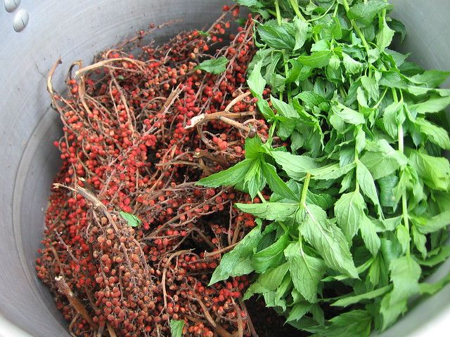
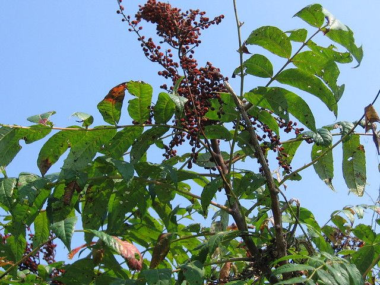
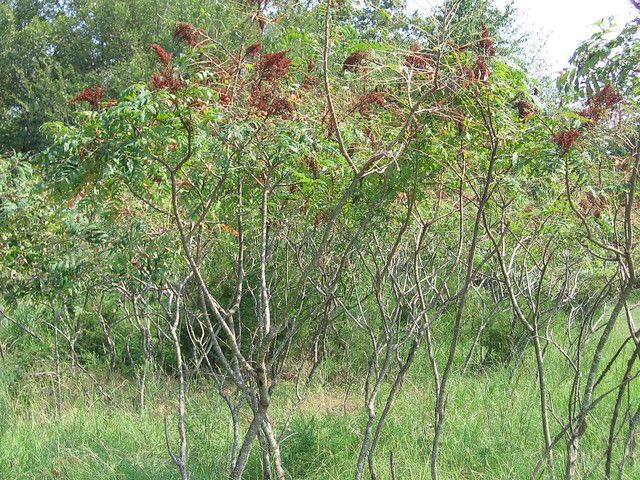
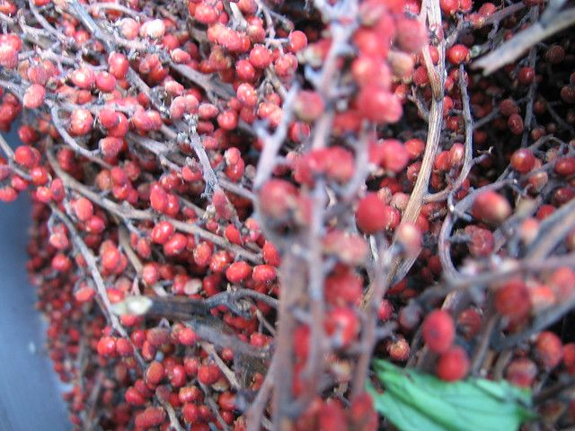
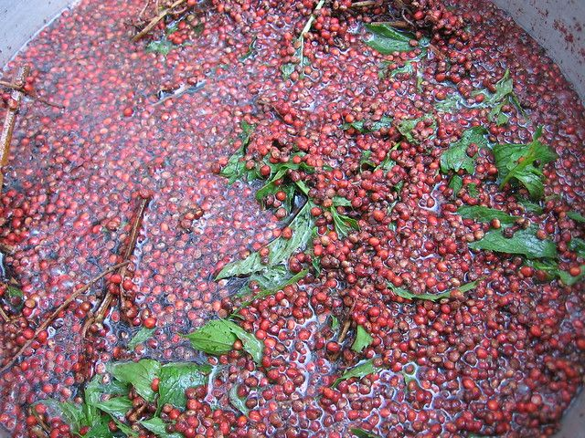
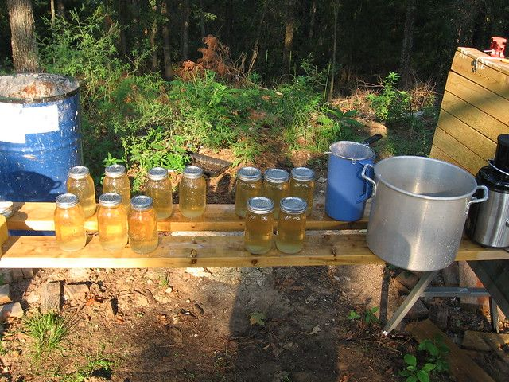
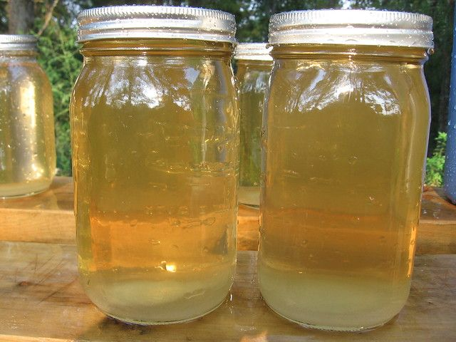

# Foraging: Sumac Lemonaid

Well, the dome is pretty comfortable and it is still kind of hot outside so I took a break for the past couple of months to work on other smaller projects.

My long term goal is to get to the point where I am living off $2 a day, fairly comfortably, in the USA. This is actually what the majority of the worlds population manages to live on. I will likely spend over $50,000 in the next few years getting to that point but after that I hope to spend the majority of my income on things with greater long term importance than just myself. I could insert a paragraph about the impending economic collapse or say this was about personal survival, fear is a great motivator as the media knows well. I wish that was not part of my personal motivation, unfortunately it is... but I don't want it to be.

I realize that for those living off $2, investing $50,000 up front to make their meager budget practical is not really an option. This blog is probably not going to help them much, but if I can convince a few of you to reduce your expenses and get out of debt, it will free up your time and money so that you can make the changes in the world that you would like to see. Whatever those changes may be I think it will be an improvement.

So with that in mind I decided foraging was going to be part of my long term strategy. Foraging is basically finding food around you growing wild. It involves a lot of new and unfamiliar flavors, and can be dangerous if you eat the wrong thing. With that in mind, I have started reading books and blogs and am going to try and go into it slowly and carefully.

Which brings us to Sumac. This stuff grows wild all over the world and you can use the red berries to make tea, or lemonaid, or a sour acidic spice. This is not to be confused with poison sumac, which has white berries and is kind of like poison ivy, make sure the berries are red. Look carefully at the pictures, the shape of the leaves and the berries, you can click on them for a bigger version. The new chutes are apparently edible in the spring... so I will have to try that when spring gets here. But now (after July) in Arkansas is the perfect time for the berries and there is a patch of them a few hundred feet from my dome.

To make the tea you soak the berries in cold water for 30 minutes to a few hours depending on how strong you want it. You don't have to remove the berries from the stalks, just throw the whole thing in. I did this as a kid in hot water and it turned out terrible. Hot water apparently leeches out all the bitter tannin, so use cold or room temperature water. After you add the water reach in and crush the berries with your hand to bruise them a bit. Finally after they have sat for a while, filter it through a cloth, or paper towel or coffee filter into a container add sugar if you want (I use 2 spoonfuls for a large mason jar) then refrigerate or microwave and that is about all there is to it.

In an attempt to keep with realistic expectations I won't say that it is the best thing ever... but at the same time I will say that it is quite good. Certainly the same quality as something like red-zinger herbal tea. It is good enough that I have gone through the process three times now and keep a refregerator full of the stuff... very refreshing.

I also add some mint at the same time. If I had some stevia growing (which I don't this year) then I would probably add that instead of sugar. Sumac is very high in vitamin C which is quite important. The early pilgrims often died from scurvy just because they ran out of lemons, while this stuff grew all around them and would work just as well.

Apparently the berries dried and ground up are also used as a spice. Some articles claim that in Mediterranean countries it is used as a table spice as common as salt and pepper. It has a sour and slightly bitter flavor that goes well with fish or grilled meat or rice dishes.

Anyway... sumac... good stuff. Other things I have tried, including grass seeds, new pine chutes, and the inner bark of a pine tree were not so good. And the new tips of green briers are ok but not great. I will try to post the good stuff when I find it, but if I was hungry enough I expect it would all be good.

Here is the finished product... which will last me about a week or so.

While I am on the subject, it is not wild but sweet potato leaves are also very good. Basically you cook them like any green and they taste great. Very common in asian countries but almost unknown here. Sweet potatoes grow very well in hot climates and given a chance will cover an entire area year after year with almost no maintenance. I would advocate growing this stuff instead of grass in your yard. If you needed to you could feed your whole family with sweet potatoes and sweet-potato greens and have most of your nutritional needs taken care of. Just a thought...

4 comments

Anonymous · September 2, 2011

I am leaving Saturday morning on a trip (vacation) to Arkansas and Missouri to look at some land. Can't do much more than prep supplies and building materials till I get the land. What do you think of North center state Arkansas. I also am very interested on living on two dollars a day. Thanks, Darren

bhoult · September 2, 2011

Darren: Northern Arkansas if generally quite nice. If you are looking for a larger city Conway is fairly nice with a growing economy and a short commute to little rock. Mayflower is right between conway and little rock but is more rural and kind of trashy for the most part with the exception of crappy lane which has some land for sale that I almost bought a while back. It is completely surrounded by game and fish land and they are selling 1 acre lots for about $10,000 (kind of expensive I know). Here is a map http://maps.google.com/maps?q=Crappie+Ln,+Conway,+AR+72032&hl=en&sll=34.804783,-92.312622&sspn=4.234694,6.707153&vpsrc=0&t=p&z=15

If you mean further north, the buffalo river area is beautiful, you might consider doing some canoeing there on your vacation. Rentals and shuttles are available. Bull Shoals and Mountain Home are both really pretty towns with lots of outdoors stuff and fishing.

I am in the Russellville area, if you end up coming through here I would be happy to meet you for coffee or give you a tour of the dome such as it is. Email me if you want to meet up.

Enjoy your vacation.

Anonymous · September 2, 2011

I would love to see the dome and / or pick your brain if you don't mind. I was going North out off Hot Spring on my route. I don't have a e-mail address but My phone # is 316 305 3714 if you want give me a ring or a text. Thanks, Darren

bhoult · September 2, 2011

Darren: I tried calling you but did not get an answer. Feel free to call me whenever at 479-264-7511. It sounds like you will be going right through Russellville if you are going up highway 7.

Just give me a couple of days notice and I will give you directions on how to get here.
