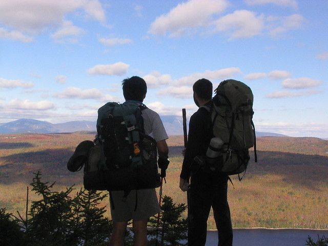

# Hiking/Backpacking Notes

In 2004 I through-hiked the Appalachian Trail. Both before and after that I took a lot of inexperienced people on weekend hikes so at some point I made some notes to give out before we left.

I thought these may be useful to anyone who is either preparing to go on a hike or making a "bug out bag", so here it is... some of the links are old and may be broken so let me know if I need to update them.

HIKING NOTES

For more information contact Brandon Hoult - bhoult@gmail.com 479-264-7511

In 2004 I through hiked the Appalachian Trail. I have lots of pictures here: http://www.flickr.com/photos/bhoult/collections/72157604127646199/ if anyone is interested. It is a cross country 2174 miles from Georgia to Maine almost entirely composed of going up and down mountains for about 6 months. Prior to this I had done many weekend and week long hikes and thought I knew what I was doing. I trained with a 100lb pack for 5 years doing about 12 miles a week up and down a 1000ft hill. I quickly discovered that I did not know as much as I thought I did. I bought heavy duty equipment “that would last” and started the AT with a 85lb pack. While I did finish, I changed a lot of my attitudes about what is “necessary”. If I did it over again, my pack would be no more than 30lbs preferably less than 20lbs, and it would be a fun walk instead of a death march. The single most important variable on a long distance hike is weight.

This is an overview of equipment you may want to consider. Keep in mind that you want to bring as little as possible, and what you do bring should be as lightweight as you can make it. Every extra pound you carry for 100 miles will take the equivalent energy of carrying 100 lbs for one mile.

You should be able to get down to less than 30lbs which includes a week of food. Some people have hiked the entire Appalachian Trail (2174 miles) with less than a 20lb pack. You will find yourself wanting to carry all kinds of stuff “just in case” which will make it more than 30lbs. Resist the urge, it will make the difference between an enjoyable hike and a death march where you are likely to be injured.

FOOD

The best tasting, lightest, most nutritious food I have found is the freeze-dried meals made by Mountain House. These are available individually or in bulk here or here. You can get breakfast, lunch and dinner for 7 days for $124 or you can get them individually for about $5 - $7 each. The only disadvantage to the bulk packs is that they will have to be repackaged into zip-lock bags while you can just add boiling water to the individual packs.

Other foods that work well are the rice and noodle Lipton-sides, ramen noodles, instant mashed potatoes, granola bars, gorp, instant oat meal, macaroni and cheese, cheese, tuna packets, summer sausage, soup mixes, and anything dried. These will all take a little longer to prepare and will be heavier than the freeze-dried stuff, but will be a lot cheaper. Also bring lots of candy bars or power bars or gorp to snack on while you walk.

Coffee, tea, and hot chocolate, and hot cider mix are also really good when you get to camp, and Gatorade powder is helpful during the day if you want to mix it with your water. I usually have one Lexan bottle for flavored drinks (hot and cold) and one for just water since in spite of what they say, the bottle always ends up keeping the flavor of whatever you put in it.

EQUIPMENT (General)

Most stuff you can get at Walmart, but you can get much higher quality, lighter, more durable equipment by ordering online. Some good places to look are REI.com and Amazon.com. REI good for browsing, but Amazon might be a little cheaper. Also Amazon seems to have a better variety and you can usually get everything in one place. Everything in the "Award Winners" section at REI is gong to be some of the best you can get. REI Award Winners

LIGHT

LED Lights generally work the best as you will probably only use one set of batteries for the whole hike. If you bring a non-led, make sure you have extra batteries. Head lamps are more convenient than hand-held as they leave both hands free so you can read/cook/whatever. You can get a cheap LED headlamp at Walmart or Lowes for < $10. If you want a really good one I highly recommend the Petzl Tikka XP

WATER

Lexan Bottles make good almost indestructible containers that you can pour boiling water into without worrying about it melting. You should have at least one of these. Empty Gatorade bottles work well also and are lighter and cheaper than the Lexan bottles. Plan to carry at least two quarts of water if streams are plentiful, and more if not.

You will be re-supplying at creeks along the way, so you will need to purify your water. If you take the risk of drinking untreated water you can come down with several illnesses that can put you our of commission for weeks or even months, like giardia. Many people consider it safe to drink out of clear cold springs coming directly out of the ground, but will treat any creek water no matter how clear. There are several options for this. The lightest and least expensive is probably Aquamira. This is a chemical treatment. It has the disadvantage that you have to wait 20 minutes before drinking the water. There are other chemical treatments but Aquamira tastes better than any of them that I have tried.

There are also various pump filters, these are nice since you can drink the water immediately but are kind of heavy and bulky. You also have to be careful not to contaminate the hoses by letting the intake hose drip water onto the out hose.

I kind of like the steripen, which is a UV water treatment. It uses batteries and there have been complaints about it being unreliable so have some aquamira as a backup. It can only be used in clear water, but you can drink immediately, and there is no chemical taste.

Bring some coffee filters to pre-filter water before you use any of the above, it will get most of the larger stuff out and extend the life of the filter. There are also various filter straws that can be used in emergencies. My favorite combination is a filter straw with some aquamira and coffee filters. If you need water immediately then use the straw, otherwise use the aquamira and if it is really bad then use both.

It is also a good idea to bring a small bottle of bleach. You can use it to clean your bottles and filters and in an emergency a couple of drops per litre will purify water after an hour or so.

Also if it is hot outside consider adding Gatorade to your water since it will both give you energy from the sugar and keep you from getting heat exhaustion and cramping from a lack of salt and potassium. If you sweat a lot and are going on a really long hike then consider potassium tablets.

CLOTHING

You should only bring at most two sets of clothing (shorts, t-shirt, socks, underwear). The one you are wearing and possibly one other. Your rain clothes could count as your one other that you can wear while you are washing what you hike in. This may seem odd, but clothes are bulky and heavy and everyone will smell bad anyway. In general bring stuff that is light and synthetic. Cotton dries slowly and is cold when wet.

If it is cool outside you will probably also want a light jacket. Microfleece works really well, is light, packs small, dries quickly, makes a good pillow etc. You will probably not need this when walking but it is good to have at camp. Also remember your sleeping bag is what you will use if you get really cold. You may want to bring some lightweight microfleece sweatpants to wear at camp as well.

RAIN GEAR

It will probably rain. When it does you will be walking in it. Unless it is really cold the easiest thing to do is just get wet... as long as you are moving you will stay warm. When you stop you will want something to wear that will keep you dry. There are all sorts of different jackets and pants that you can get for this. The more expensive ones use Gortex which has some breathability as well as being waterproof. If you sweat a lot this will probably not help, but in theory if you just sweat a little it will still evaporate through Gortex while you are standing in the rain. REI has all kinds of raingear you may want to look at. There is also cheep plastic raingear at Walmart for about $10, which should be sufficient for standing around camp. It is not breathable, and you will not want to hike in it, but it will work. Alternatively you could use a poncho which can also cover your pack and serve as a tent, although it will do all of these badly. Oddly enough, a small umbrella works pretty well for hiking in the rain. You poke the handle in the sternum strap on the pack and put the umbrella on your head like a hat. Looks funny, but I was surprised at how well it worked.

Keep in mind that if you are hiking in the cold, as long as you are moving you will be warm, but a few minutes after you stop you can get extremely cold. I was hiking up a 4000ft hill in a sleet storm in below freezing weather wearing just shorts and a t-shirt. I was fine until I got to a shelter at the top but a few minutes later I could not feel my hands and I could barely get undressed and into my sleeping bag. If this happens you are on the verge of hypothermia, try to get dry and eat something as soon as possible to help your body generate heat.

SHOES

DO NOT WEAR NEW SHOES! Make sure you have broken in anything you want to walk in. Especially if you have leather boots. If possible they should be ½ to a full size larger than you normally wear, your feet will swell and you will have heavy socks. There should be at least an inch or so extra in the toe so your toes do not hit the front when you walk downhill. I would recommend something light and comfortable, it helps if the soles are stiff (less rocks poking your feet) and if they are waterproof (there are sprays to help with this). I have had really good experiences with stuff made by Merell and Lowa. If you can easily bend your shoe in half you may want to consider insoles. These will stiffen the bottom and make them generally more comfortable. Superfeet work really well for this. Socks are also very important. If you get nothing else you should buy good socks. I highly recommend Bridgedale. You should also get a sock liner, these are basically thin synthetic socks that you wear under your heavy socks. They tend to keep you from getting blisters. You can use thin nylon dress socks, or panty-hose for this purpose, or you can buy sock liners.

You may also want to bring something to wear in camp and when crossing creeks. There are several brands of foam rubber shoes "Crocs" that are perfect for this. But sandals or flipflops will also work. You should have one pair of socks to hike in and another to wear to bed and in camp.

If you do any kind of long distance expect your feet to hurt. A lot. People on the AT routinely lose toenails and treating blisters is a constant ritual. In general take your shoes off and air out your feet whenever you get a chance. Keep toenails trimmed, remove dead skin from blisters as soon as possible, make sure your shoes don’t have any rocks or sticks in them, make sure your socks don’t have any wrinkles in them before you put on your shoes. Gold Bond powder can help a bit with your feet and chafing elsewhere.

SHELTER

The most common option is a tent, check the award winners at REI. I prefer a hammock myself... Hennessy makes some really nice ones. The lightest option is a tarp get a sil-nylon one if possible. Tarps are a little harder to set up so practice in advance, and most don't have bug netting or a floor but they are inexpensive and very light and versatile.

SLEEPING BAG

The ones at Walmart will work, but are usually too heavy and bulky. Down bags are the most expensive but are also the lightest and pack the smallest but don’t work well when wet. Good synthetic bags are almost as light as down and are a lot cheaper, and work better when wet... but they are also more bulky. Check REI for various types of sleeping bags. You may also want to get a compression sack to keep the bag dry and make it as small as possible when packed. In general a 20 degree bag should be plenty in spring and fall. A 45 or up will work in the summer. You may want to wear a jacket or get a bag liner, or fleece liner (at Walmart) which will make it a bit warmer.

MATTRESS

The cheapest route is to get a foam pad at Walmart for $3. Inflatable pads are much more comfortable and usually smaller as well. Thermarest makes some really nice ones. These are necessary for warmth as well as comfort since the ground will be cold at night and sleeping bags do not work well when compressed (on the bottom). I use a half length (short) Thermarest mattress which saves on space and weight, but means my legs hang off the end.

Do not think you will sleep comfortably on the bare ground in cool weather... it is not the hardness that is the problem it is the ground conducting all the heat from your body all night long. If nothing else, get a pile of dead leaves or even wood to sleep on.

BACKPACKS

There are a number of theories here. It basically all depends on how much weight you are carrying. The old external frame packs are fairly unpopular these days unless you are carrying a huge amount of weight (100+lbs). Internal frames tend to balance better and do not get caught on branches as much when you are walking.

Ideally you will be carrying less than 30lbs. For this your pack should have some kind of internal support and a good padded hip and shoulder belt, the pack itself should weigh about three pounds or less. If you can get down to 20lbs or less then you can get an even lighter pack without padding or internal support that will only weigh about one pound.

It is important to size the pack correctly. You may consider going to a local outfitter and trying some packs on even if you buy online to save money. Otherwise look at the sizing charts at REI.

Also don’t forget to get a pack cover to put on when it rains.

COOKING GEAR

All you will probably need here is a large lightweight lexan or whatever camping cup. The idea is that you will basically boil water that you can then add to whatever in your cup. A nalgene bottle can also be used, but is a little harder to clean. The most popular lightweight stoves are homemade alcohol stoves. There are instructions for building these yourself or you can buy a commercial one. If you do this then you will also need a lightweight pot of some sort.

For speed and convenience I like the Jetboil this basically just boils water really fast and has it’s own pot to boil in. There are all kinds of expensive fancy stoves, but I would not recommend any of them over the above two. You will also want a spoon or spork to eat with. You can also just get a lightweight aluminium or titanium pot and use a camp fire, although this is slow, inconvenient, and illegal sometimes.

MISC.

Other things you might consider include the following: a cell phone, a gps, a small knife, spare batteries for your flashlight, a small book to read. A light cloth or nylon bag to hang your food with. A 20ft length of parachute chord (string) available at Walmart. Some ibuprofen, helps with swelling and sore joints. Vasoline and gold bond powder for chafing. Moleskin and duct tape for blisters. Deet (bug spray) if you are not allergic to it, and some soap (Dr. Brommers works really well). A hiking stick is also handy a piece of bamboo works really well, although lots of people prefer the double lightweight hiking poles these days. For a really long hike you might also consider a kindle and a small radio.

Recently SPOT Messenger became available. If you are going alone, or are worried about injuries and lack of cell phone coverage then this is probably something you should seriously consider. It allows you to use satellites to call for help or let someone know where you are. Also useful for coordinating food drops etc.

Finally, you might consider losing some weight before the hike. If you are kind of heavy to start with this is probably the best way you can prepare. I was 280lbs when I started. When I finished I was 205lbs. But it would have been a lot better to lose 30 or 40 lbs before I started. There are a couple of good ways I have found to loose weight quickly. One is to go on a few week long hikes. I tend to lose a pound a day no matter how much I eat on these. For a day hike you will probably be starving at the end and will gain most of it back that evening at dinner, if it is a week or more then that is not an option, you can only eat what you carry.

Another method I discovered recently is a juice fast. Basically get a juicer (approx. $50) and just drink fresh fruit or vegetable juice. I lost 17lbs in two weeks this way recently, often people go for 60 day and loose over 100lbs. There is a documentary on netflix called “Fat, Sick and Nearly Dead” that is fairly convincing. If you can loose the weight of your backpack, then it will be just like walking without carrying anything.

CHECKLIST

REQUIRED

3 lbsBackpack

2 lbsShelter (Tent / Tarp / Hammock)

2 lbsSleeping Bag

1 lbsMattress

1 lbsRain-gear / Spare Clothing

15 lbsFood

2 lbsWater

Total: 26 lbs

Light

Knife

Parachute Cord

Water Purifier

Shoes

Cooking Gear

Ibuprofen

Bug Repellent

Soap

Tooth Brush

Small amount of duct tape

Trail Guide

Lighter / Matches

EXTRAS

Camp Shoes

First Aid Kit

Bleach

Spot Messenger

Cell Phone

GPS

Vaseline

Gold Bond

Sewing Kit

Moleskin

Hiking Poles / Stick

Kindle

Radio

Spare Light

Extra Batteries
