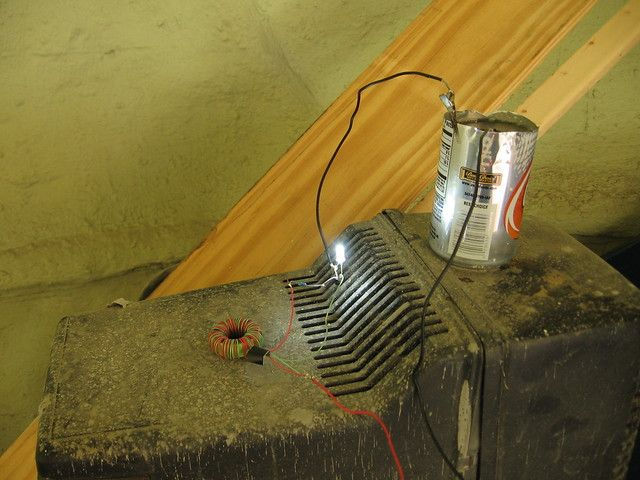
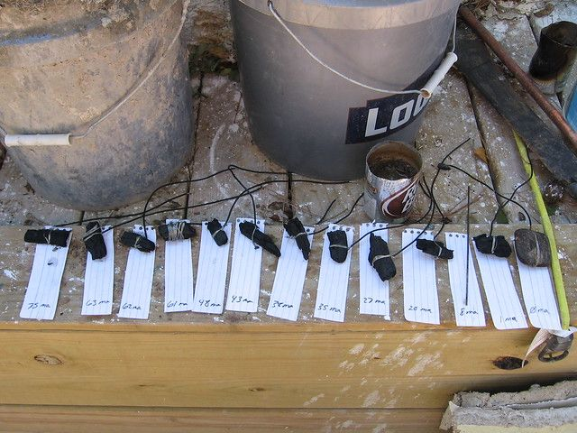
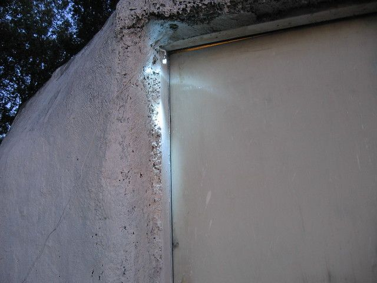
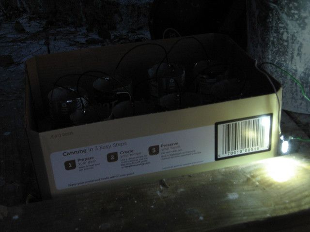

# The Earth Battery Experiments.

For the last week I have been collecting parts to continue testing the earth battery. This is the second part in a series, for the first part which explains what this is and what it is for see here. After messing with this for a while I am not really sure this can properly be called an "earth battery" anymore, but since it is kind of similar and I don't have a better name I will stick with that.

My long term goal with these is to just make individuals and organizations working in third-world areas aware of their existence. I may just end up sending a minimal kit with instructions that would allow them to make their own. Without seeing it work, I expect it will end up in the "if it were that easy everyone would be doing it already" category.

My original plan was to send a "joule thief" circuit so that they could just add some dirt and see it work. This may be the easiest on their end, but it will take me a lot longer to make and even though the circuit is very simple they may still think that it can not be done locally.

So the other option is to send just a LED a lump of charcoal and a few wires. They will have to put at least four cans in series which takes a little more effort but then they would not need the circuit at all. Somehow, to me, it is even more impressive when you just connect a light to a series of cans and out pops light... so I am undecided as to what I will end up doing in the end.

The Joule Thief Experiments

I ordered the parts for the "joule thief" since my scavenging efforts did not turn out that well. The components are less that $1 if you buy in bulk (around 100 pieces). The hardest, most time consuming and most expensive component is the ferrite torroid. They can be bought for about $0.50 each or they can be scavenged from computer power supplies and high efficiency light bulbs among other places.

The best instructions I found for making them is here http://www.evilmadscientist.com/article.php/joulethief, there is also a video here: http://www.youtube.com/watch?v=gTAqGKt64WM

My original assumption about how they worked was wrong, they do not merely boost voltage at the cost of amperage. Instead they turn the DC current into AC at a high frequency. The AC current spikes at a little over double the DC input voltage so it works fine for illuminating a LED but will not do so well with anything else so far as I know. There are variations on youtube for lighting fluorescent tubes at higher voltage though so I will have to keep working on it. I also found that at least with the earth battery you can skip the resistor so there are really only three parts.

I attached the first one I made to a aluminium can filled with dirt, a little salt and vinegar and water. I then wrapped another wire around a piece of charcoal and pushed it into the center of the dirt a few inches. The bulb lit nicely from a single can and remained at about candle brightness for about 15 hours. When it went out I added a couple tablespoons of bleach and it lit up even brighter than before for another 10 hours or so. Finally I dumped out all the dirt and filled the can with pure salt then pushed the charcoal into that and filled with bleach. That was this morning, now about 12 hours later it is still lit brightly.

The "Dirt" Medium Experiments

I should probably add that I sanded the inside of the can a bit before I added anything. There is a film on the new can that will not generally conduct well. Sometimes it works, probably from the dirt scratching through the film, but it is better just to lightly sand the inside of the aluminium can.

Here are the results of different combinations:

Aluminium can + charcoal battery experiments.

- Bleach + salt in sanded can = 0.93 volts x 160ma

- Dirt + water in sanded can = 0.575 volts x 0.23ma

- Dirt + water in unsanded can = 0.103 volts x 0.00ma

- Dirt + urine in sanded can = 0.75 volts x 68ma

Basically just dirt and water will not work very well, while adding salt or bleach or any acid will help considerably. I also figured out that urine, which contains both salt and acid, works very well. While it may not be the most politically correct thing to make a battery out of, nobody can complain about it not being easily available and renewable.

So far, there has not been any noticeable corrosion of the can or the charcoal, and the mud can be easily replaced. I expect the can will eventually corrode but it will be a while before I can see how long that will take.

The Charcoal Experiments

Next I tried different types of charcoal to see what difference that would make. My original assumption was that charcoal worked well because it was porous and so had a large surface area. This may be part of the explanation but there is something else going on that has me a little confused. It seems that charcoal briquettes do not work at all... I expected they would work at least as well as the camp-fire charcoal but that is not the case. Even with salt and bleach they would just produce a tiny voltage and no measurable amperage. I also found that different lumps of charcoal produce a similar voltage, but widely varying amperage. I have no idea why. Below you can see the charcoal pieces I tried and the amperage (ma) for each. It does not seem to follow any pattern that I can see, size does not seem to make much of a difference, nor does the amount of wire wrapped around the charcoal. They are arranged in order with the best (most amperage) on the left and the worst on the right. I tested them by inserting them each into the same mud in the same can.

(click on the pictures for a high-res version)

If anyone knows what is going on here, please let me know. I am totally confused, but the important thing is that almost any lump of camp fire charcoal will work (probably).

The End Result.

I wired eight cans in series using the best lumps of charcoal. Filled them with dirt and added a little urine. I ran out of urine so I will have to wait until tomorrow to renew the supply. Although there was just barely enough urine to dampen the top of the dirt the attached LED is burning a little more brightly than the original version I made out of 5-gallon buckets. That one BTW has been running non-stop for over a week and a half now with no change in brightness. It is very helpful as a porch light... I can now find my doorknob to insert the key.

So the final verdict is that anyone can produce enough light to read by with 8 aluminum cans, some campfire charcoal, some dirt, urine and a 10-cent LED. I will post more later as to how long it lasts. If anyone knows some other things I should try to improve performance please let me know in the comments.

Long live the urine-light.

1 comment

Anonymous · September 26, 2011

Very cool! You may be able to make this smaller; check out http://johnsenergy.com/?p=490
