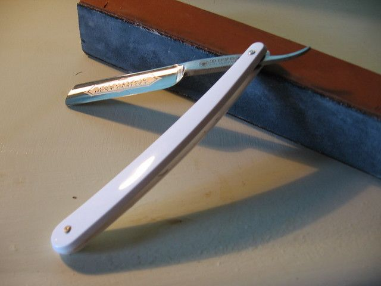
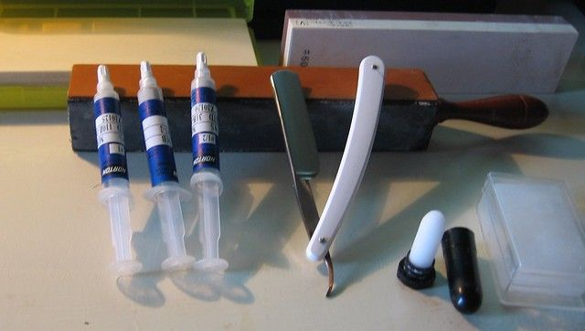
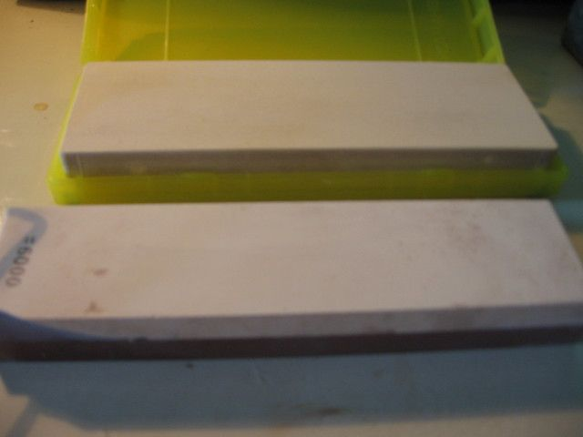
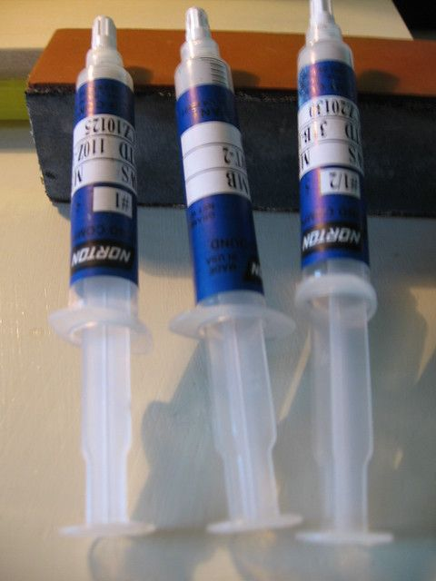
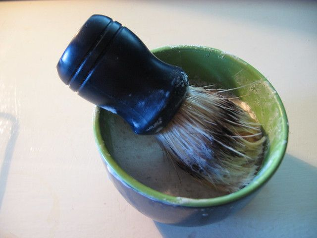
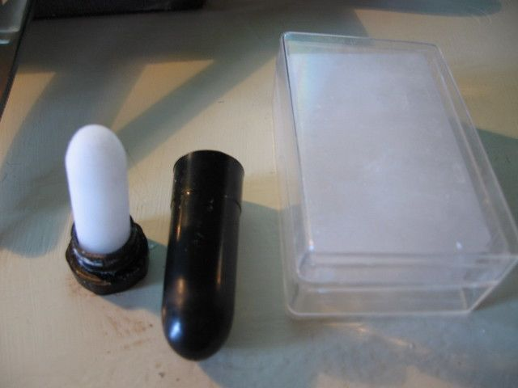

# The Straight Razor

When your grandfather hit puberty your great-grandfather likely gave him a straight razor and showed him how to use it. Just like his father had done and so on back to before anyone can remember. This had been going on since the 1600's when the classic "straight razor" design originated, but long before that men all over the world had been scraping their faces with some manner of sharp knife, or rock. The straight razor evolved until it was a durable and efficient tool that with care would last generations.

And that was a problem. The best way to save money is to get rid of as many recurring expenses as possible. Conversely, the best way to make it is to convince someone to buy something off you that will only last a short time so that they will come back again and again to keep buying it.

This blog is about saving money, getting out of debt, and finding simple solutions to solve common recurring problems without becoming dependent on an external supplier. In so many ways we have sold our independence out of convenience and laziness and have in effect accepted a number of parasites on our lives.

So back to the straight razor... it was a simple and final solution to a recurring issue, but in the 1950's our parents were convinced that disposable "safety" razors were the way to go. There are still many thousands of people in the US using straight razors, they can attest that with a little caution and practice a straight razor is not dangerous. But women generally don't want their young children playing with extremely sharp knives, so the "safety razor" seemed like a better idea. Given that they were so cheap and convenient, requiring less care and maintenance they quickly caught on and the market proved once again that fear was the best motivator.

Now today it is common to pay $25 for a dozen mach-3 razor blades. If you shave every day then you probably go through this in a month. So you have a $300/year parasite to live with. You can get by with cheaper razors, or you may go electric for about the same cost. While the dollar amount is not much, it is the mindset that is most important. When we make it a pattern to just throw money to external entities to provide us with quick short-term solutions in one area it becomes easier to do it again in another area until finally we end up with "the modern american lifestyle". It is fun while it lasts, but if any kind of disaster interrupts the party then we will all become aware of how many dependencies we have come to rely on. Most of these with a little preparation could have been avoided.

So whether you want to prepare for a possible disaster, become less dependent on external sources, or just save some money please consider the classic straight razor. It is not nearly as scary as it has been made out to be, and can serve you just as well as it did your grandfather long ago.

Straight Razor Basics.

Unlike a disposable razor, the biggest difference is that you have to sharpen a straight razor. This is not particularly hard or time consuming but it does take practice. There are two ways to sharpen a razor, namely honing and stropping.

Honing

Honing is using a very fine sharpening stone to put on the basic edge. This has to be done every six months or so. You basically lay the razor flat against the stone, the back of the razor provides the correct angle, and then you very lightly push the blade across the stone with the edge pointing in the same direction as the motion. You then flip the razor over keeping the spine down and go in the other direction with the other side. You use very little downward pressure during this, the weight of the blade is generally sufficient. You start on the coarse stone for about 30 strokes then do the same on a finer stone until you run out of stones. The best stones are called Japanese water stones and you want an 8k stone or higher to put the final edge on the blade. There is a more complete explanation of the process here: http://straightrazorplace.com/srpwiki/index.php/Beginner's_Guide_to_Honing

Water stones are expensive (from $30 - $200) you could use a very fine oil stone like marble but it would take longer and you would have to be more careful.

Stropping

The next step is stropping. This is basically polishing the blade and aligning the metal on the edge. It should be done before and after each shave. You will need a strap or a block covered in leather for this. I prefer the block, but the strap is more traditional. You essentially do the opposite of honing, by pulling the edge across the leather with the spine of the blade at the front. Then flip on the spine and go in the opposite direction for the other side. A more complete explanation can be found here: http://www.classicshaving.com/articles/article/590351/4057.htm

Strops cost from $10 to $80 although you could probably use an old leather belt if you had to.

My personal favorite is a combination between stropping an honing. Basically you can buy diamond paste with different grit sizes. I got a block with four sides and got 1-micron 1/2-micron and 1/4-micron paste for the three sides leaving the fourth plain leather. You sharpen the razor like you were stropping it, but it accomplishes the same thing as honing. I found this method to be the fastest and it tended to be sharper in the end (for me).

Soap / Brush / Bowl

You generally don't want to use the canned shaving cream that you are probably used to. Mostly because it is expensive and secondly because it does not work very well. It leaves junk on the blade that is hard to remove. One cake of $5 shaving soap with a brush if used conservatively will last at least a year. I got a whole kit with the brush, bowl and soap for $5... this is probably the cheapest you can go. Beaver or Badger hair is considered to be the best for brushes, but those will cost you around $30.

Alum / Stypic Stick

This is basically a block of alum or a stick or pen that will stop bleeding from a small cut. You will likely get a number of these when you start. It is not painful, you probably will not even feel it. But there will be a small spot of blood that you can completely get rid of by touching the spot with the stick or alum. This will sting a little, but is fast and will not leave a scab.

The Razor

The last part is the razor itself. There are only a couple of good razor manufacturers left. Dovo is the most popular, and Boker also makes a few. The rest are by custom knife makers or are generally junk. Another option is to find an old razor made before 1950, but make sure there are no nicks or cracks in the blade. A decent razor will cost about $80. You can get much less expensive ones but you will likely end up with a very bad experience.

So, with a $80 razor + $50 block + three tubes of diamond paste ~ $30 + soap/brush/bowl ~ $15 you will end up paying about $175 minimum to get started. This may seem expensive but it will pay for itself in six months and last the rest of your life.

Another option is to get a straight razor with disposable blades. There are several brands, I like the Dovo Shavette this will cost about $30 but will let you know if you like using a straight razor or not, and will give you an idea about how the blade should function when properly sharpened. Even if you just stick with this, the blades are about $7 for 100, can be used several times and can even be sharpened if you really want to.

As for how to shave with it, search for "straight razor" on youtube and there will be hundreds of video demonstrations that will do a better job of explaining it than I can here.

9 comments

Greg · September 15, 2011

Good info here. In the past I thought of going this route. Lucky for me, (or unlucky) I don't have to shave all that often.

But that said, another expensive part of this is a good shaving brush. These are often beaver hair brushes and are typically in the $30 range. Not too expensive, but it all adds up.

Shaving soap can be hard to find. I have found it in Walmart or Target. It is usually in the same aisle as the shaving cream, but is hidden up on the top shelf. I imagine there isn't much money to be made off of shaving soap.

bhoult · September 15, 2011

Hmmm... yea.. good point. I just used a cheap $5 kit from Walgreens that had soap, a brush and a bowl. It is not beaver hair, for $5 it is probably rat hair or something like that, but it works well enough.

I will add that to the blog shortly in any case.

Victor · September 26, 2011

I would say that your cost for the electric shave is rather exaggerated. I got my first electric shaver when I was 16 and used it til I was 49. In the tween years I bought only 2 sets of knives for this shaver. So let's see. Original shaver $70 + 2 x knives $40 each. That makes $150 for 33 years of shaving. Yes there is electrical involved but that would be negligable. That's less than $5 a year. I would be surprised if you could buy your soap and supplies for less than that.

bhoult · September 26, 2011

Victor: Either you have the worlds greatest electric razor or I have just had miserable luck with mine.

Prior to the straight razor I went through electric razors about every two years. In most cases the blades were almost the same price as a new razor and the rechargeable batteries were having issues so I just got a new one.

I also tend to shave inconsistently, and if the blades were dull at all then they tended to yank out the longer hair instead of cutting it.

If electric has been working that well for you though then I can't argue with results.

Motowyre · November 1, 2011

I also got tired of the razor and blades business model. The blades would just get clogged up and even with the light beard that I have would never last more than a few shaves. After looking into it a went the safety razor route. Looked around a little for an old razor from an estate sale or two, but ended up buying a new one from Amazon.

http://www.amazon.com/gp/product/B000JPKLUU

It certainly was not cheap, but I expect it to last me the rest of my life, and the blades are cheap and seem to last quite a bit longer than the disposables.

Careful that you do not get carried away though, my razor got away from me and I ended up shaving my head! :)

keregg228 · August 15, 2012

i have an electric razor. 15$ a year for a replacement blade. 60$ for the shaver. its 3 years old and going strong. much cheaper. no shaving cream or gel. i shave while i drive into the hospital(work).

bhoult · August 15, 2012

keregg - well, after a couple years with the straight razor I will say that they are kind of high maintenance. Certainly not something you would use while driving unless you were more than a little sadistic.

Really in today's world the money savings over the long run probably are not worth the hassle (unless you just kind of like the idea). But then there is tomorrows world to think about.

Anonymous · May 12, 2015

The best safety razor looks very modern. The product looks very attractive with its ebony handle and shiny chrome finish. Its handle provides the area of good grip.

James Franklin · October 30, 2016

Though a safety razor is an old and traditional shaving tool but nowadays it has been modified. The safety razor provides the better shave than a cartridge razor. Also, the price of a safety razor is cheaper than a cartridge razor. And that's why the safety razor become popular nowadays. Best safety razor
