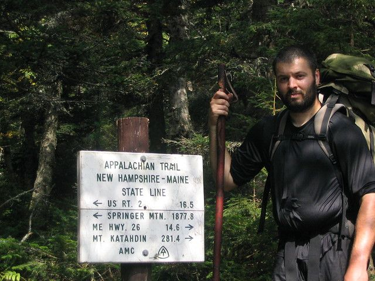
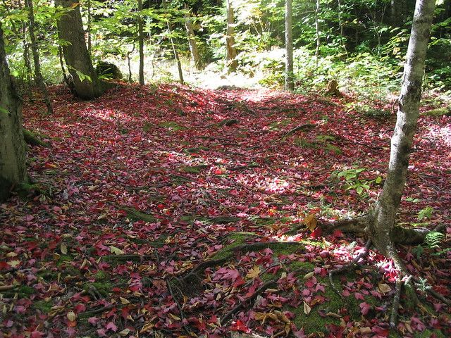
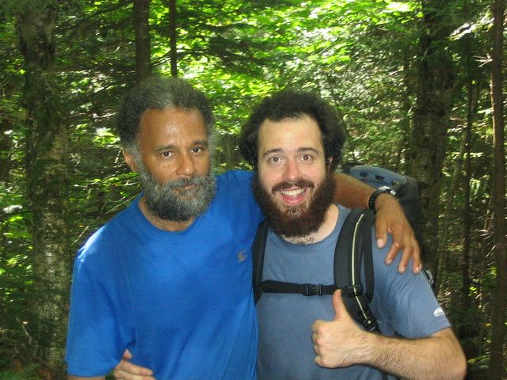
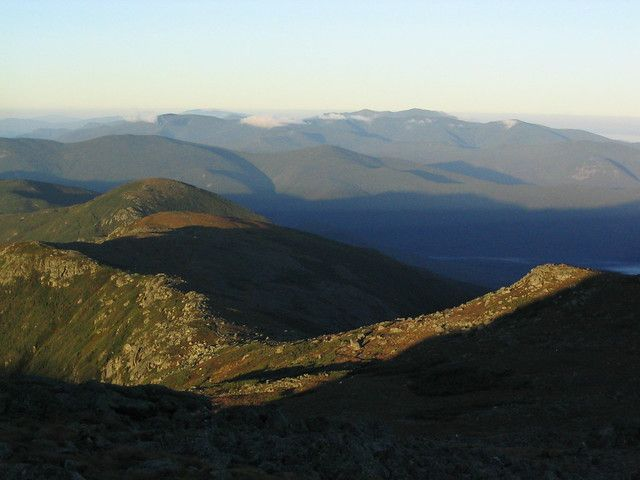
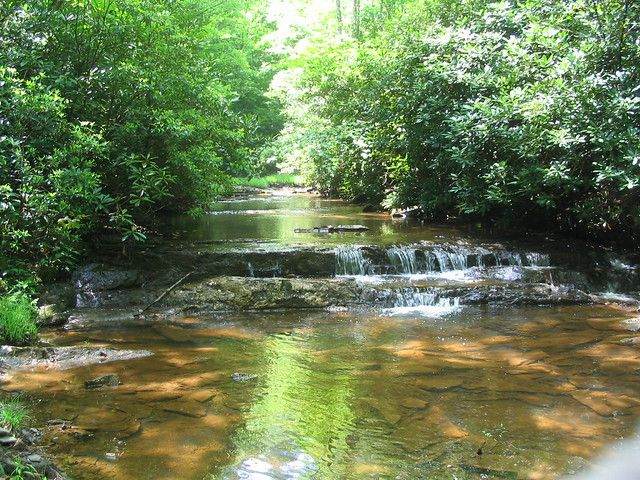
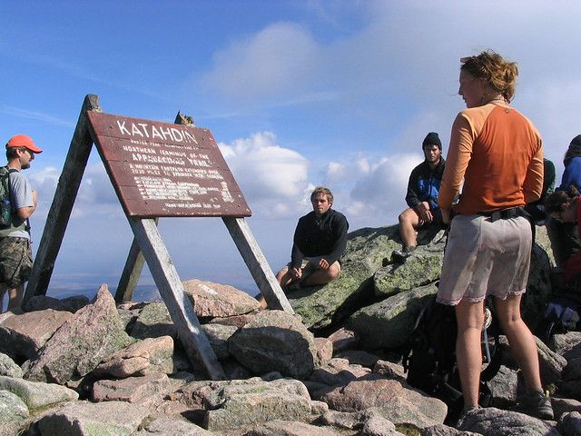

# Thoughts on the Appalachian Trail.

It has been over six years now since I finished a through-hike of the Appalachian Trail. I still think about it. It is interesting how my perspective on what it meant and what I got out of it has changed from when I first started thinking about it to now.

For those who have never heard of it, it is merely a thin, rocky path that stretches 2174 miles from Georgia to Maine. It is almost never level or straight. It is always painful, exhausting and beautiful. Each year a couple thousand people try to walk from end to end. About 10-20% make it. The rest had the courage to try. The pictures of my hike are here: http://www.flickr.com/photos/bhoult/collections/72157604127646199/

It is a hard thing to talk about though to people who have not done it. They don't have any way to relate, no similar experience to compare it to. Most of them have done some kind of hike so naturally they think it is like that, just longer. And while that is true, it is a very small part of the story. It is like trying to understand the life of a soldier based on the fact that you too own a gun. Because you have that in common you get it, you understand what he went through. What could be said to communicate what the experience really meant? Is it even worth the effort?

As we would hike, we would see people at road crossings or in towns that were curious. They always asked "Why are you doing this?". Then they would look at us as if we could sum it up in a couple sentences. We tried many times to produce what they were looking for. Their slight nod and polite smile would tell us each time that we had failed. Eventually I realized that they were just wanting a meaningless blurb, "because it is there.", or "why not?". They wanted to admire what you were doing, but not necessarily to understand it.

Now, six years later people still ask me why I did it. I have had some time to reflect so I hope I have a better answer.

It was because life lived unintentionally is not living. It is just doing what needs to be done so you can do what needs to be done tomorrow and repeat until the end. You become just an actor in the life your circumstances scripted out for you. It is as if we are born sliding into a long downhill rut and our lives are just coasting down that path of least resistance. We "do" when we have to. We deal with obstacles when required, not because we chose them but because they were just in our way. An annoyance, a thing to be resented, avoided. We "do" because it is prudent, because it is necessary, because we will profit from it in some way. We "do" because we were told that we should, because it is expected of us, because that is just how it is. Nothing has purity, nothing is done for its own sake.

Occasionally though you have to "do" just because you choose to. You have to make a deliberate choice against all reason, tradition, and habit to go to the hard and lonely place. You have to make a pilgrimage, to go into the wilderness to enter the darkness. You have to climb the walls of your rut not to impress or persuade anybody. Not to fulfill a requirement, but merely so that you know that you can. To demonstrate, if only to yourself, that your life is lived by choice and not just the dictates of circumstance. You have to choose something that tests the limits of your endurance, your will, your strength. It has to be hard and long and painful and can have no tangible reward... something that almost nobody will understand because it belongs to you alone. It has to be something you will likely fail at, that you fear, something rational people would avoid. It has to be defiant, a demonstration that this box you are in will not hold you and define you. If you can ever fully explain it to someone who has not been there, then your task was too small.

It does not have to be the AT, it probably should not be. You know the places where you meet your boundaries. If you would be free, then choose your battle and begin to fight. The war will never end until you are too exhausted to pick yourself up again, but by then you will have seen lands that few have dared to enter. And even though you find yourself alone and misunderstood by all those you left behind yours will be a bigger world and you will know that you have lived.

3 comments

Carla McDonough · October 18, 2011

I love that you did this. I can relate, my horse back trip was to me your Appalachian Trail to you. It's just something you want to do, You dream of it, you play it over in your mind until it happens. You can't duplicate it, it IS hard to talk about it to someone that has never even tried to do something that most don't even want to think about. It is scary but it is challenging too. Among the minority, Thank You Brandon

bon · April 22, 2012

Congratulations on your hiking trip through the Appalachians. You are a truly remarkable person for having done so. My family and I spent a few months atop a mountain in the NW corner of North Carolina. After a while I began to crave a level surface. Even the house was crooked to an extent. You cannot walk, run or jog anywhere without climbing up and trekking downwards. I lost 25 lbs and gained the most muscle strength in my legs I have ever known. I was not hiking! There is no other beauty comparable to the Appalachians from black bears, fresh water streams and non-stop all enveloping greenery. I miss it. I can only imagine the scenery you experience on the entire trail. Just one sole mountain was life-changing for me!

bhoult · April 23, 2012

Thanks Bon... the more time that passes the more I think of going back and at least doing parts over again. Especially the section from the white mountains northward. Have you considered trying to hike it yourself? If you ever get to the point where you can take the time off I can guarantee it will be an interesting experience.
