# Garden Update Sept 2011

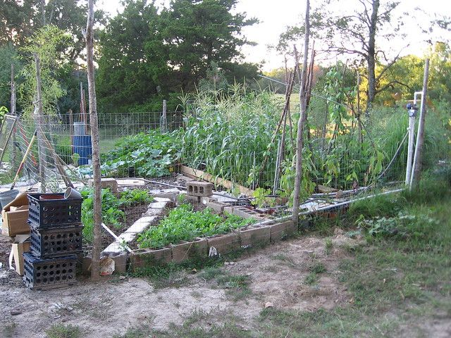

Just thought I would post some pictures of our garden. Mostly because it is my first attempt at making a real garden of the scale that I can regularly eat out of, and I am kind of proud of it. I am not a pro at this, and it is a community effort so I am only partly involved. But for the sake of those who are thinking a small scale garden may be in their future there are a few things I learned that may be helpful.

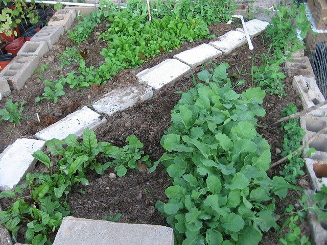

We started this in the late spring with a single bed 24 ft by 4 ft. There is a picture here, of when it started. We made raised beds out of treated 2x6x8ft timber two high. The original idea was to do square-foot gardening but lack of organization and multiple people being involved quickly ended that idea. A few months later (early summer) we more than tripled the size, added two more beds with wooden walkways and a couple more corner beds.

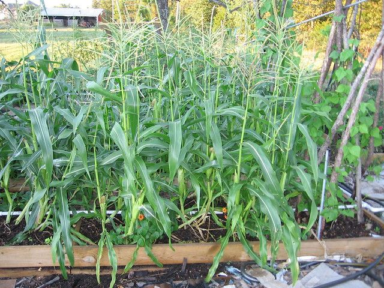

For fertilizer we used about 1 part old horse manure to two parts wood compost / leaf compost. There are about 4 bags of store bought fertilizer in there somewhere as well. We turned over the initial dirt that was there already with a pick and mixed this in as well to some extent.

We had to fence the whole thing since we are over-run with deer up here. Any hunters want to come kill our deer? Please? It is only about 5ft high but the deer have stayed out so far mostly because there is not a good clear area inside that they could jump into.

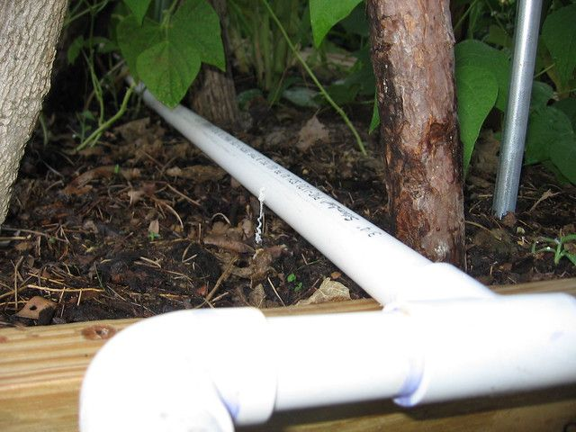

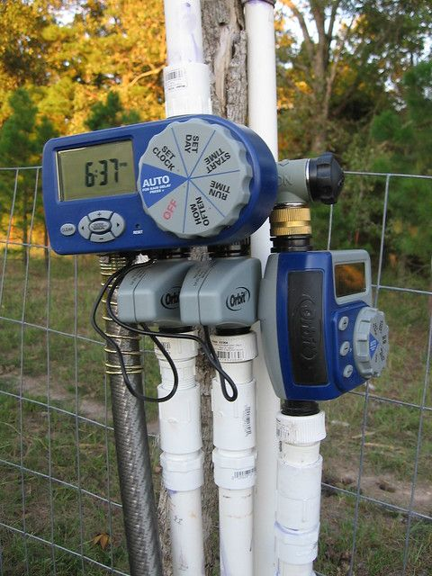

I installed a automated watering system. This has always been my issue with gardens in the past. I would forget to water and a couple of weeks later the garden was dead. The first attempt was to use drip-hoses but a couple of those burst within the first month... I think our water pressure is too high. I could have gotten a pressure regulator, but decided to use cheap PVC instead. I just drill holes where I want the water to go. The water flow rate is not sufficient to run all the pipe so I had to make three separate sections, the water comes on at 5am and does each section for about 30 minutes.

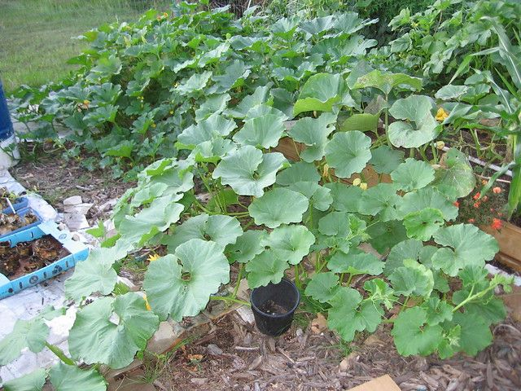

The cost has been about $700 total. $250 for fencing, $100 for automatic watering, $60 for PVC, $100 for wood and the rest for plants and misc. parts (hoses, connectors, etc.) We also probably spend another $100 on watering. This year we probably got about $200 of food out of it and will probably get another $200 by the end of the year. Obviously this is not cost-effective yet. Hopefully now that it is established, next year will be more productive.

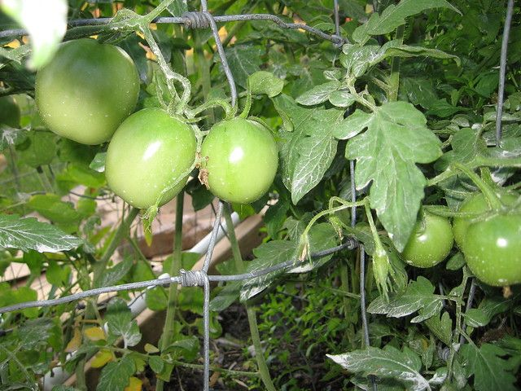

Lessons Learned.

1. Gardens take time and practice. If you are planning to quickly summon up a productive garden if things get bad then you are probably going to be in for an unpleasant surprise.

2. They take quite a bit of maintenance. This garden probably gets at least 30 minutes of attention each day by somebody. I am glad that I am not the only one working in it since I would probably neglect it more than I should.

3. Automate as much as possible. Obviously the automatic watering saves about an hour of standing there with a hose each day. There are way to plant things so that they control insects naturally, we are not very good at this yet, but we are learning.

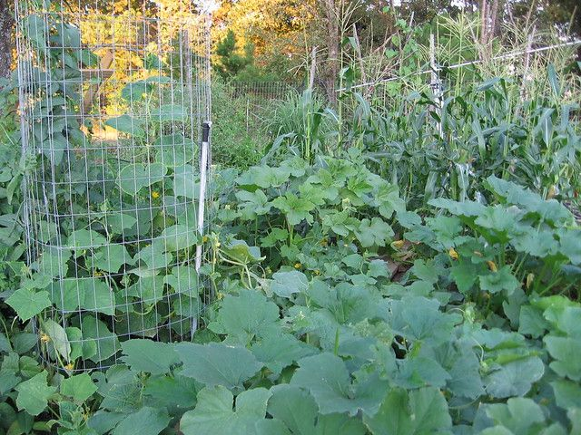

4. Our garden is dense. This is nice from a space perspective but it is hard to harvest stuff. Given that we are trying to keep cost low we will probably make it just as dense next year, but it would be nice to spread out if we could afford it.

5. Bugs are irritating. We are still "organic" so far, but we lost quite a bit to insects. Hopefully in the coming years we will get an ecosystem of predator bugs to help but if you are thinking about a survival garden you may want to stock up on pesticides for the first few years. Either that or plant twice as much.

6. Wood is cheap and fast to build raised beds with, but it will not last more than a few years. We have started collecting old cement blocks, bricks and rocks to replace the wood with when it starts to fall apart.

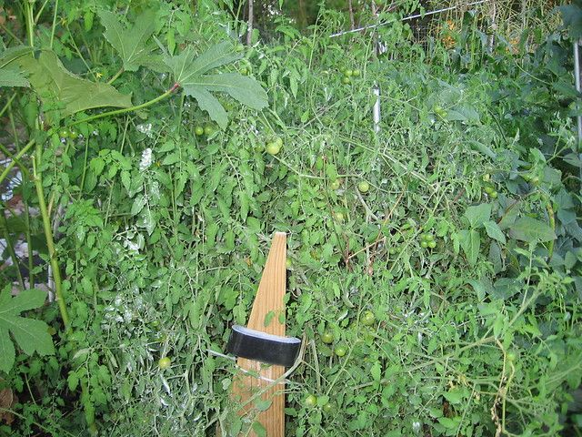

7. Weeds require quite a bit of work to remove. We have been putting down cardboard, old carpet, newspaper, wood chips and anything else we can find to act as a weed barrier wherever there are not plants. It looks like a mess, but it prevents a lot of grass seeds from falling in the beds.

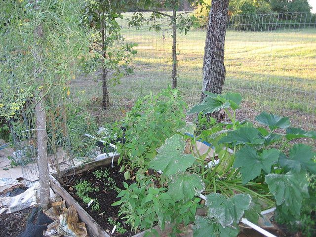

Like I said... I am not a great gardener. I am trying to make as maintenance free a garden as possible and eventually will get back to the aquaponics, but in the meantime this is working nicely. If you have any questions please leave them in the comments.... in this subject I could probably use any advice you might have so please leave suggestions also.

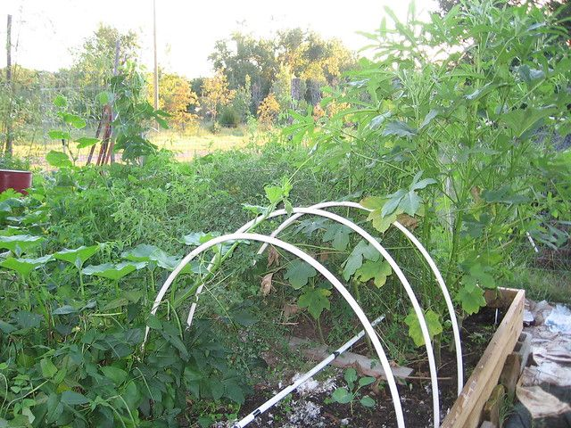

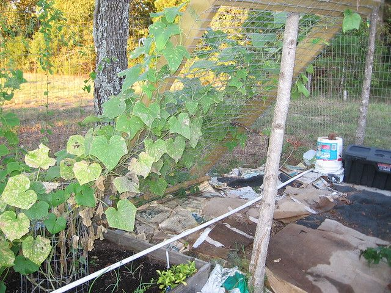

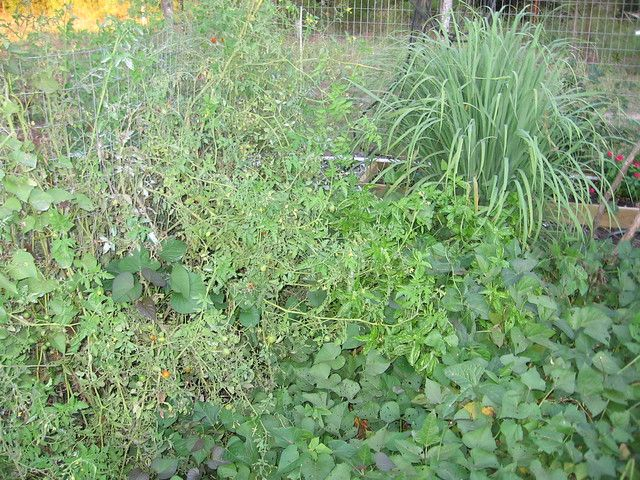

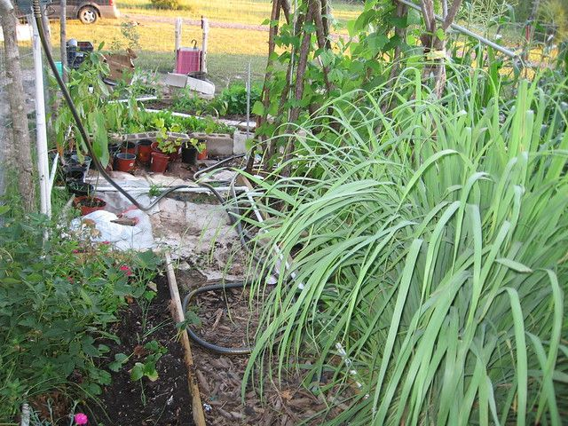

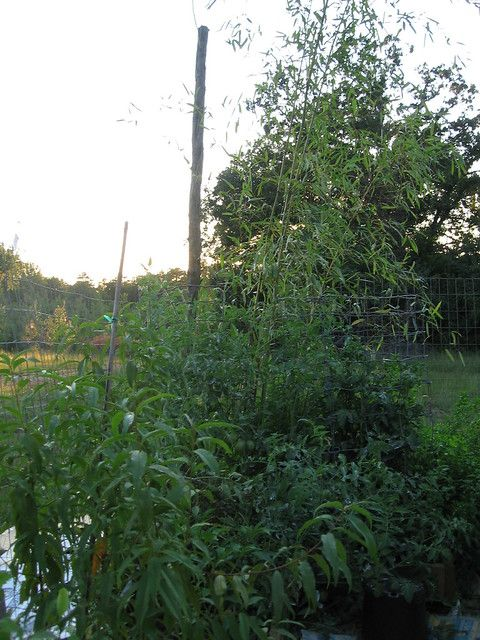

8 comments

Fritz · September 28, 2011

Thanks for showing us your garden. Any chance you can go into more detail about your watering set up? I will likely do something similar next year. What's the hole sizes? What kind of timer setup is that? etc.

As for the weeds, in my garden I see them as part of the ecosystem. I allow weeds to grow unless they start competing with the veggies. I do have to keep a good eye on them, but they hold in the soil and seem to reduce my need for watering.

bhoult · September 28, 2011

The watering system I used is made by Orbit, I got them at lowes for about $50 for the two hose system and $30 for the single hose system. The two hose system can be expanded with two more connectors for $20 each. They run off two AA batteries and seem to last all year on a single pair. Basically they just turn the water on at a specific time then turn it off after a specific period.

The pipe is just the cheapest PVC I could get at Lowes. I think it was a little over $1 for 10ft. I also got an assortment of connectors then just glued them all together with PVC glue.

The holes are the smallest I had... about 1/16. I drilled them all the way through both sides horizontally so the water sprays out the sides. Some holes are larger, if I wanted to water more in that area.

Water pressure is the most important factor. If you have too many holes then it just dribbles out and may not make it through the entire length. Also if there are dips in the pipe then it will come out more in the bottoms of the dips. As long as you don't make it too long then it works fine though. That is why I have three timers on mine. I had to do it in three sections because there is only enough water pressure to do 1/3rd at a time.

I have it set to come on before sunrise so that it does not evaporate off. Also I believe it is important in the summer not to get the plant wet as they may cook if it gets too hot. Not sure about this, but it is what I have heard.

The downside is that it uses a lot of water. Like I said above I think we spent over $100 this year watering the garden. We probably over-watered though, it was hot and really dry here this summer and most gardens in the area died. Ours did great and is now full of frogs and lizards.

I wish we had a well though.

bhoult · September 28, 2011

This may be something you should look into if you are concerned about water.

http://www.richsoil.com/hugelkultur/

I understand that you don't need to water these hardly at all since the rotting wood holds a lot of moisture from the occasional rain. I have not tried it yet though.

Motowyre · March 15, 2012

How's the garden coming along this year?

bhoult · March 16, 2012

What we have done is going ok. Just still have a lot to do and it seems like there is always other stuff that needs to be done.

The plan is to almost triple the size this year. We are also trying hugleculture in a couple of beds to see how that works out.

Hopefully I will get a post up about it... have been neglecting the blog lately.

Anonymous · March 23, 2013

Wouldn't it be possible to make some sort of automatic watering with the use of rainwater? As far as I understand permaculture holds solutions for this kind of thing. http://www.filmsforaction.org/watch/permaculture_join_the_revolution/

Leona · January 9, 2019

fantastic agency to deal with. crew showed up on time, well mannered and friendly, left no mess behind and it only took them 4 hours to tear our old fence out and put 70 ft of latest fence up! The fence and gate are exactly what we desired. Very smooth method, fantastically advocate them click here for more!

Happy Little Succulents · January 17, 2022

Excellent post. I really enjoy reading and also appreciate your work.Succulent Gifts Sydney This concept is a good way to enhance knowledge. Keep sharing this kind of articles, Thank you.
