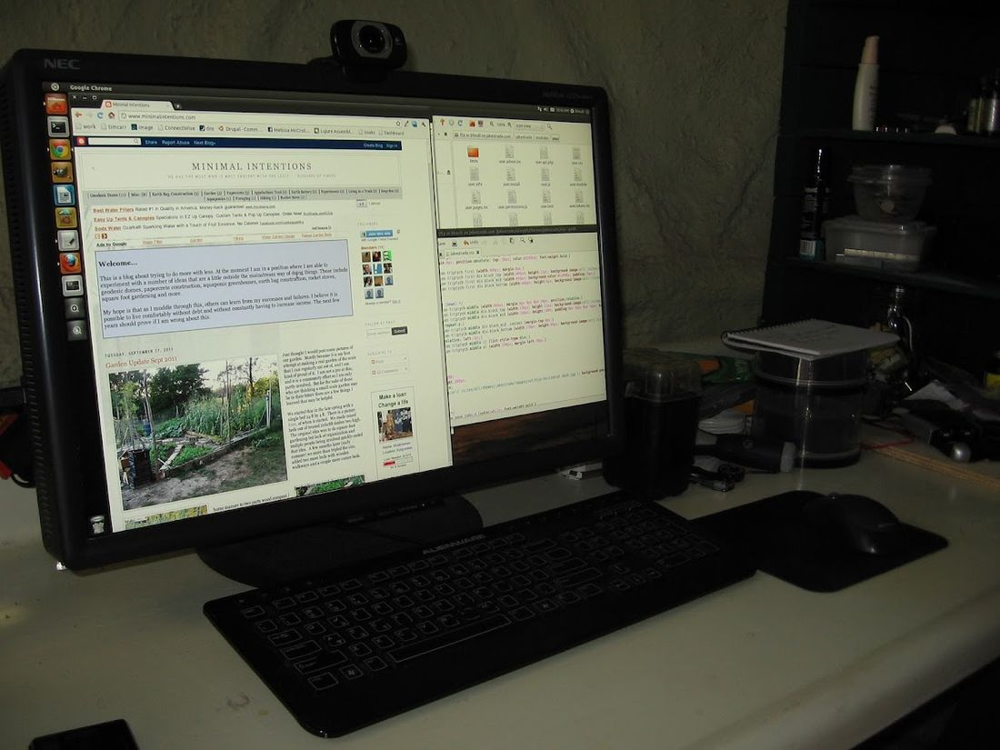
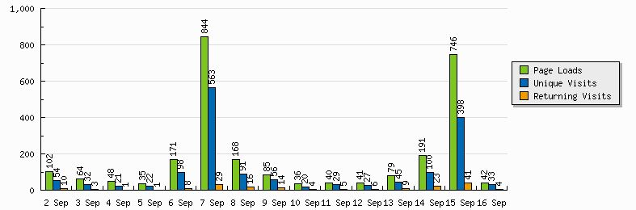
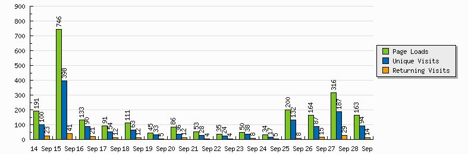

# Making Money with a Blog - Year One.

It has been a little over a year now since I started this blog. Several people have asked how much I made off advertising... I don't really consider it secret so I thought I would share what I have learned over the last year or so.

Like everything else in my life, I want this blog to eventually be self-sufficient. My long term goal is to get my total living expenses down to $2/day by eliminating recurring expenses. My phone and internet are about $150/mo. so I will either have to get rid of them eventually, or figure out some other way to pay for them. Some may consider this cheating since it is still "earning money"... my theory is that if I build something once now to resolve a recurring expense forever then it is no different than building a dome to end paying rent. The dome required $3000 up front to build. The blog will require an undetermined amount of my time. After they are done though, the problem is solved in both cases with minimal maintenance.

The direct costs are the domain name (about $10/year) and the hosting (free on blogger.com). Other costs are my internet connection ($60/mo. DSL) and time (about an hour per post). My phone (android/verizon) is about $100/mo. I may decide to get rid of it and use skype or google voice instead. Or I may get rid of internet and use the phone for that also depending on the price whenever the time comes. So... if I can make $61 - $161/mo. then I will consider the blog to be self-sustaining.

Which brings us to how much I have managed to make in the last year. Which would be $17. Not $17 a month... $17 total. But it is not quite so bad as all that really. $11 of that was in the last 30 days. I found some things that I was doing wrong initially and made a few changes and so far the difference has been huge although still rather unimpressive.

Things I learned:

1. The biggest factor is the number of hits you get on your blog. You make money from people seeing and clicking on your advertising... the more people the better your chances that someone will click something. I am getting about 40 unique visitors per day, which is up from about 25 per day last month. From month to month this is mostly search traffic. However, adding content with a link back to my blog in other relevant high traffic forums and blogs will increase the hits substantially in the short term and seems to continue to do so to a lesser extent in the long term. For example, here is a graph of my blog traffic for the past 30 days:

On the 7th of Sept I was reading http://thesurvivalpodcast.com and added some comments with a link to my blog for more information. I got about 563 extra unique visitors. This died off pretty quick though and it was back to normal until I did the same thing on http://www.survivalistboards.com on the 15th. These are both high traffic forums, I had more feedback and encouragement in a single day from each than I have had since I started my blog. As a side note, I highly recommend both these forums, they contain far more information than my meager blog and the people are extremely helpful and friendly. It is important that you not just spam places like these with links, you have to participate fully in the forum you are on. This takes time and effort. I made sure the places I posted were specifically on subject with a pre-existing post on my blog. In this context, both these forums encourage you to link back to your blog. If it was not on-topic, relevant and helpful, I doubt the response would have been positive. I would also suggest that you not just participate where you can sneak a link in. These are communities of real people, they don't mind you sharing a link but will notice if you are just trying to drive traffic and not really participating.

As you can see from the graph above the traffic again died off, but I was still getting almost double my previous traffic on a daily basis. I did nothing on the 25th, the surge in traffic was due to other people leaving a comment on one of the above forums which brings the topic to the top of the list on that forum.

2. Get on the major search engines. I have mainly focused on Google and Bing, but the more the merrier. My understanding of how search engines work is that they will generally consider your blog more important if you have other known high profile sites linking to it. This probably will take time to take effect, but the more external forums and blogs you participate in the higher you will rank on the search engines and the more hits you will get as a result. The goal is to get as many other sites to link to your blog as possible... some people cheat at this, it is called "link farming", basically they own thousands of junk blogs that all just link to each other. This used to be a common practice, but there is a constant battle between search engines giving you relevant results and people trying to "game the system" to get their own sites higher than they deserve. I would suggest you not try to cheat, it may get you banned entirely from a search engine and then your domain will essentially become worthless.

A search engine finds content by "spidering" the web... basically following all the links on a site to new sites like a spider crawling over the strands on a web. Because of this if there is not a known site linking to your site it may never be found. If you use blogger or wordpress then there will be an internal index that will point to your site and you will eventually get on the search engine. A better way is to manually submit your site to each search engine. There are various sites that claim to do this for you automatically, but I would not trust them. For the major three (Google, Bing, Yahoo) there are what they call "webmaster tools", http://www.google.com/webmasters/, http://www.bing.com/toolbox/webmaster/. I believe that yahoo and bing are now using the same tools. You have to go through these and jump through some hoops but if you do so you are sure to be in the search engine even if you are not in one of the first few pages. Make sure you register your XML sitemap so that all your content is known to the search engine.

3. The more content you have the more hits you will get. This is my 35th article, so my blog is still really small comparatively speaking. For search engine traffic the overall theme of your blog is not important... it will index each article and send traffic to an individual page. However, if you do have a theme that someone appreciates then they may bookmark your site and return regularly. These are the most coveted type of traffic. Return visitors are more likely to try to help you by leaving comments and suggestions that make your blog more interesting. Sometimes a good comment thread is better than the original article and it is work that you did not personally have to do. You can think of this as volunteer labor to add content to your blog. Do everything you can to encourage it. If someone asks a question, reply promptly and thoroughly. If they have a criticism, take it seriously and don't be offended. People value honesty and the ability to recognize and fix a mistake more than they value pride.

There is pretty much a direct relationship to quantity and quality of content to the amount of traffic you get. I expect that if I am making $5/mo. with 34 articles that I will make at least $10/mo with 70 articles... although I expect it will be better than this since my blog will be rated higher with the search engines by this point.

4. There are several ways to monetize your blog. The major ones are search engine advertising, and affiliate marketing.

For search engine advertising I use Google Adwords. Search engines make money by selling ads to businesses. These businesses pay for the number of impressions (views) that their ads get and for the number of times people click on their ad. Impressions are not worth much (about 1cent per hundred). Clicks are worth a variable amount depending on the keywords the advertiser bought... they are sold like an auction. Usually you get paid from $0.25 to $2 per click. You basically add a bit of code to your site that will take a fixed amount of screen space that the advertiser can fill with their own content. They will try to make the content as appropriate as possible to both the visitor and where they have been in the past and to the content on your page that they are visiting. If I am taking about my garden then the advertising should show gardening supplies or something that the user has shown interest in on another site.

WARNING: Please do NOT click the ads on this article in order to try to help me out. The search engines look for this kind of thing and will ban me if it happens. If you see something that you genuinely are interested in then by all means, click away. Just don't do it more than once... if a bunch of people click on ads and then don't buy anything they consider it "click fraud" and will terminate my account.

With adwords you have to exceed $100 before you are paid at all.

Positioning of the advertising is important. A month ago I just had one ad-box half way down the right column. Nobody paid any attention to this so in the year or so that I had the blog going I think I had made about $2. Last month I added another couple ad-blocks to the top and made about $5 in the first couple of weeks.

Advertising is obnoxious and in a perfect world it would not exist at all. People would buy based on the quality and merit of the product and not how much it is hammered into their subconscious. Unfortunately that is not our world... I apologize for having it on here at all, but it is the only hope I have of making this blog independent. With that in mind, there is a balance between content and advertising. If you have too much advertising on minimal content I believe it will drive people away.... and people are always the first priority. Without people there will be no income so don't bite the hand that feeds you too hard.

I have a friend who blogs as well... her blog is at http://elegantastronaut.blogspot.com/. It is mostly about space and science type stuff, and she gets about twice the hits I do. Last I heard though, she has only made a few dollars so far. This could be because the type of things I talk about are things that my readers may be working on and therefore buying stuff for. If you talk about abstracts and beliefs then people are less likely to be actively researching for information and products. If they are trying to find specific information and the advertising is relevant then I believe they are more likely to click on it.

Affiliate marketing is showing specific products that are hopefully relevant to your content that people will click on and get directed to a specific place they can buy the product. This works really well if you are doing a product review. I used to use Amazon.com for this until they canceled all their affiliates in Arkansas due to a new Arkansas law that claimed they should pay state taxes. In the year or so before it was canceled I made $3.70 which I got last week as an Amazon gift certificate.

I would still recommend Amazon for this unless you live in one of the states they have black-listed. Basically if someone clicks on one of the links on your site and then buys something on Amazon then you get a percentage of the sale... like 3%-7% depending on how many clicks you are getting. I only sold a couple of books so I did not make much. If someone bought something for a few hundred dollars though then the income could have been substantial. Amazon is nice because they have just about everything. I am looking into other alternatives now that Amazon wants nothing to do with me and my fellow Arkansans though. You can still see the Amazon links in some of my older content.

5. Know your audience. Hopefully you will have some interaction with them and will get to know some of them personally. But before that you should at least identify the type of person who you think may read your content and try to keep that in mind as you write. In other words your blog should have a specific style and tone that you use consistently throughout. For this blog I am trying to accomplish the following:

-Write as concisely and informatively as possible. The people that I want reading this are people who do stuff... they don't have time to listen to me ramble on about something.

-Write about stuff that I have personal experience with, people don't care what I like or what my opinions are, they want solid information as unbiased as possible that they can use to come to their own conclusions.

- Write about stuff that I would want to read about. Before I write an article I check to see what is already out there... If someone does a better job than me then I will just add a link to their stuff.

- Write honestly. This is not a vanity blog, I will be honest about both my successes and failures. I don't want "fans", I would rather have partners.

- Write about what you care about. Sometimes I will start ranting about something that means a lot to me personally. It may not mean much to the reader so I try to identify it as a rant so they can skip it if they want.

Ultimately it is about a relationship... a distant and dysfunctional one to be sure, but you have to respect your reader the same way you would a friend. When I learn to do that well I believe my little blog will be successful. If you can do that then your blog will eventually be self-sustaining and maybe even profitable someday.

15 comments

Anonymous · October 4, 2011

Have you thought of putting in a "donate" button? (using Paypal)

Ernest · November 8, 2011

It's far cheaper to get a laptop or netbook with built in wi-fi, then go to a McDonalds or other place with hotspot to access the internet for free.

bhoult · November 8, 2011

Ernest: Well... sometimes. I live about 15 miles outside of town which would mean I would have to drive there each day. That would end up making it a lot more expensive by the end of the month.

Also my job (which I do from home) is to develop websites. So I tend to have to be online a lot.

Other than that, I agree that public hotspots are great. I used them a lot when I was living in my truck.

bon · April 22, 2012

Thank you for the article(s). You have gone into great details in describing responsible, safe and reasonable ways to make money online. I also am practicing permaculture, living within my means and attempting to get by in a more green environmentalist way. I thoroughly enjoy the peace and solitude and the freedom of living life in a self-sustaining manner! You seem like an expert at sustainable living, self sufficiency and peaceful living in an earth-friendly way. I've followed your directions according to your detailed article and hope I've hit some major keyword that truly relate to your article. Thank you, kind sir, for being so generous with your honesty! Bonnie

bon · April 22, 2012

Thank you for the article(s). You have gone into great details in describing responsible, safe and reasonable ways to make money online. I also am practicing permaculture, living within my means and attempting to get by in a more green environmentalist way. I thoroughly enjoy the peace and solitude and the freedom of living life in a self-sustaining manner! You seem like an expert at sustainable living, self sufficiency and peaceful living in an earth-friendly way. I've followed your directions according to your detailed article and hope I've hit some major keyword that truly relate to your article. Thank you, kind sir, for being so generous with your honesty! Bonnie

bhoult · April 23, 2012

Thanks Bon... I don't think I am by any means an "expert" yet. I still have a lot of dependencies so am not yet "sustainable". But hopefully we will all continue to become more sustainable as we go. Good luck with your own blog. Please add a link to it here when you are ready... I would like to hear more about what you are planning.

bhoult · April 23, 2012

Thanks Bon... I don't think I am by any means an "expert" yet. I still have a lot of dependencies so am not yet "sustainable". But hopefully we will all continue to become more sustainable as we go. Good luck with your own blog. Please add a link to it here when you are ready... I would like to hear more about what you are planning.

Penny · September 29, 2012

Thanks for all the great info, I will use it with my blog and hopefully kick it up a little! It is fun to run across an interesting blog and realize they aren't that far from you, I'm up in West Fork, Ar. I look forward to following your blog,:)

http://homesteadingpaganstyle-penny.blogspot.com/

bhoult · September 29, 2012

Thanks penny... I am reading through your blog as I type this... interesting stuff. Good to know there are more of us weirdos in the area.

It looks like you are doing better than I have been at keeping content current. I guess I need to get back on that.

Anonymous · March 18, 2013

Hey, followed your link on slashdot to here.

All of these are things that I find fascinating!

I was quite sad to see that the last post was over a year ago.

Any chance we could get a post with an update on the property and your projects?

bhoult · March 19, 2013

Jake: Well, spring is here so I plan to clean up a bit and will do some interior pictures.

The thing is that I really have not done that much that is interesting in the past year. Made a lot of progress on the hot-tub and that may get done soon... hopefully, but mostly have been messing with other stuff.

Still... you are right, I need to make more of an effort to write articles. Thanks for the encouragement.

Frank · November 10, 2013

Very nice article, had exactly the same experience with my blog.

Great blog this is, going to follow you!

Jaxon Oakley · December 18, 2017

I love your thoughts.

johan32 · June 3, 2019

I have been running my own blog for more than 6 months now and it is helping me make a stable income through ad revenues. I have now started to invest in SEO Services so that my website can get more visitors. Have recently hired the reputed seo consultant Los Angeles for their expert services.

Andersonfrank · March 31, 2020

The article should be longer I can see you write good but some vital part of the information is missing. so let's see this PPCexpo blog library.

Best PPC Reporting tool 2020 PPCexpo
