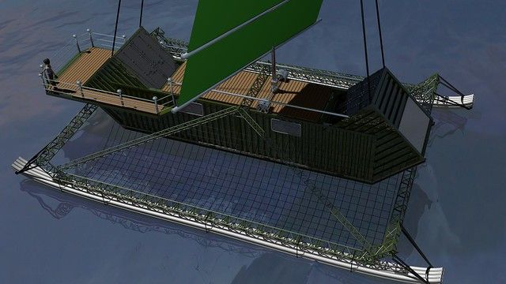
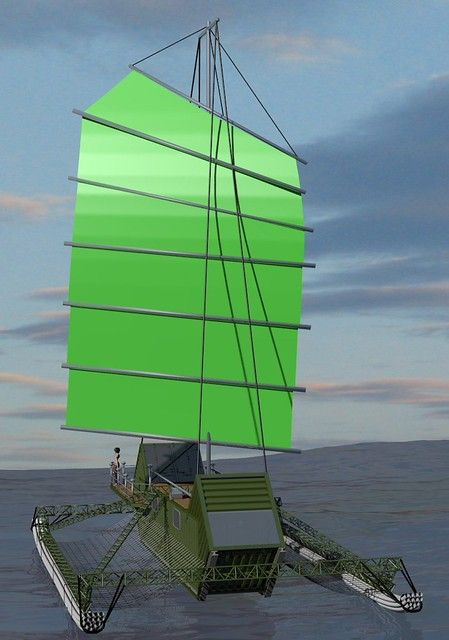
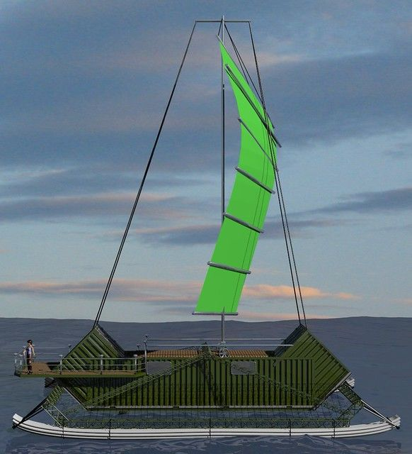
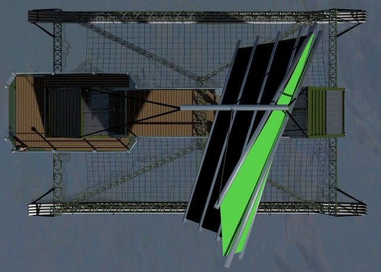

# Shipping Container Sail Boat.

Years ago I used to want to live in a shipping container. I had all kinds of plans mostly involving burying it in a hillside. Around the same time I was reading a few books about people who sailed around the world on homemade sailboats. As often happens the two ideas kind of got mixed together and I ended up with this. I thought it was pretty clever so I told a few people. The general consensus was that it was the stupidest thing they had ever heard of.

So a few weeks ago I started learning Blender (http://blender.org), a 3d modeling, animation and rendering package that is open source and free to download. If you have not heard of this I highly recommend that you check it out. I did this partly because 3D rendering software has always fascinated me and partly because I am a crappy artist and so am a little handicapped when trying to describe an idea. If there is one thing I have a lot of it is strange ideas... everything from personal dirigibles (air ship/blimp) made from trash bags, to a combination catapult/outhouse (I get tired of digging).

So I present to you my retirement plan. Click on the pictures for a larger version. If I can manage it in the next 30 years or so I want to build this, and then instead of going to a retirement home I will float around until I sink ... and that will be that. Hopefully it will not take 30 years... but that kind of depends on how motivated I can get to make some money.

The basic idea is that you should be able to make this out of a 40ft and a 20ft shipping container cut up and welded back together. The pontoons are made of bundles of plastic PVC pipes. The sail is a "junk rig" mostly for simplicity of construction and operation. It should be possible to make it out of common materials such as pvc or metal conduit pipes and tyvek without any complicated patterns. In the pictures the sail pivots on the rear axle of a truck. I wanted to try to reuse common cheaply available components as much as possible, but in retrospect it probably is not very practical in this case.

I would also like to add solar panels and have an electric motor for backup propulsion. I think a small greenhouse in front of the sail might be kind of nice as well. In any case this gives me a way to better plan this contraption and describe it to others.

If anyone else out there would like to make suggestions feel free to leave them in the comments. If you want the .blend file to make the modifications yourself let me know and I will setup a link where you can download it. If you think it is the ugliest most ridiculous thing you have seen so far today... well... yea, I already heard that.

21 comments

Craig · January 10, 2012

awesome.

Anonymous · January 22, 2012

Great!

Im thinking about such things too.

It would be even greater if living on the sea could be done in a community way. To have a haven where you can dock.

Check out aquaponics..it maybe compatible in one way or another.

Tidal energy besides solar should help too.

bookmarked you. keep these ideas coming. nice pics!

bhoult · January 22, 2012

The plan is to periodically update this rendering with refinements as they come. So far, going to add more pipes under the main hull to reduce the waves slapping the flat surface. Also going to add a small greenhouse in front of the mast and solar panels that hang from the sides. Aquaponics may work, but probably for this soil gardening may be simpler. Less sloshing about of fluids.

Let me know if you have any other ideas.

Larry D Gray · January 29, 2012

Great Blender work!

margaret T · January 30, 2012

You will need to stay off the rocks, how maneuverable will this be?

I agree with Larry- nice images in blender work!

Shawnna · February 22, 2012

i think this is SO you :)

bhoult · February 25, 2012

Thanks Shawnna. I thought you might prefer drowning over a long medically assisted coma. My first choice would have been to be composted... but that is apparently illegal.

Anonymous · March 1, 2012

Hey we need a new minimal intention post! Readers want to know what's up. I know you have new work and all but your audience needs more inspiration!

Help Desk Guy · November 25, 2012

I love the idea!! This is true DIY stuff. Please provide us with an update

quezz38 · March 19, 2013

This is really cool! I like the concept a lot, and I'm excited to see updates to it. Have you considered using 55 gallon drums as pontoons? I have seen some houseboats with lines of drums welded together and painted that actually look very good.

bhoult · March 19, 2013

Thanks Jacques. Have not done any updates since this, but I have not given up on it either... Just a lot of other projects in front of this one.

55 gallon drums would also work well for the pontoons I think. Basically I just want to use readily available inexpensive materials.

BTW... for an even better idea that is actually being done check out "spiral island" if you have not already seen it. http://en.wikipedia.org/wiki/Spiral_Island

Shane · April 8, 2013

Cool, I have been having similar ideas for a while..... would be very cool if you build it!

Dakota christianson · May 25, 2013

It takes 136, 55gallon plastic barrels to float a 16'x40' 24,000# load.

How many pvc tubes are we talking here? Sounds like it would have to be bundles the size of ancient redwood trees ?!

Last I checked an empty 40' container weighs @30'000#.

What about using two containers as pontoons each one diplaces 67 cubic tons x two equals 134 cubic tons of displacement of bouyancy.

Factor in a safety value of half and.....

Dakota christianson · May 25, 2013

It takes 136, 55gallon plastic barrels to float a 16'x40' 24,000# load.

How many pvc tubes are we talking here? Sounds like it would have to be bundles the size of ancient redwood trees ?!

Last I checked an empty 40' container weighs @30'000#.

What about using two containers as pontoons each one diplaces 67 cubic tons x two equals 134 cubic tons of displacement of bouyancy.

Factor in a safety value of half and.....

Mark In China · January 6, 2015

containers alone would be 6 tons dry weight. using pvc is a good idea as you can go onto a beach and put new ones in when its time to fix them, thus taking away the need to have it pulled out of the sea every year or two.

the problem with using metal is that it will rust... badly.. without a lot of upkeep and lots of painting. It could be better to build floats out of pvc (barrels or piping, if its piping you will need to design a way to replace the piping without needing to be pulled out at a marina, barrels can be done individually by beaching (gently) and digging out the sand from under the barrels to replace them).

to hold the barrels or pipe, cement (ferro-cement) would be best as it does not need to be painted or have sacrificial anodes, it wont rot or have things eat into it and is not affected by UV rays, thus better for this sort of application.

if the floats take the main structure out of the water fully, then just a 1/2 inch marine grade plywood structure with a coating of 9 oz fiberglass would be fine, as it would be out the water in all but the stormy weather, it wouldn't require painting or blackening every year.

you could also give your self extra space, different heights, have extra bits for fuel, black water, fresh water, batteries, a generator, storage for your trade and some spare barrels or pvc pipe for repairs, you could even have a bath that hangs out the back.

bhoult · January 6, 2015

Thanks for the input dakota and mark.

I realize that it looks like it is floating above the water in the picture, mostly because I did not want to hide the details underwater. But the container is intended to provide most of the flotation. The pontoons were mainly intended to stabilize it from falling over sideways when the wind blows.

I believe it is possible to get aluminium shipping containers which should be less prone to rust. But I also like the idea of using plastic barrels for flotation as well. They could augment the pipes and would be a convenient place to store some supplies perhaps.

On the ferrocement do you know if you can make a floating cement by mixing high amounts of something like perlite or crushed Styrofoam with the cement. I wonder how strong a structure made from something like that would be?

mtom · April 22, 2018

Attractive section of content. I just stumbled upon your blog and in accession capital to assert that I get in fact enjoyed account your blog posts. Any way I’ll be subscribing to your feeds and even I achievement you access consistently quickly. 40ft shipping container

George · May 8, 2018

I am glad that I discovered this blog, just the right information that I was looking for! a course in miracles

Anonymous · May 28, 2018

Hi there Guys

have any of you seen or hear or maybe have links for anyone out there who may have converted a 20ft or 40ft shipping container into a short term liferaft or boat or even a yacht?

im looking for the most basic design available and it only needs to last about 6months

if there isnt anything available what can you sugest thats cost effective?

what are the restrictions other than the obvious welding and sealing the openings to prevent water ingress?

if we load the container with enough balast wheight ( water bottles food etc) will the walls bend and be compromised ?

any and all advice is greatly appreciated

regards Travis

trademarktravis@gmail.com

Asad Ali · February 21, 2019

Great post, and great website. Thanks for the information!

OMC repair parts

Anonymous · May 4, 2019

I am hoping the same best effort from you in the future as well. In fact your creative writing skills has inspired me. Aftermarket Mercury outboard parts
