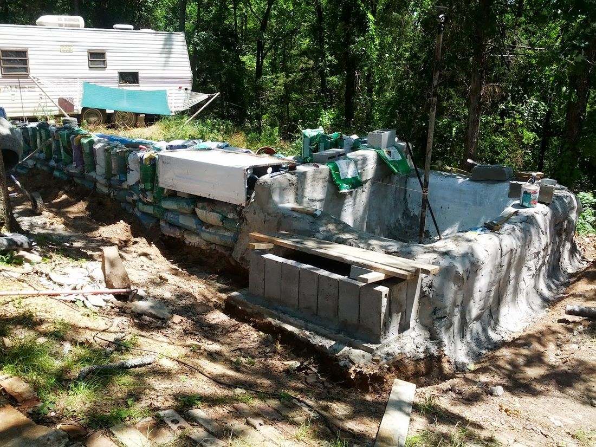
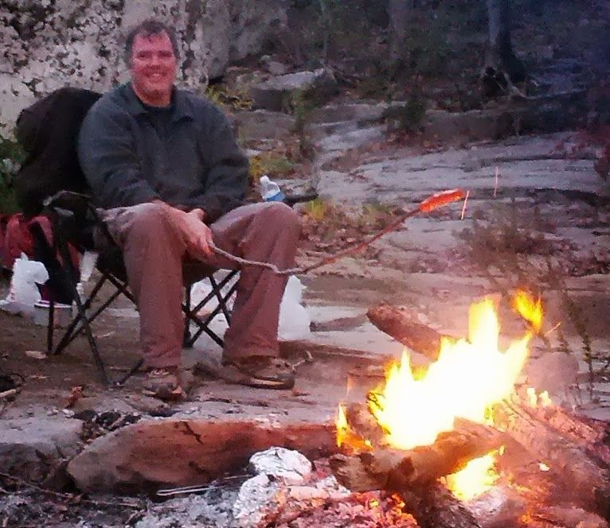
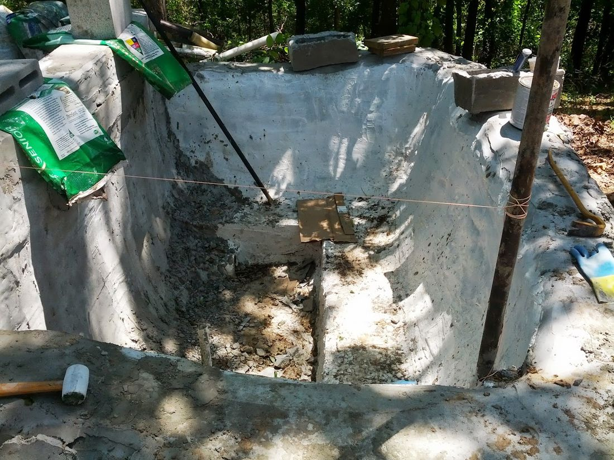
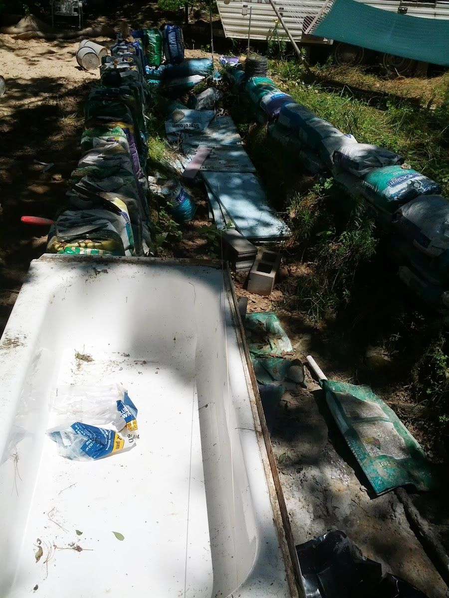
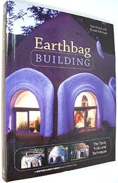
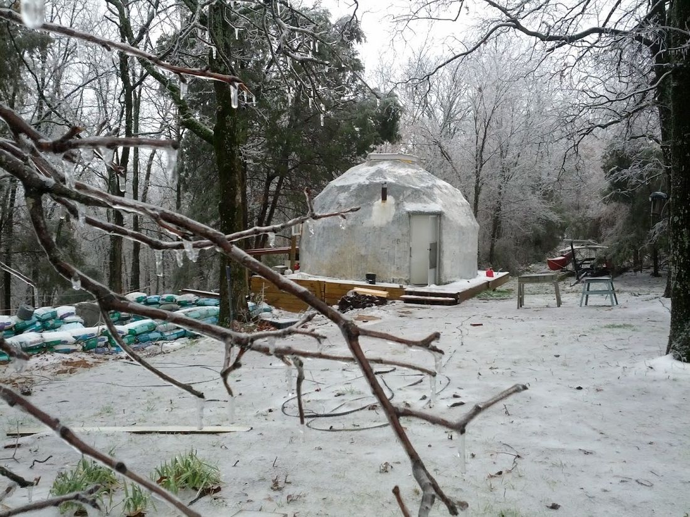

# The Giant Earth Bag Hot Tub.

It has been over a year since my last update. There has been a lot going on but not much worth blogging about until this. When I first got this land I had planned to build a giant hot-tub. I outlined the original plan in the post here. After the dome was basically done, I dug the initial section which was about 10x10x4ft.until I hit bedrock. I had hoped to go down about 10 feet and make a cistern / geothermal heating / cooling system but it did not look like that was going to happen. I even bought a small jackhammer to try to get through it but after several hours of getting nowhere I just kind of put it on the back burner hoping for inspiration.

And then a year passed.

A backpacking / world-traveling / friend of mine showed up about that time looking for a place to stay for a few months while on route to the Appalachian Trail and then to bicycle across China (again). He took a liking to the hot tub plan and started digging for a few weeks. I spent most of my spare money buying and renovating the trailer you see in the picture for him to live in (guest house). So at this point I had a big hole with a bunch of earth bags filled. My friend decided to go hike the AT for the fourth time, but I had a little money saved so I started working on it again. Basically for the past three weeks for 3-4 hours a day I have been filling bags and mixing cement to plaster over the bags.

The "hot-tub" is roughly 40ft long 10ft wide and 3-5 feet deep. The idea is to use the last 8ft or so as the tub and the rest will be filled with gravel, sand, and dirt to make a giant filter on top of which I will plant bamboo and mint (probably). There is a drain pipe on the floor of the tub which goes to an electric pump at the back. This will pump water continuously from the tub through a perforated pipe running the length of the "filter". There is a 6 inch pipe at the bottom of the dividing wall through which the water can come back into the tub after having filtered through the sand and gravel. Essentially I am trying to make an artificial creek so that the tub will be self-cleaning and not require any chemicals. I may even put some small fish in during the summer. On the right there will be a big wood-burning stove (3ft by 6ft.) made from cement blocks with a metal top. Hopefully by this winter I will have it so that I can divert water from the filter to the top of the stove where it will be heated and run back into the tub. I believe I can also use this to make charcoal at the same time.

I had an old bathtub which is the white thing you can see on top of the bags in the picture at the top. That is going to be part of an outdoor kitchen eventually. There will be a prep area to the left of the tub and a brick oven (wood burning) across from it. I also plan to build a screened in area behind the hot-tub so that during the summer I can sleep outside in that without having to worry about the bugs. The eventual goal is to figure out a way to manage with about $1000 of solar panels. This will mean limiting electrical use as much as possible and air-conditioning will have to go.

In the end this "hot-tub" will not be that cheap. I estimate I will spend about $600 on sand, $400 on cement $500 on gravel, and $300 on the various plumbing. So basically round it up to $2000 or so. But it should provide a lot of bamboo and will be the starting point for a lot of other projects such as an aquaponic garden, fish farm / cistern, and mushroom growing bunker... more on that if I ever get that far.

If I were doing this again I think I would make it about 1/3 the size. Especially the filter. I think I would make it about 10 feet instead of the current 30feet (which is excessive). That would probably cut the labor and cost in half and accomplish basically the same thing.

8 comments

Unknown · July 16, 2013

"And then a year passed........"

Hello Brandon,

Your last line rings so true. It is amazing how quickly life passes by.

I have had several inquiries about how your progress is on the home stead. If I could twist your arm for fresh pictures or a walk around video, I would love to post it on your pakercrete dome page http://www.mortarsprayer.com/papercrete/papercrete-dome/ .

Best regards,

Nolan

bhoult · July 17, 2013

Hello again Nolan.

I keep putting off pictures of the dome since it needs a fresh coat of whitewash on the outside and a serious reorganizing on the inside. It is still my tool shed along with my bedroom, kitchen, office, living room... all that in less than 300sq feet leaves it looking fairly cluttered. Still if you want pictures and a walk around video in the current state of chaos then I can probably manage that. It will not be pretty, but it will be honest I suppose. Will work on pretty when the tub is done.

bhoult · July 17, 2013

(Nolan) BTW... I loaned your papercrete sprayer to a friend who is also planning to do some kind of dome. Probably a star-dome covered in papercrete. If it happens I will send some pictures.

Nolan Scheid · September 2, 2013

Hello Brandon,

I hope your grand adventure is going well. We often get people that ask about you and the papercrete dome. Please post an update on how everything is working out.

How is your friend's dome doing? Has he moved in?

Best regards,

Nolan

2009 DREAM · November 29, 2017

Great write-up, I am a big believer in commenting on blogs to inform the blog writers know that they’ve added something worthwhile to the world wide web!.. sex pills

IMF · January 31, 2018

I absolutely thanks for the treasured info on this exceptional concern and stay up for greater first-rate posts. thank you lots for playing this splendor article with me. i am appreciating it very a good deal! looking forward to any other fantastic article. correct good fortune to the writer! all of the high-quality! Same Day Utah

Anonymous · June 28, 2019

I love everything about this. Amazing Brandon.

Anonymous · June 28, 2019

It's Debbie 😊
