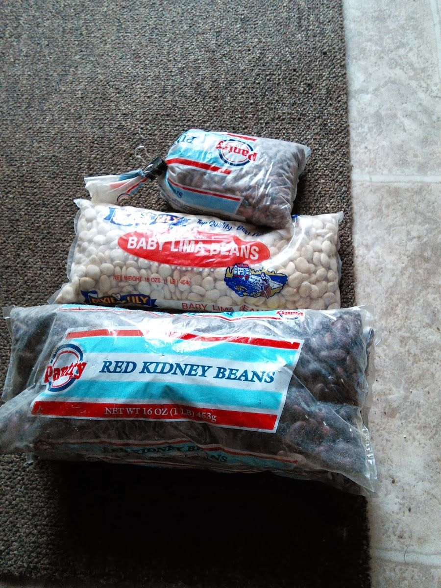
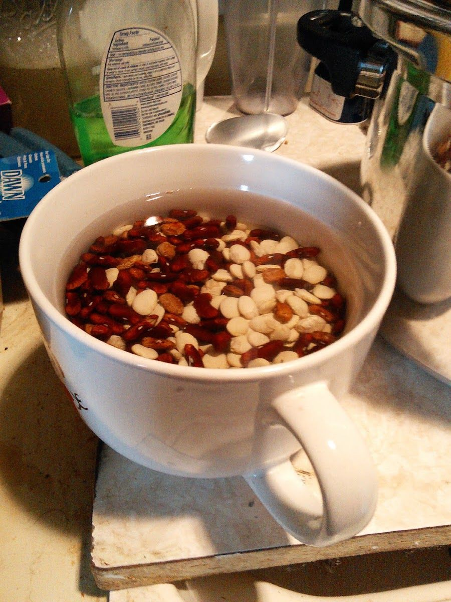
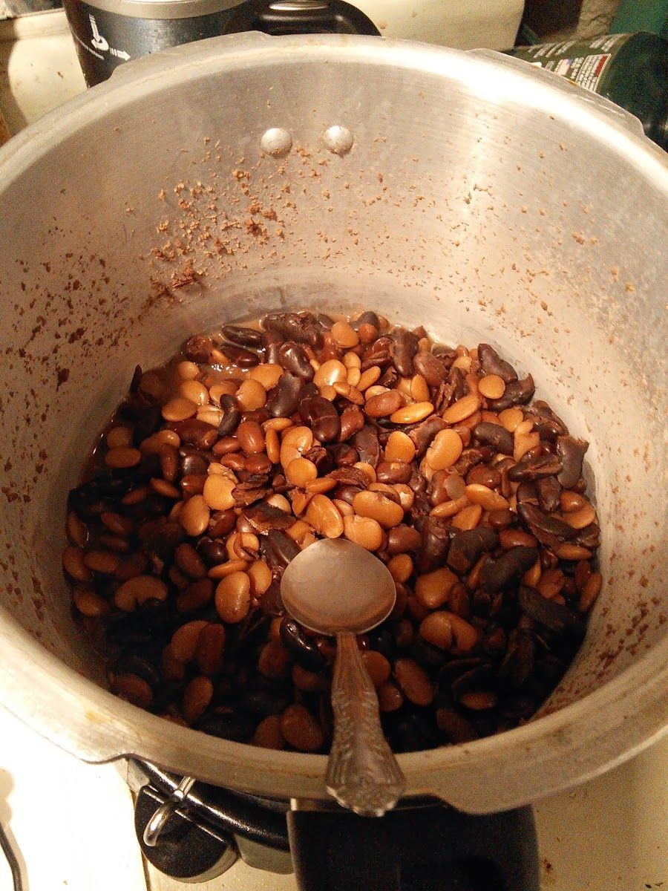

# 14 Year Old Beans Taste Test - Cooking for the Apocalypse

Whenever someone gets the urge to prepare for the end of days the first thing they go out and buy are a stockpile of beans and rice... well perhaps after they get a bunch of guns and ammunition. But after that beans and rice are certainly among the first things to be found in the aspiring preppers stockpile. There is good reason for this, primarily that they are cheap in bulk. They also supply a decent amount of carbs and protein and can be quite flavorful if you manage to get a few mice, or a large rat or squirrel to throw in the pot. So the choice comes down to two weeks of premium mountain house professionally prepared and freeze dried cuisine. Or a huge heap of rice and beans that will last for a very monotonous and musical year.

One of the problems with this plan is that most places will tell you that rice and beans will only last about 3-5 years even with careful storage whereas freeze-dried meals supposedly last over 30 years.

So in the late 90's, preppers the world over were convinced that the infamous y2k bug was going to bring about the end of life as we know it. I will admit I was freaking out a little along with the rest of them but I was broke at the time so my preparation consisted of buying a bunch of mouse traps and sharpening a few long sticks as I watched the clock tick down before it would all go dark. Lucky for us all, nothing really happened. At the same time a yet-to-be friend of mine with a little more money was busily stashing bags of beans in his parents basement.

Fast forward to 12 years later. When the previously mentioned friend comes to my little dome carrying a box of beans that he pulled out of his basement and was going to throw away. Realizing what an opportunity this was for the advancement of science and all that, I snatched them up and today I have just finished cooking them.

So, I have pinto beans, red beans, and lima beans. These were stored in a cool basement for 12 years inside an unsealed popcorn tin without oxygen absorbers or mylar bags. Then they were transferred to my dome for about a year (before I got around to trying this) where they sat in a cardboard box under my sink. Yesterday I dumped some of each into a soup bowl and let them soak for 24 hours. Then I cooked them all together in a pressure cooker (10lbs of pressure) without any salt or spices. I was not expecting this to turn out well. The results were as follows:

After 30 minutes in the pressure cooker the red beans and pinto beans were not that bad. They were not as soft as fresh beans and were a little gritty. Fresh beans should have been mush after 30 minutes and these were not, but the flavor was recognizable if a little bland. The lima beans were still very gritty and the flavor was not that good... however I am not a fan of fresh lima beans so maybe the flavor was acceptable, the texture was definitely not though.

I put them back on for another 30 minutes in the pressure cooker. This time the pinto beans and red beans were just about what you would expect fresh beans to be like. With the addition of some salt and pepper they were actually quite good. The lima beans were no longer crunchy, but I was still not a fan of the flavor.

So... it looks like pinto beans and red beans will be going into my stockpile. I am not sure about the rice... if anyone has some to test please leave your thoughts in the comments. It is also worth noting that beans are improved greatly by adding salt, so unless you live near the ocean it would probably be a good idea to store some of that as well. Beans and rice are also much better with some oil and this is probably what is missing when it gets really old. So adding coconut oil and some pepper would also be a good idea. And if you don't have one, be sure to invest in a pressure cooker. Otherwise you will be cooking this stuff for days and your rat will still be really tough.

So you can now be assured, as you watch the world burn around you, you can sit on your porch and watch the lunatics killing each other while you relax on your five gallon bucket eating a hot skillet full of mummified refried beans. Ah, the good times we have to look forward to.

5 comments

Anonymous · October 16, 2013

Please let me know you're still alive. I assume you lived long enough to publish the article, but I'm still a little concerned.

bhoult · October 16, 2013

Still here :)

elegantastronaut · November 12, 2013

Nice work! I'd like to post this on my blog...

bhoult · November 14, 2013

Go ahead Lewter. Thanks.

Aliesen Senado · June 1, 2016

Your post is very helpful, thank you. One of the most important aspects of disaster preparedness is storing plenty of food. While many emergency organizations in America say you only need to have a few days’ worth of food storage in your home, someone with a little more common sense would certainly say, the more the merrier. See more http://survival-mastery.com/diy/food_preserv/emergency-food-storage.html
