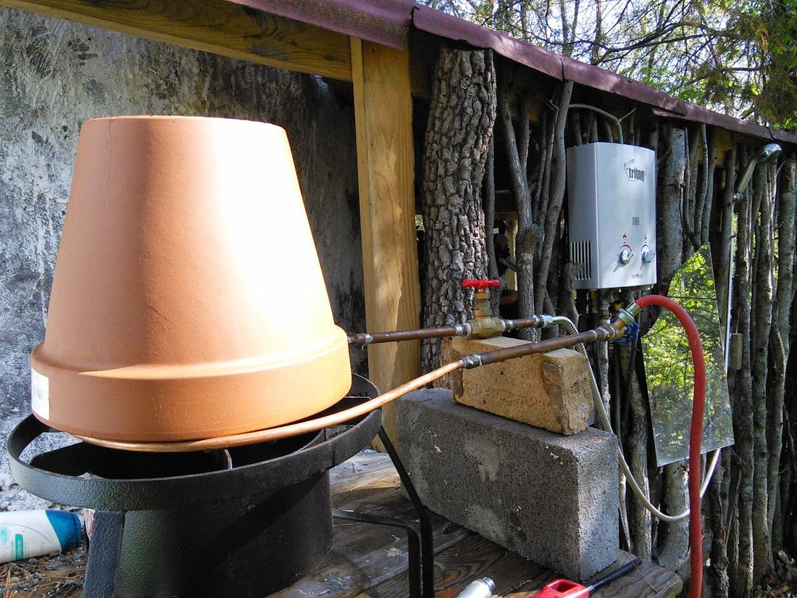
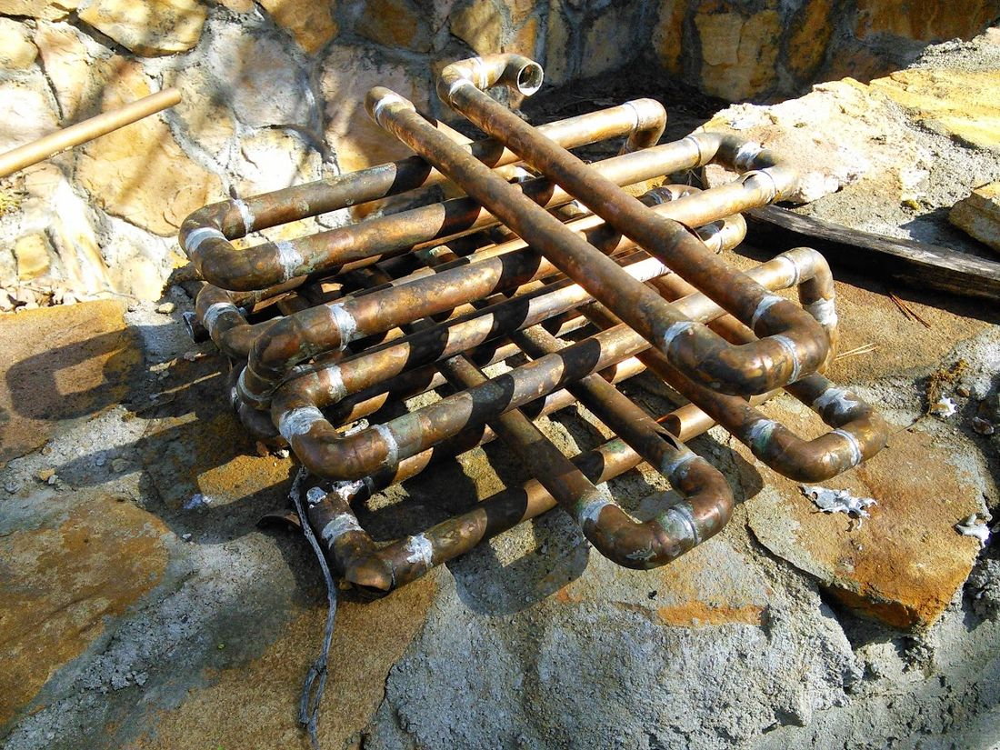
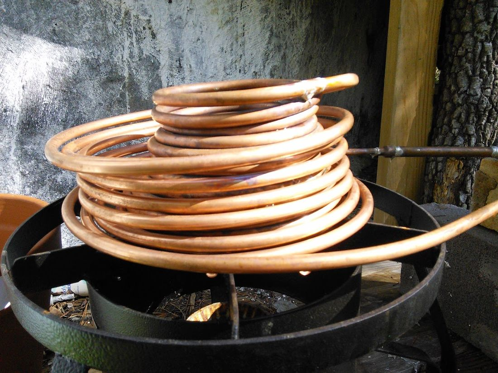
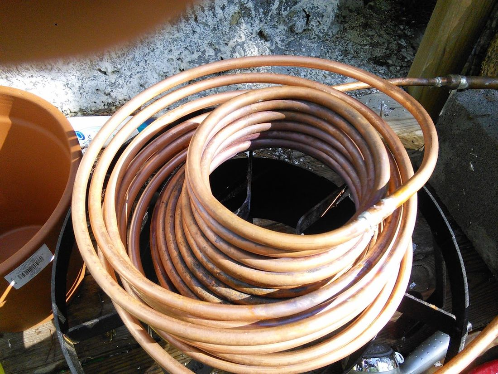
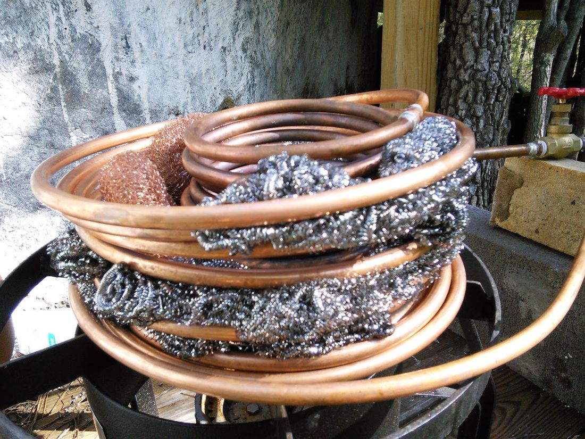
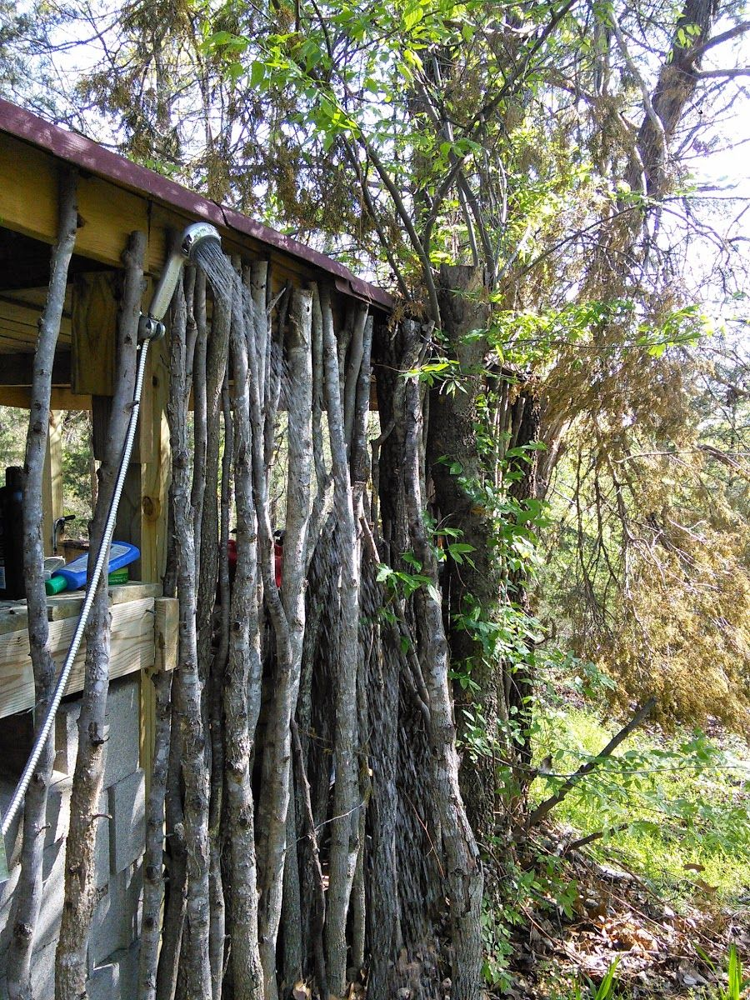

# Homemade Inline Propane Hot Water Heater

The first year I moved out here, unless it was mid-summer, showers were a pretty unpleasant prospect. It basically involved taking a deep breath, and grabbing the garden hose. In the winter there was a lot of dancing around hyperventilating, but I figured it was just a few minutes a day so just get it over with. Then a friend pointed out these inline hot water heaters that you just hook to a propane tank and the water hose and they automatically come on heat the water to a comfortable temperature and shut off when you turn off the water. It seemed kind of extravagant, but I found them at walmarts online store for $100 so I decided to give it a shot (they have since gone up to about $180). It was a bit of a revelation... apparently in the year I had gone without hot water I developed a whole new appreciation for the stuff.

All was well for a few months until the heater froze and started leaking. It turns out that there is a little cast-iron part that cracked. I tried fixing it with solder and jb-weld, but could not ever get it to work right again. At this point I had gone all soft and was addicted to hot water. I bought another one along with valves so that I could drain it when I was done (to prevent freezing). The second one worked for about six months, but I don't think they are meant to be used outside long-term... it started acting funny, shutting off randomly, it kept getting worse until it would not stay on for more than 10 seconds or so which made for a unpleasant, but probably very comical shower. Got a third one which somehow started leaking after a few months, even though it was drained completely after each use. At this point I was getting tired of buying these things and decided to try to make my own out of more durable and repairable materials.

It turns out that "making my own" was not nearly as simple as I had assumed. It took multiple tries and modifications to get it working adequately, so if you are planning on trying it please read on to see all the things I screwed up.

The first attempt was a lattice of copper pipes soldered together on top of a propane fish-fryer burner. The way these work is basically you can control the flame and the speed of the water flowing through it. If the flame is all the way up, then the temperature of the water is controlled by the rate of the water flowing through the heating element. With version one (in the picture), it was hot enough only when it was barely dribbling out of the shower-head. Not great but adequate. I used it for a few weeks then the temperature got down to 8 degrees Fahrenheit and the pipes burst in about 6 different places... you can see a few in the picture. I was going to repair it but I thought I would try a simpler design using coils of copper so that i would not have to do all the cutting and soldering.

Version two used 20 ft of copper tubing bent into a cone like shape. It worked about as well as version one. I tried covering it with a clay pot to trap more heat and that helped a little but it was still just kind of dribbling out once the water flow was reduced enough to be hot. It also only had one water valve where the garden hose attached and it got vapor lock unless the flow rate was adjusted just right. Vapor lock is caused by air in the lines that blocks the flow of water. It basically makes a thumping noise and causes the water to come out in intermittent spurts instead of a constant flow.

For version three I added another 20 ft of tubing in a coil around the first one and then added another valve between the heater and the shower head. This one determines the flow rate and prevents vapor lock, while the one by the garden hose determines on/off. The result was much better... pretty much equivalent to the store bought version. I thought that I could get it even better by increasing the surface area again. So I got a bunch of stainless steel scrubbing pads at the dollar general and pushed them between the coils. This basically acts like the fins on a radiator and conducts more of the heat from the flame into the copper tubes. More copper tubing would have done the same, but this was less expensive.

The end result is hot water at a satisfying flow rate. Hopefully you can see it in the picture. It is about 70 degrees at the moment, so the flow would be less in the winter to maintain the same temperature. I will probably add more stainless steel pads this fall to keep it hot. The clay pot has cracked in several places, but has not come apart yet. A metal bucket may have been a better cover.

The cost was about $50 for the propane burner, $60 for the copper, $10 for the two valves, and about $20 for various other materials, joints, solder, etc. So at $140 I am not saving much, but I expect this one will last a lot longer and is easier to repair if something does happen. It is still likely to freeze this next winter so I need to figure out how to fix that before then.

It is definitely not as automatic as the store-bought one, you have to turn the water on first, then the propane, light, shower, then turn the propane off and finally the water. Screwing this up will probably break something... the solder will melt if there is no water flow, and the water will turn to steam, build up pressure and rupture something if it goes on too long.

If I were doing it again, I would probably try to buy a 50ft coil of copper, and would use a metal bucket instead of a clay pot. Basically the larger the coil the more surface area you have and the hotter the water becomes. Let me know if you figure out any other tricks to improve or simplify what I have above.

22 comments

Anonymous · November 5, 2014

Hey that's a good invention. Heaters are the necessary part of hot tubs. Therefore it's necessary to get quality hot tub heaters which are the most advanced & energy efficient. Homemade heater seems to be useful... will try this. Thanks.

Da tiger · January 3, 2015

Hey brother,stumbled on your blog while looking at aquaphonic stuff.i like your style ,dude.ill follow ur posts from now on

bhoult · January 5, 2015

Thanks Tristan and Da Tiger... I have not been doing much worth posting recently but I am hopeful that will change this year.

Anonymous · February 3, 2015

Like the hot water system. I've seen where someone built a similar heater connected to a hot water tank. It was a hot water on demand system, powered by wood. The coil was in the exhaust stack at the top. He put a plate between the coil and the upper part of the smoke stack to hold the heat in that area. Perhaps that will give you some ideas. Look up thermo-siphon hot water on YouTube if you wish to see the vid.

Anonymous · January 15, 2017

Necropost here but I had a thought.

take burner, and measure the ring of fire outside diameter, add two inches. measure the inside of the ring of fire, and subtract two inches.

you now have a measured "donut" 2+fire in "Thickness" around the ring of fire.

now, find a steel pipe the diameter of the inside, and a steel pipe the diameter of the outside. you know have material for a pipe inside a pipe.

for a rough example, like this: https://www.researchgate.net/profile/Ferri_Hassani/publication/282925672/figure/fig1/AS:302680091185152@1449175965144/Figure-1-Schematic-of-heat-and-fluid-flow-through-a-double-pipe-heat-exchanger-used-in.png something to put your coil in.

Drill/weld/whatever/install allthread etc.... what ever you need to do along the bottom to get them to be held in position one inside the other.

measure up about 1" from the bottom of your double pipe system, and install 3 bolts/allthread through to the inside, spacing them equally around the pipe, same height, this is to hold the coil about 1" above the bottom, in the center of the flame.

make sure it sits well on the burner.

Next, take a length of annealed copper pipe (I'm gonna guess at least 50ft) and using something halfway between the two pipe diameters, make a coil, with one end 90* down bend so it comes out BELOW the burner, and a 90* bend so it comes out the top SIDE of the outside pipe.

for a rough example, like this: http://g03.a.alicdn.com/kf/HTB1Q8idKVXXXXXNXXXXq6xXFXXX7/5KW-outer-and-inner-copper-font-b-pipe-b-font-font-b-heat-b-font-font.jpg With single walled pipe.

put fittings on the heater coil you just made, so you can hook it inline to your water lines.

drop you coil in and do something similar at the top, to hold everything together solid.

stuff the center of the inner pipe FULL of ROXUL, and wrap more ROXUL around the outside for the outer pipe, for a completely insulated unit.

hook up water, and get it running, then turn on the burner.... adjust as necessary to produce warm water.

I would think it safest to run cold water in from the bottom, hot out the top, to prevent steam locks.

you could plumb in some valves to drain after use at lowest position, using the shower head to vent the top.

I wanna make something like this to heat water over a wood fire.

BIG DOG · February 19, 2017

Thanks for posting this info. I just want to let you know that I just check out your site and I find it very interesting and informative. I can't wait to read lots of your posts. Review of EcoSmart ECO 27 Electric Tankless Water Heater

Anonymous · July 11, 2017

I made my water heater work off of a SINGLE PILOT LIGHT flame. My 40 gallon water heater I easily modified by simply turning the gas control to "PILOT" light... and I simply left it there. Now my pilot light is the only heat to warm up our water. The exhaust pipe had to be blocked, so NO HEAT escapes. I simply removed the flue pipe and put a wad of aluminum foil to clog the flue. NOTE; THIS COULD BE DANGEROUS IF SOMEONE TURNS THE WATER HEATER BACK TO NORMAL!!!!... So, I am writing this as an example to show how easy it can be to heat water... not to encourage anyone to remove their flue pipe!!! (end of legal safety warning). So.. the result is my 40 gallon water heater heats up after 24 hours of no showers. Next morning, there is PLENTY of hot water for 2 people to take normal showers. If more people lived here, we would take military shower (wet the body, turn off water,soap up, scrub, water back on for rinse-off). I have done other experiments you may be interested in by reading my free ebook on the website biblioboard.com Just sign up, log in (free), and search for books by David Mundy on that site.

Anonymous · November 30, 2017

excellent in depth article glad i read this article also check my article best tankless water heaters reviews in my blog my home appliances.

Anonymous · February 6, 2018

Ive made something real similar.using one 20' length and a waterpump.and a 50 gallon trash can.i also use camp fire to heat water.i resurculate the water from trash can,through my coil which is in the camp fire and then back to the garbage can.it takes about 45 min.to have 40 gallons of hot ass water.i mean hot.then after its hott..i pull the coil out of fire.then turn pump off.turn my splitter from coil side to shower head side.and turn back on.i now have hott water coming out my shower head.i never have to worry about vapor lock or any of that.just cant leave coil in the fire without water going through it.it will burn up.but its real similar to yours and works flawlessly.its been two months and im still on my first one.thanx

fortnite · October 23, 2018

Thank you for some other informative website. The place else may just I get that kind of information written in such a perfect method? I have a venture that I am simply now running on, and I’ve been at the glance out for such info. heating repair mt kisco

Nicole · December 28, 2018

Great pieces. Keep posting such kind of information on your blog.

Im really impressed by it.

Hello there, You’ve done an incredible job.

I will definitely digg it and personally recommend to my friends.

I’m sure they’ll be benefited from this site.

how many bottles of water are in a gallon

gunardi · February 9, 2019

Hello ...

Can I use fiberglass for the tank?

regards

Tangki Fiberglass

Admin · March 13, 2019

wow these are good looking water heaters

https://www.cdhpl.com/fluid-ounces-gallon-water/

UsamaAk · July 20, 2019

Thank you very much for this useful article. I like it. Water Heater Installation Riverside

ADMIN · August 29, 2019

We have sell some products of different custom boxes.it is very useful and very low price please visits this site thanks and please share this post with your friends. Jurupa Valley Water heater repair

Bizzy Bee Plumbing, Inc · December 11, 2019

Great job for publishing such a nice article. Your article isn’t only useful but it is additionally really informative. Thank you because you have been willing to share information with us. water heater installation raleigh

Ash Green · October 27, 2020

Awesome! No words. You always go one step beyond.

There is so much great, useful information here. Thank you! Thank you! Thank you!

Read our guide if you wish.

besttoolsbrand

Thanks again :)

Online Safety Training · January 13, 2021

You've worked eminently with your insight, making our work head since you are giving such praiseworthy data about security. Please continue to provide such information to us. Propane Handling Training

legacymarbleandgranite · January 26, 2021

I read your post and this blog is very good. You have good knowledge on this. This post really impressed me. Thank you for sharing your knowledge with all of us. water heater repair toledo ohio

Seagate Controls · January 29, 2021

Your post is really impressive and it has lots of knowledge in learning.keep share your valuable knowledge with us. watlow heater

Bizzy bee plumbing · May 19, 2021

Several many thanks for share your blog website right here.

water heater installation wake forest

AlexGSalv · January 31, 2022

Hi there!

Very nice content and blog, I found it very informative and useful, hope to read more nice articles like this one around here,

Keep sharing the best content,

Best regards and take care!

Your follower

Salvatore from Cataratas
