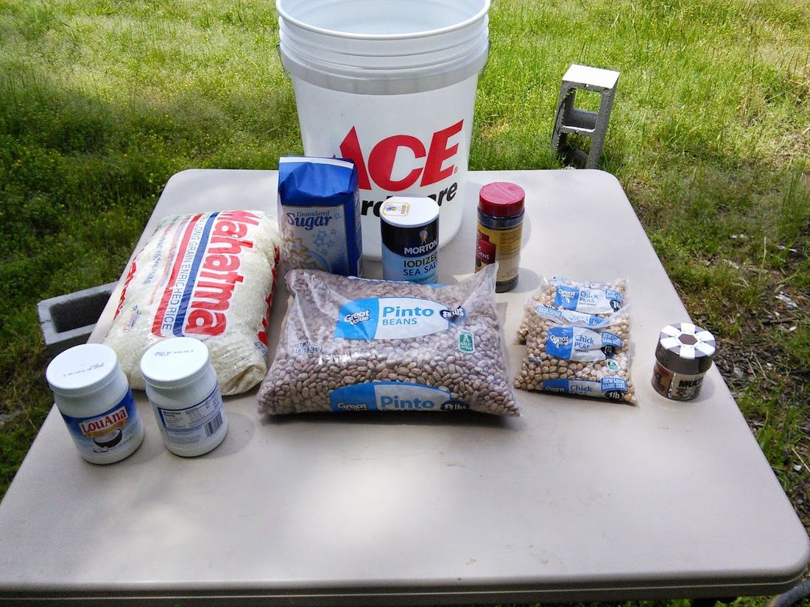

# 20 Days of Emergency Food Storage for Less than $43.

I don't think the world is coming to an end. But I have been wrong about a lot of things and this would be a bad one to screw up. It does seem fairly likely that there will be some kind of calamity in the next 30 years or so, at least to me. I am a computer programmer. In my experience when systems become more complex and interconnected they are more likely to fail catastrophically at some point and then people panic until things are fixed. With software, when things go wrong people loose money, when infrastructure goes wrong people start to fear for their lives. In Arkansas when it is going to snow we panic... grocery stores run out of food people get a lot less friendly and a lot more competitive. I remember when gas went to $3/gallon the first time, there was a man threatening to kill the attendant at a gas station at 5am. As a rule (some) people behave badly when things are not going as expected.

If we were to have a major environmental disaster, or a significant disruption in fuel or electricity then I guarantee it would be a bad time to be trying to get to the grocery store. This is where a food reserve comes in. The crisis will likely pass, and if you have spent a little effort preparing then you will not be one of the people fighting over whatever is left when something goes wrong.

There are a number of places that will sell you dehydrated or freeze dried food with a 30-year shelf life that tastes really good. My favorites are http://www.thereadystore.com/ and http://www.mountainhouse.com/. I use this stuff when I go backpacking since it tastes great and is lightweight. The problem is that a one month supply of food will cost about $520 or about $17/day. This makes it a little prohibitive if you are on a budget. If the option is spend $500 on something you will probably never need or pay off a credit card, most people will hopefully pay the credit card.

However, we are talking about an emergency situation here, we are not eating for fun or flavor, but for survival. If that is the case, once people start starving I guarantee they will be happy to eat just about anything. With that in mind I suggest the old standby - beans and rice. This is a staple of people all over the world. It provides most of what you need to survive and stay healthy, and it goes well with just about anything else that you are able to come by. Most importantly it is really inexpensive and stores for a long time. See here where I ate some 14 year old beans.

The cost of surviving on beans and rice is less than $1.50/day. Even with extras such as salt, sugar, spices and oil it is still only $2.30 per person per day. Starting with a 5-gallon bucket you can start preparing for about $43. If it is a choice between paying down a credit card a little bit or having almost a month of food if things get bad. I suggest you get some food. The breakdown is below, the prices are from Walmart May, 2014. If you eat this for a month you will be pretty hungry all the time but you will not starve. Portions are for an adult woman who is not extremely active.

ProductWeight LBSServingsCalories per ServingTotal CaloriesGramsProtein / ServingGrams Protien TotalGrams Carbs / ServingGrams Carbs TotalPrice

White Rice10101150151503303353535$7.98

Pinto Beans81039092707721202060$7.98

Chick Peas2261102860718221546$2.74

Sugar44541568100041816$1.74

Salt1491000000$1.98

Black Pepper0.56320000000$4.44

Coconut Oil1.685612067200000$7.36

Multi-Spice$4.97

Hand Warmer$0.70

5-Gallon Bucket$3.00

Sealing Wax$0.20

Total27.24155148540810171206807957$43.09

Daily Recommended2000Daily Recommended56Daily Recommended130

Days of Food20.405Protein/Day =59.10316099Carbs/Day =389.9534428

The hand warmer is used to remove oxygen from the bucket after it is sealed. Get a bucket with a rubber gasket in the lid. The sealing wax is melted and poured around the lid just to make sure it is air-tight. Keeping the contents sealed and free of oxygen will easily double the shelf life. I would expect that this would last easily 5 years. After that it should still be good for a long time although it may not taste or cook as well. Beans that are really old tend to not get as soft when you cook them. If possible store in a place that is cool and does not have a lot of temperature variation, such as a basement, or even dig a hole and bury it in your yard or under your house.

Also you should consider getting a pressure cooker. You will use less than a quarter of the fuel when cooking and it will make cooking the rice and beans a simple 30 minute process, instead of a all-day ordeal. A dutch oven would also be handy if you end up having to cook over a camp fire.

Other things you should consider storing are water, candles, fuel (gas, and propane). Also bleach and soap and something to purify water. You can use bleach if you need to for water purification. A person needs about a gallon of water per day at least for cooking / drinking and minimal hygiene. A supply of seeds would be handy even if you don't have a garden at the moment. I suggest something like this.

Hopefully nothing goes wrong, and every 5 years you can open a bucket and not have to worry about shopping for rice or beans that year.

8 comments

Anonymous · May 20, 2014

Several years ago I read a blog post by a Serbian war survivor. His country's infrastructure and economy fell apart almost overnight. Food, heat, clear water and just about everything you can imagine became scarce and super expensive. His suggestion; if you could have ONE thing with you to survive, what would it be. His answer was NOT what I expected... "Canned Gravy". Why canned gravy? Simple; "Anything tastes better with gravy, even roadkill" Food for thought, pun intended.

bhoult · May 21, 2014

I have a similar plan except it involves BBQ sauce. I figure if I have enough of that and slow neighbors then I am set :)

I think I also read that story, he suggested stocking up on cigarette lighters. I should probably put that on the todo list.

Troy Flores · July 6, 2015

One of the foremost vital aspects of disaster preparation is storing lots of food. whereas several emergency organizations in America say you merely got to have a number of days’ price of food storage in your home, somebody with to a small degree a lot of sense would definitely say, the a lot of the merrier. http://survival-mastery.com/diy/food_preserv/emergency-food-storage.html

Demented guy · March 23, 2018

How's the dome are you still living on the property

bhoult · March 23, 2018

Dome is doing well, still living in it.

Demented guy · April 22, 2018

I know you don't update much anymore, but I was wondering if your dome was a 3 or 4 v? I am planning a dome and trying to plan a good size to live in but not waste conduit. Would like a 3v for strength. Thinking 16 to 20 foot diameter. Is your dome 18 about? Is it big enough or should I do a little bedroom 12 and connect a another later. Thanks for all.

bhoult · April 23, 2018

Demented Guy: Yea... bought another 7 acres so now my life consists of making money to pay off land. Hope to post more when I actually do more worth making a post about. Thanks for reading though.

Mine is 19ft diameter 3v. Still living in it (8 years later). It has held up pretty well. No leaks or major issues except for the skylight which I got tired of fixing and just replaced with a big welded aluminum lid. I am in the process of building an underground dome out of cement blocks. So far it is just a giant pit, but when I get some spare cash it should be interesting enough to write about.

For a single guy 19ft with the trampoline for the bed and storage is kind of enough. You have to limit the amount of stuff you get and if you want an indoor bathroom then another foot or two would be nice. Underground dome will be 20 ft... but that is because it will be accompanied by an above ground workshop. If you do a lot of stuff with tools then you need to figure out a solution for that. Currently half my house if filled with tools.

There have not been any issues at all with strength. Survived a close tornado that threw a small tree into the dome without any major issues (except to my underwear). I have about 500lbs cabled to the structure to suspend the trampoline and it has not had any trouble holding that.

If you add about three feet at the bottom then you can easily do two floors (13ish feet tall). Also, don't do a deck if you can help it. Do a slab, or a rock floor or something like that. The deck was the most expensive part and is likely to be the first thing that fails... it is already kind of rotting in places. I imagine that it will need some repairs in a few more years.

Good luck with your dome.

Dwayne · May 5, 2021

Remarkable post. I simply came across your blog and desired to say that I have really enjoyed searching your blog posts. Thank you for sharing such blogs. Survival Kit Water
