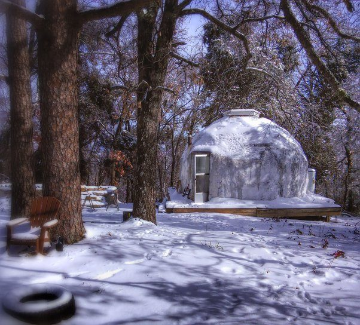

# What are the cheapest ways to build a house?

It depends on what you want out of a house. I live in a 19ft diameter geodesic dome made from conduit pipe and papercrete. It was about $3500 to build and knowing what I learned from it I could probably do it again for about half that. I blogged about it at Minimal Intentions if you are interested in details. 

I find it quite comfortable, but others may disagree. My philosophy is that you can "save" a lot of money by examining your expectations and determining if they are really things that are important to you or they are just assumptions that you have never questioned. For example... is it really necessary to have a large space, would it be better to modify your lifestyle instead?

But there are a number of inexpensive building styles that you might want to consider. Look up the following for a start:

1. Earth Bag Construction
2. Papercrete.
3. Straw Bale Construction.
4. Earth Ships
5. Cord-wood Construction
6. Yurts
7. Tiny House
8. Modern Gypsy Wagon

With all of these the trade off is usually labor vs permanence. Earth Bag is probably the most labor and will last the longest. But generally the biggest factor in cost savings is size. Figure out the least you can build to be as comfortable as you need to be. Smaller spaces reduce buying junk (nowhere to put it), are easier to heat / cool / clean / maintain. Understand that you can always add on if needed down the road.
