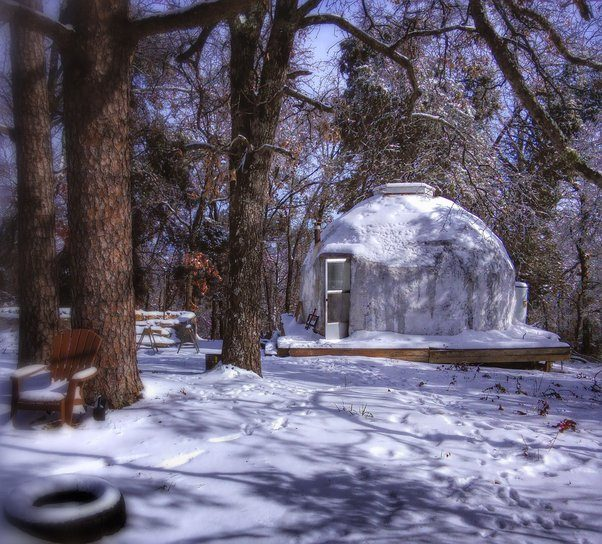

# What is your ideal house?

It would be as small as possible containing just the stuff I consistently use.
It would have a small shed to hold the stuff I inconsistently use.
It would be inexpensive so that I don't have to pay a mortgage.
Being small it would be easy to clean. It would have an outdoor shower so that I would not have to clean the shower. It would have an outhouse so I don't have to waste a ton of water.
It would be built solidly with materials that won't rot or require maintenance.
It would be well insulated and easy to heat/cool.
It would have a garden sufficient for my needs, but not big enough to require a lot of work to maintain and water.
It would have perennial fruit trees and berry bushes.
It would have grass that is never mowed and leaves that are never raked.
It would not have mosquitos or ticks or flies.
I would be able to lock the door and leave it for years without having to worry about payments or maintenance.

I have been working on such a house for the last 4 years or so. This is the current version: 

