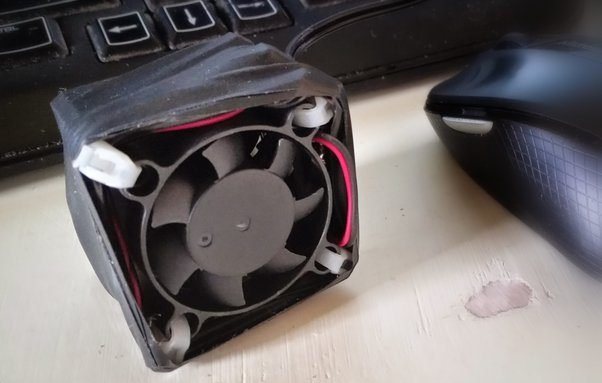

# Why do flies get attracted by my computer display?

I have the same problem with fruit flies. I live in a one room house, the computer desk is a couple feet from "the kitchen" so I have fruit hanging right next to my computer.

I tried traps, putting netting around the fruit changing the lighting, squishing them with my fingers all kinds of things over several years. I am kind of anal about my screen though so I don't like fingerprints or squished bugs all over it.

Last week I tried using a small shop vacuum to suck them up. It worked pretty well, but was kind of awkward since it was really too big for this sort of thing. My solution this morning was to make a "bug blender". It is basically three small CPU fans stacked and tied together with zip ties then wrapped in electrical tape.

Basically from reading overclocking forums it seems like putting fans end-to-end like this does not really improve air flow since it produces a bunch of mini-vortexes inside between the fans. If I were a flying bug the last place I would want to be is in a vortex surrounded by spinning blades. So although it does not work so well for overclockers it should work for this.

I used three fans about two inches in diameter each using 100ma. Found an old "wall-wort" type plug that produced 12v and wired it all up. The result can be left hanging under my fruit for passive bug-blending. It uses very little energy and is quiet. If I see a bug on my monitor I hold the intake side over the bug and it gets pulled in and whacked around sufficiently to kill it by the three blades.

Here is a picture next to a mouse for scale.

 
So far it seems to be working great... killed about 10 of them in the past hour.
