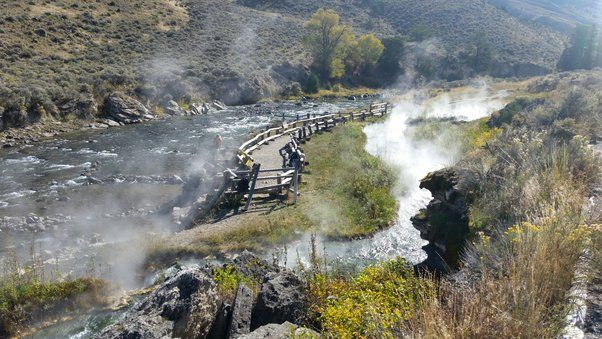

# What are the best parts of Yellowstone to backpack through?

Can't really say what the best parts are since I have not spent sufficient time there. From what I did see I thought the boiling river was incredible. It is a not really advertised spot where boiling spring water mixes with ice cold river water in a series of pools that you can swim in. Depending on how far down you go from the point they mix, the water is a constantly fluctuating extreme of hot and cold that feels incredible. I could only spend a few hours there but I wish I could have brought a book and stayed a few days. It is a short hike from the parking area at the north end of the park near mammoth springs.

​
