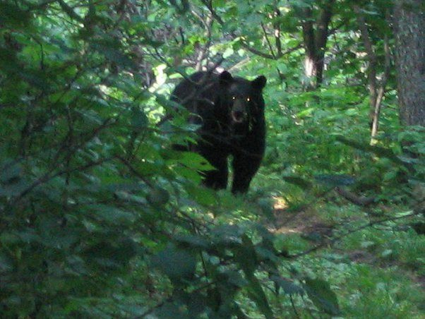

# What should I do if I encounter or see a black or grizzly bear on the Appalachian Trail?

I took this guys picture on the appalachian trail in Virginia (near the Shenandoah Parkway). I had been pushing hard all day to get to one of the visitors lodges where I could get a hamburger before it closed. I had been thinking about this burger for the last several days as one is apt to do while hiking the AT. 

I came around a corner and this bear was standing there looking at me about 25 feet away. I stopped immediately and so did he. I knew I should not run so I just stood there. Several minutes passed while we just stared at each other. I took this picture when I started getting bored of not getting eaten. The brush was too thick to go around and the clock was ticking on my hamburger, so I tried waving my stick and yelling at it. The bear looked a little shocked but eventually turned around and walked up the trail.

I went a little further and he was standing there again. So I repeated the process and he went a little further. This went on until I was running at the bear full speed while screaming and waving my stick and the bear was running in front of me. We went about a quarter mile like this until there was a break in the trees, and the bear ran into the woods.

Looking back I wonder what a southbound hiker would have thought if a 500 lb bear suddenly came charging up the trail at him with a disheveled lunatic chasing behind it waving a stick and screaming.

Luckily it ended well, the bear did not kill me or anyone else and I got to the hamburger about 5 minutes before they closed.
