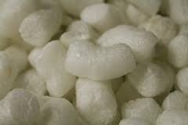

# What is the crunchiest food in the world?

Biodegradable packing peanuts. (those things that look like Cheetos they sometimes use to prevent shipping damage). I know you are thinking “those are not food”. And you would be correct generally, but I had a friend that used to eat them because he thought they were “crunchy”. He assumed that like Cheetos they were made from corn, just without the flavoring.

One day someone noted that regular Cheetos quickly became stale when the package was opened whereas these did not. We looked them up and it turns out they were made form “recycled waste protein”. So the stuff they produce at rendering plants, from dead animals, road kill and raw sewage.

Their crunchiness was less appealing after that.
