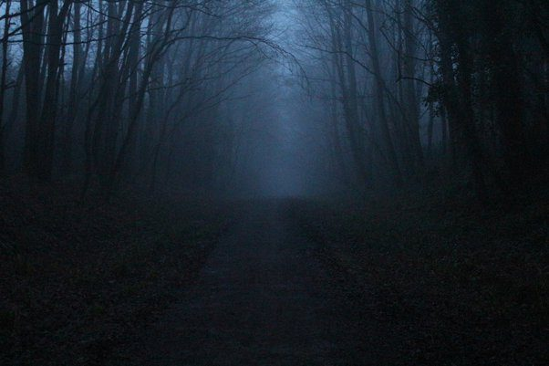

# What is the strangest thing someone has ever said to you?

So this is the story of me telling someone the strangest thing they have probably ever heard.

I used to train for hiking the Appalachian Trail by walking up the road of a small mountain (hill) three days a week for five years. The only thing at the top of the hill was a state park (Mt. Nebo, AR) so the traffic was minimal in the evenings. For this reason and because it was cooler at night I would walk up the hill from 8pm to 10pm usually. It was easier to see the cars coming in the dark. I kept a flashlight but would only turn it on briefly to check for snakes in the road.

After a couple years it became too easy, so I got a backpack and put some weight in it. Every time I made it to the top in less than 27 minutes I would add some more weight. The only heavy things that I had in the car were some motor oil, antifreeze and brake fluid. So I threw those in as well.

Later for arm exercise I started carrying two 15lb dumbbells. But this made it hard to carry my flashlight so I replaced one of them with 15lbs of tow chain that I wrapped around my wrist.

One night during the winter I was walking up the hill for the 400th time. I had a big black rain jacket on because it was cold, foggy and drizzling. About half way up I see some emergency blinkers through the fog, so I walk a little closer to see what is going on.

There is a van pulled over to the side of the road. The hood was up and a man was looking under it with a small light. He had a dipstick in his hand. Behind him was his wife observing quietly with a couple small children clinging to her legs. This hill is pretty steep in places so people frequently have trouble with their brakes when coming down.

I was going to turn on my flashlight and make some noise but it gets pretty boring walking up and down the same hill by yourself in the dark hundreds of times. So instead I just pulled my hood down over my face and slowly walked out of the fog into the headlights with my chain making small clinking noises.

They noticed me right away. The whole group pivoted so the wife was behind her husband and the kids were hiding behind her. Nobody said anything.

I slowly walked up to them stopped and stood there for about 10 seconds. Then I asked “Brakes?” They blinked a few times and the husband said something like “low fluid”.

I shrugged off my backpack which weighed about 80lbs. It landed with a thud and they all took a step back and bumped up against the van. I reached inside my pack and grabbed the brake fluid then handed it to the man in front. He took it and just stared at me without saying anything. I put my backpack back on, picked up the chain and dumbbell and quietly walked off into the dark without saying another word.

Come visit beautiful Arkansas! Natural vistas and friendly locals will leave you with stories to tell for years to come.
