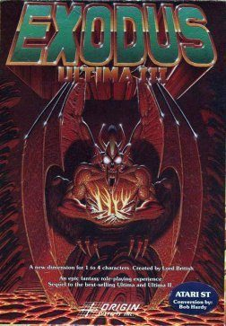

# What's the longest play-time you've accumulated in a video game?

Going to go all old school here and say ultima 3 on the commodore 64. About 4 years from 83 to 87. I had a pirated copy so no maps and no manuals. We mapped all the psudo 3d dungeons in books of graph paper. Tried all manner of key combinations to figure out the spells that were presumably in the manuals. This was pre internet if you can imagine… so no cheat codes or hints. I remember there was a town that would only show up during a certain phase of the moon, I discovered that after looking for it for two years. You could ask NPC's questions in text… like “job”, but certain characters would answer other questions… the time we spent asking all manner of questions from hundreds of characters with no response is mind boggling to me now.

I loved winning that game. I still remember it today. I don't know if I should envy today's generation for the richness and complexity of today's games, or pitty them that they will never experience the sense of accomplishment that I had back then.
