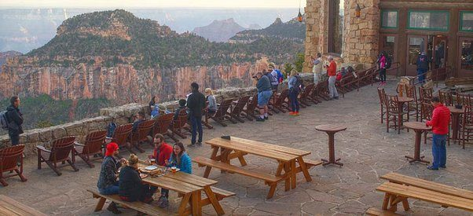
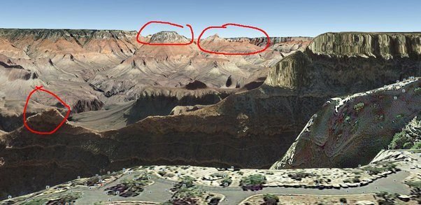

# Can anyone tell me where this photo was taken?

That looks like the overlook at the grand canyon visitors center.

Edit: Jefferson Kolmer noted that this is on the north rim. I think the google earth image below is probably more accurate (south rim).

Found it on google earth I think. 36°04'37.14" N 112°00'53.01" W

