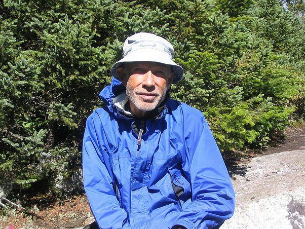

# How difficult is it to complete the Appalachian Trail?

It depends on how you think about it. Most people are accustomed to approaching tasks that are accomplished in a relatively short period. Things too big to handle in a small time span are broken down into sub tasks to prevent them from becoming overwhelming. These then require corporations, managers, leaders, politicians etc. to motivate individuals over the life of the project. People participate because they get paid, they don’t need to care about the long term completion of the project they just need to do their part until the next paycheck and repeat… it has to become a lifestyle instead of a goal.

On the AT you will have a community that will encourage you, but you will not have a boss or a leader to keep you going. You will experience physical and spiritual benefits but will not get paid. You will know pain and hunger and exhaustion like you have likely never experienced in your life. You will see sights and learn truths about yourself, humanity, and your world that can only be discovered on the other side of self imposed agony.

But is it difficult? It is as difficult as you are able to tolerate. It is a trade off between speed and persistence, it is making it a lifestyle instead of a task. It is choosing the hard road every day for six months. It is not changing your mind, not giving up, not compromising your commitment.

The year I went there was an old man named Turtle Don. He was walking so slowly when we passed him that we were sure he would never make it. He just took little tiny steps, we could have gone faster on our knees. Then the next day we passed him again. Then again the next day…. at this point we tried to figure out how he kept getting ahead of us. He had Alzheimer's and did not talk much so it took us a while to figure it out. We (everyone else) would walk until about an hour before dark, then stop at the first shelter, eat dinner, rest a bit, sleep until 9 am or so and continue on. Turns out Turtle Don would walk until it got dark, then he would keep walking in the dark, then eventually he would just collapse in the middle of the trail and would pull a blanket over himself then before the sun rose he would get up and start again. It did not matter if it was raining, snowing or hot he just kept creeping along. About 1/3 of the way in his legs started retaining fluid and swole up to about triple their usual size. His wife came and took him to the hospital. We thought that was the last we would see of him. Four months later we are passing through the Mahoosuc Notch, probably the most difficult section of the trail, and there is Turtle Don. He is covered in cuts and skinned up from the rocks, his glasses are broken and he has dried blood on his head from where he fell. He was grinning from ear to ear and greeted us cheerfully as usual but could not remember any of us. Apparently he left the hospital and skipped ahead so he could get to the end point before the park closed on Oct 15. Then he would go back and do the section he skipped. We spoke with his wife, she said he did not have long to live but was determined to finish before he died.

I don’t think had we asked him if he would have said it was difficult… it was what he wanted to do and he was loving it. It seems that is the way of life, nothing you do out of love is difficult.

Turtle Don - New Hampshire 2004
