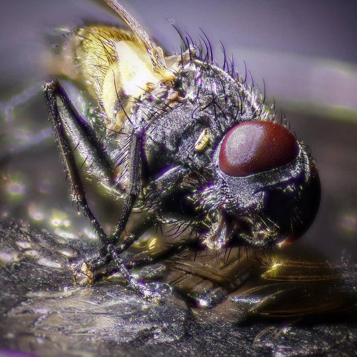
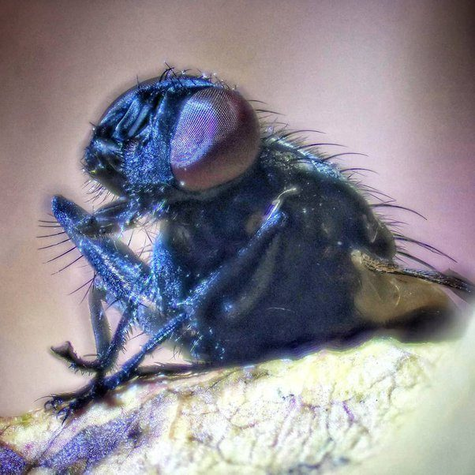
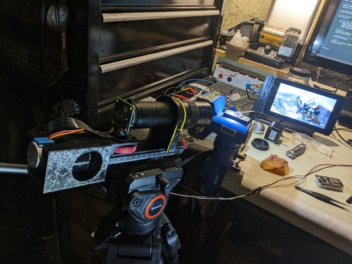
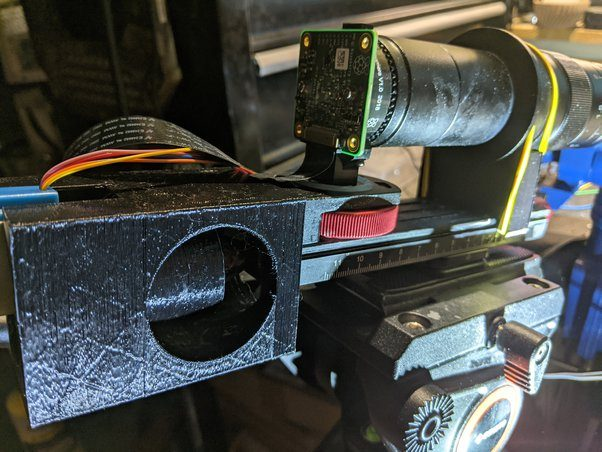
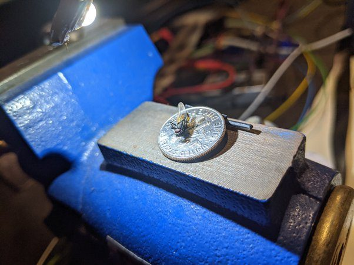

# What is the most technically demanding photograph you have ever taken and why?

It is still in progress, but so far it is a dead fly. This one:

Not that spectacular, I know. But it was taken with a custom built camera made out of a little computer called a raspberry pi. I had to know 3d modeling and learn 3d printing in order to print the pieces of the camera. I had to learn basic electronics to mount a stepper motor controlled by the pi to a focus rail. I had to learn all about focus stacking in order to increase the depth of field.

I am already a web programmer, but using node.js to control the gpio pins to manipulate a bare digital sensor and lens was entirely new.

Now I have a system that can automatically take an arbitrary number of pictures while moving the camera hundredths of a millimeter each time without any vibration and then automatically align and stack them all in a few minutes.

Over a hundred hours of work specifically for this. Who knows if I did not already have some prior experience with the other various elements how long it might have taken… years likely.

As it is this is just the first phase, I anticipate at least 1000 hours to get to where I want to be.

