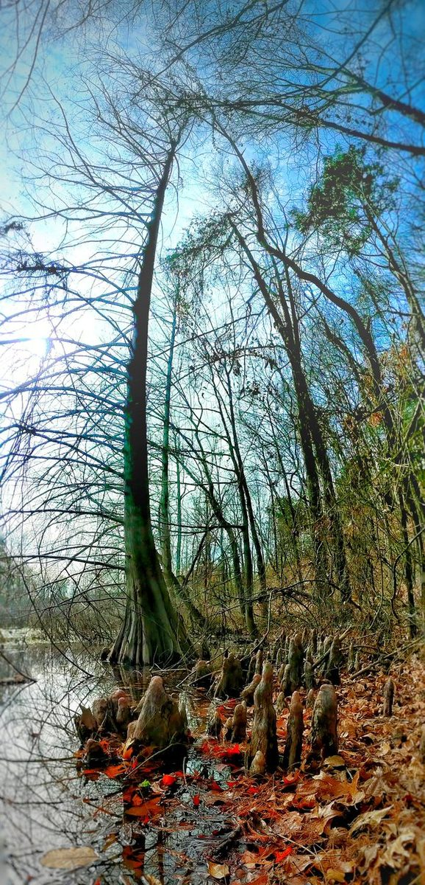
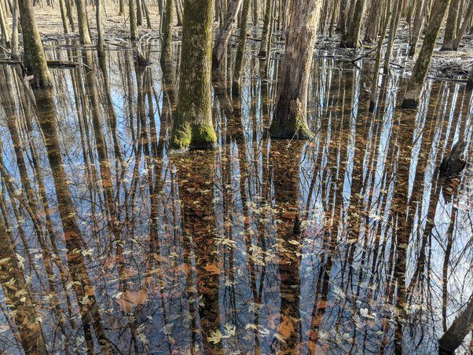
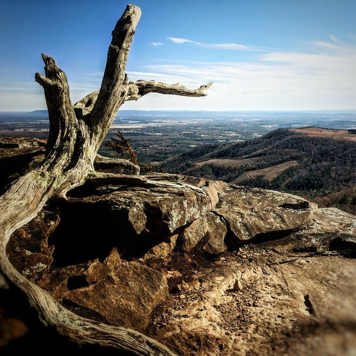

# Why do you go for trekking or hiking? Has it taught you anything related to your general life?

Have you ever seen a spectacular tree?

Or a glorious swamp?

Or an amazing overlook?

The woods are full of this stuff. You will only ever see a tiny fraction if you stay on the paved roads.

I go because my soul would die if I did not.
