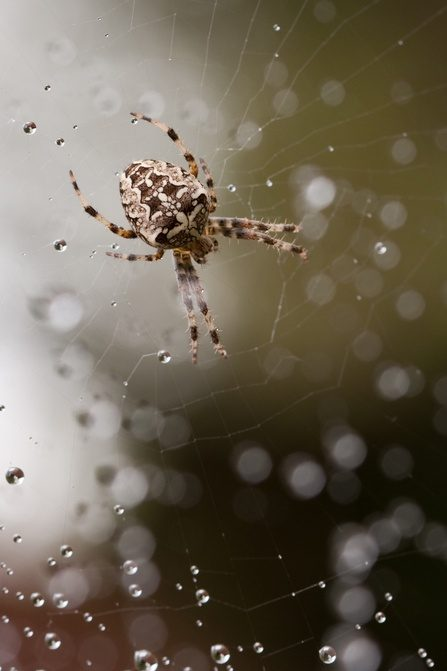

# What should you do if you accidentally run into a massive spider web while hiking or camping?

Walk through it. If it tickles you may need to wipe it off your face with a cloth. It is probably an orb-weaver if you are in the south, they seem to like building webs across trails in the evenings. Once you hit the web the spider itself will curl up into a ball and roll off. They are harmless even though they look rather large and sinister.

If it becomes too much of a nuisance, get a small branch off a bush and wave it in front of you as you walk. That will get most of the webs, but eventually you will just stop caring.

